# Báo cáo chi tiết — CI/CD and Test-Harness Engineering

## 1. Giới thiệu

### 1.1. Bối cảnh

Trong phát triển phần mềm, mã nguồn thường xuyên được cập nhật bởi nhiều thành viên. Mỗi thay đổi có thể ảnh hưởng đến các chức năng đang hoạt động. Nếu việc kiểm tra chỉ được thực hiện thủ công trước khi bàn giao, lỗi có thể được phát hiện muộn và khó xác định thay đổi gây ra lỗi. Vì vậy, nhóm phát triển cần một quy trình chạy kiểm thử thường xuyên và phản hồi sớm khi có thay đổi mã nguồn.

Tích hợp liên tục (Continuous Integration – CI) hỗ trợ quy trình này thông qua pipeline tự động, được cấu hình để kiểm tra mã nguồn khi có sự kiện như push hoặc pull request. Pipeline thực hiện các bước kiểm tra, ghi nhận kết quả và lưu bằng chứng phục vụ chẩn đoán lỗi. Để kết quả có thể tin cậy, bộ kiểm thử cần đi kèm một test harness bảo đảm việc chuẩn bị môi trường, tạo và dọn dẹp dữ liệu, thực thi test và xuất báo cáo được thực hiện nhất quán.

Một thách thức của kiểm thử tự động là flaky test – test có thể cho kết quả pass hoặc fail qua các lần chạy dù mã nguồn không đổi. Hiện tượng này làm nhiễu kết quả pipeline và tăng công sức điều tra. AI có thể được sử dụng để hỗ trợ đọc log và đề xuất giả thuyết nguyên nhân; tuy nhiên, các đề xuất đó cần được kiểm chứng bằng bằng chứng thực nghiệm.

Trong đề tài T07 – *CI/CD & Test-Harness Engineering*, nhóm thực hành trên backend của hệ thống EShop: xây dựng test harness và pipeline kiểm thử, triển khai trên GitHub Actions và Jenkins, đồng thời so sánh phân tích flaky test thủ công với trợ lý GPT trên cùng dữ liệu log.

### 1.2. Mục tiêu

Báo cáo trình bày quá trình thực hiện và đánh giá các mục tiêu sau:

1. Xây dựng test harness và bộ kiểm thử backend EShop, với fixture, setup và cleanup hỗ trợ tính độc lập và khả năng tái lập của test.
2. Thiết lập workflow GitHub Actions để tự động kiểm tra mã nguồn, chạy kiểm thử và lưu log, báo cáo kiểm thử, coverage cùng các artifact liên quan.
3. Triển khai pipeline tương ứng trên Jenkins, chạy cùng bộ kiểm thử để đối chiếu kết quả, thời gian thực thi, cơ chế cache và công sức cấu hình, vận hành.
4. Tạo một flaky test do cơ chế chờ theo thời gian, quan sát 10 run cùng retry history, sau đó sửa quan hệ đồng bộ và xác nhận trên CI với retry tắt.
5. So sánh phân tích thủ công với GPT-6.1 Sol dùng skill trên cùng log và lịch sử retry của thí nghiệm v2, dựa trên độ đúng của giả thuyết, bằng chứng, bước xác minh, thời gian và các suy diễn thiếu căn cứ.
6. Rút ra bài học về độ tin cậy của pipeline, giá trị và giới hạn của AI trong phân tích flaky test, cùng cách áp dụng quy trình cho dự án khác.

### 1.3. Phạm vi

Đối tượng kiểm thử (System Under Test – SUT) là phần **backend của EShop**, được nhóm fork từ repo gốc `ttbhanh/eshop-sut` sang `SUT-group10/eshop-sut-group10`. Báo cáo tập trung vào:

- **Test harness và bộ kiểm thử backend:** unit test, API test, smoke test, các test kiểm tra harness, cùng cơ chế fixture, setup và cleanup.
- **GitHub Actions** là hệ thống CI chính: workflow chạy trên push và pull request, cache npm, lưu coverage XML và artifact, status check và branch protection cho nhánh `main`.
- **Jenkins** là nền tảng đối chiếu: chạy cùng bộ lệnh và cùng bộ kiểm thử để so sánh cấu hình, thời gian chạy, cache và công sức vận hành.
- **Thí nghiệm flaky test và phân tích log:** tạo một trường hợp flake có nguyên nhân đã biết; so sánh phân tích thủ công với ChatGPT theo cùng đầu vào và tiêu chí đánh giá. Kết luận được đối chiếu với nguyên nhân đã tạo và kết quả chạy sau khi sửa flake.

Các giới hạn của phạm vi thực hiện gồm:

- **Không sửa lỗi nghiệp vụ trong mã nguồn SUT.** Các lỗi được phát hiện sẽ được ghi nhận trong kết quả kiểm thử; nhóm giữ các assertion theo đặc tả, không thay đổi kết quả mong đợi hoặc bỏ test để làm pipeline thành công. Việc sửa flaky test thuộc phạm vi mã kiểm thử.
- Không kiểm thử frontend web, trang quản trị và ứng dụng mobile.
- Không triển khai ứng dụng (deploy). Phần thực nghiệm tập trung vào CI và dừng ở bước kiểm thử, xuất báo cáo và lưu artifact.

### 1.4. Thành viên và phân công

Nhóm 10 gồm ba thành viên. Bảng 1 tóm tắt phân công chính; thông tin đóng góp chi tiết được dẫn tại [Seminar contribution](../contribution/contribution.md).

*Bảng 1. Phân công công việc*

| MSSV | Họ và tên | Phụ trách chính |
| --- | --- | --- |
| 23120242 | Nguyễn Văn Bình Dương | Quản lý phạm vi và tiến độ; pipeline GitHub Actions; cơ sở lý thuyết; điều phối tài liệu nộp |
| 23120409 | Nguyễn Khắc Vượng | Pipeline Jenkins và so sánh hai nền tảng; khảo sát công cụ; phân tích flaky test thủ công |
| 23120410 | Trần Quốc Vỹ | Test harness và bộ kiểm thử; thí nghiệm flaky test; AI triage; failure modes và hướng áp dụng cho dự án khác |

## 2. Cơ sở lý thuyết

### 2.1. CI/CD và pipeline as code

**Tích hợp liên tục (Continuous Integration – CI)**

CI là thực hành tích hợp các thay đổi mã nguồn vào nhánh chung thường xuyên, kết hợp với build và kiểm thử tự động để phát hiện lỗi sớm. Thay vì phát triển riêng trong thời gian dài rồi mới ghép mã, các thành viên đưa vào từng thay đổi nhỏ và kiểm tra khả năng hoạt động của chúng khi kết hợp với phần mã hiện có. Cách làm này giúp giảm khối lượng thay đổi phải xem xét khi xảy ra lỗi và hạn chế việc dồn các vấn đề tích hợp đến cuối giai đoạn phát triển.

Để thực hiện CI, dự án cần có kho mã nguồn chung, quy trình kiểm tra tự động và cơ chế phản hồi kết quả. Khi có thay đổi, hệ thống CI lấy mã, chuẩn bị môi trường, chạy các lệnh kiểm tra và thông báo trạng thái. Nhóm phát triển sử dụng phản hồi đó để review, sửa lỗi hoặc tiếp tục tích hợp. Vì vậy, CI bao gồm cả cơ chế tự động hóa và cách làm việc của nhóm: tích hợp thường xuyên, duy trì bộ kiểm thử và xử lý sớm các lần kiểm tra thất bại.

**Phân phối liên tục và triển khai liên tục (CD)**

CD có thể được dùng để chỉ **Continuous Delivery** hoặc **Continuous Deployment**. Cả hai đều mở rộng quy trình sau bước tích hợp và kiểm tra, nhưng khác nhau ở cách đưa thay đổi lên môi trường production, tức môi trường phục vụ người dùng thực tế.

Continuous Delivery hướng tới việc duy trì phần mềm ở trạng thái có thể phát hành khi cần. Quy trình chuẩn bị bản phát hành và kiểm tra được tự động hóa để việc triển khai có thể thực hiện lặp lại, theo yêu cầu. Tuy nhiên, thời điểm phát hành lên production vẫn có thể phụ thuộc vào quyết định của con người.

Continuous Deployment tự động đưa những thay đổi đã vượt qua các điều kiện kiểm tra lên production. Như vậy, khác biệt chính là mức độ tự động hóa ở bước phát hành: Continuous Delivery bảo đảm khả năng phát hành, còn Continuous Deployment tự động thực hiện việc triển khai đối với những thay đổi đạt yêu cầu. Cả hai đều cần dựa trên quy trình kiểm tra đáng tin cậy.

**Pipeline và cơ chế hoạt động**

Pipeline là quy trình tự động hóa gồm các công việc và quan hệ thực thi giữa chúng. Một pipeline CI/CD có thể bắt đầu từ thay đổi mã nguồn và kết thúc ở kiểm thử, tạo bản phát hành hoặc triển khai, tùy mục tiêu của dự án. Các công việc phụ thuộc nhau được thực hiện theo thứ tự; những công việc độc lập có thể được tổ chức chạy song song.

Một pipeline kiểm tra mã nguồn thường gồm các bước sau:

1. **Checkout:** lấy phiên bản mã nguồn cần kiểm tra từ kho quản lý phiên bản.
2. **Cài dependency:** chuẩn bị các thư viện và công cụ cần thiết cho dự án.
3. **Kiểm tra tĩnh:** kiểm tra mã theo những quy tắc đã cấu hình, chẳng hạn bằng linter.
4. **Build:** biên dịch, chuyển đổi hoặc đóng gói mã nếu công nghệ của dự án yêu cầu.
5. **Kiểm thử:** chạy bộ test tự động và ghi nhận kết quả.
6. **Lưu kết quả và phản hồi:** lưu log, báo cáo, sản phẩm cần giữ lại và công bố trạng thái cho nhóm phát triển.

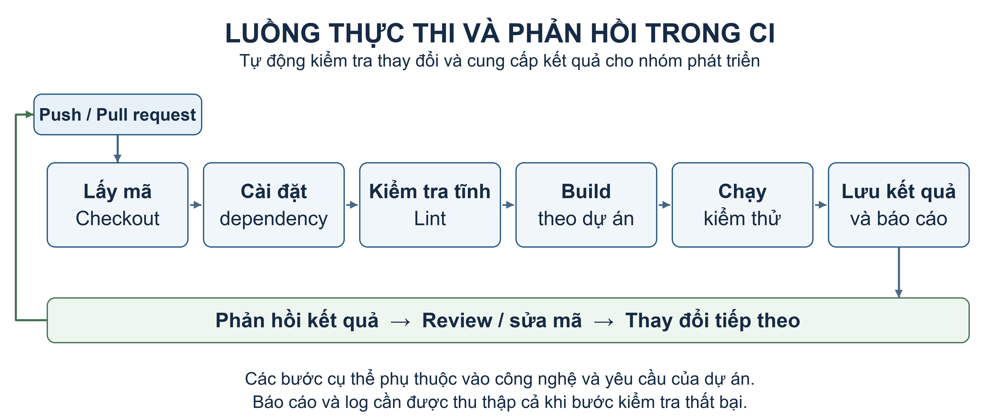

*Hình 1. Luồng thực thi và phản hồi của một pipeline CI điển hình.*

Sơ đồ minh họa một luồng phổ biến, không phải cấu trúc bắt buộc cho mọi dự án. Khi một bước kiểm tra thất bại, các công việc phụ thuộc phía sau thường được bỏ qua; các bước thu thập log, báo cáo và dọn dẹp cần được cấu hình để xử lý cả trường hợp có lỗi. Nhờ vậy, lập trình viên có thể xác định bước thất bại và sử dụng bằng chứng đã lưu để điều tra. Nếu triển khai CD, pipeline được mở rộng thêm các bước chuẩn bị bản phát hành, kiểm tra trên môi trường phù hợp và triển khai theo chính sách đã định.

**Pipeline as code**

Pipeline as code là cách định nghĩa quy trình tự động hóa bằng mã hoặc file cấu hình được quản lý phiên bản cùng dự án. Thay vì chỉ thiết lập qua giao diện, nhóm mô tả các công việc, điều kiện kích hoạt và quan hệ thực thi trong file. GitHub Actions sử dụng các file YAML trong thư mục `.github/workflows`; Jenkins hỗ trợ định nghĩa pipeline bằng `Jenkinsfile`.

Cách tổ chức này giúp cấu hình pipeline có lịch sử thay đổi, có thể được review cùng mã nguồn và khôi phục khi cần. Các thành viên cũng có một định nghĩa chung về quy trình kiểm tra, giảm sự phụ thuộc vào thao tác thủ công trên từng máy. Để dựng lại toàn bộ môi trường, dự án vẫn cần quản lý các yếu tố đi kèm như phiên bản runtime, công cụ và dịch vụ phụ thuộc.

Đối với kiểm thử phần mềm, CI/CD tạo điều kiện đưa bộ test vào quy trình phát triển thường xuyên và sử dụng kết quả làm phản hồi cho mỗi thay đổi. Hiệu quả của quy trình phụ thuộc vào chất lượng bộ test và môi trường thực thi; tự động hóa không thay thế việc thiết kế kiểm thử. Trong seminar này, nhóm tập trung triển khai phần CI: kiểm tra mã nguồn, chạy bộ test backend EShop và lưu báo cáo. Phần triển khai ứng dụng lên production nằm ngoài phạm vi thực hiện.

### 2.2. Test harness và fixture

**Khái niệm và vai trò của test harness**

Test harness là tập hợp công cụ, cấu hình và mã hỗ trợ dùng để chuẩn bị điều kiện, thực thi kiểm thử và thu thập kết quả. Một bộ test muốn chạy tự động cần có cách khởi tạo dữ liệu, gọi hệ thống được kiểm tra, xác định kết quả đúng hay sai và dọn dẹp sau khi chạy. Test harness kết nối những công việc này thành một quy trình có thể thực hiện lặp lại, thay vì phụ thuộc vào việc chuẩn bị thủ công của người kiểm thử.

Cần phân biệt test harness với test case và test runner. **Test case** mô tả một tình huống cụ thể, gồm điều kiện, dữ liệu đầu vào, thao tác và kết quả mong đợi. **Test runner**, chẳng hạn Jest, tìm các test cần chạy, điều phối thực thi và ghi nhận kết quả. **Test harness** bao quát runner cùng các thành phần hỗ trợ để test chạy trong điều kiện phù hợp. Test runner ở đây là công cụ chạy kiểm thử, khác với runner hoặc agent của hệ thống CI sẽ được trình bày ở mục 2.3.

**Các thành phần chính**

Các thành phần của harness phối hợp để đưa test từ trạng thái đã chuẩn bị đến kết quả có thể kiểm tra được. Hình 2 minh họa mối quan hệ giữa đầu vào, runner, vòng đời test và báo cáo; SUT là đối tượng mà test gọi để quan sát hành vi.

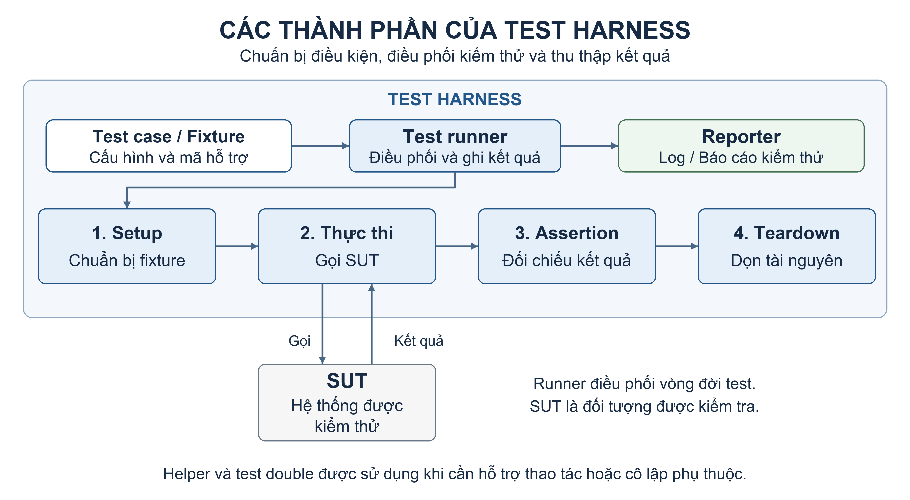

*Hình 2. Các thành phần của test harness và các giai đoạn thực hiện một lượt kiểm thử.*

Vai trò của những thành phần chính được tóm tắt trong Bảng 2.

*Bảng 2. Các thành phần chính của test harness*

| Thành phần | Vai trò |
| --- | --- |
| Test runner | Phát hiện, thực thi test, gọi các hook và ghi nhận kết quả |
| Fixture | Cung cấp dữ liệu, đối tượng và trạng thái cần thiết cho test |
| Setup/teardown | Chuẩn bị và thu hồi dữ liệu, kết nối, tài nguyên trong vòng đời kiểm thử |
| Assertion | Đối chiếu kết quả thực tế với kết quả mong đợi |
| Helper và test double | Hỗ trợ thao tác lặp lại hoặc thay thế phụ thuộc khi cần cô lập |
| Reporter | Tổng hợp kết quả thành log và các định dạng báo cáo |

Assertion cần dựa trên yêu cầu hoặc đặc tả của chức năng. Nếu chỉ dùng hành vi hiện tại của SUT làm chuẩn, test có thể xác nhận lại một lỗi đang tồn tại. Chẳng hạn, kiểm tra checkout không nên chỉ xác nhận request trả về thành công mà còn cần đối chiếu những dữ liệu hoặc thay đổi trạng thái mà yêu cầu quy định.

Helper giúp tái sử dụng những thao tác như tạo tài khoản mẫu hoặc gửi request đã xác thực. Test double phục vụ việc thay thế một phụ thuộc để kiểm soát điều kiện kiểm tra. Trong đó, stub cung cấp câu trả lời đã định trước; fake có phần cài đặt hoạt động nhưng được đơn giản hóa; mock gắn với kỳ vọng về tương tác cần xác minh. Việc thay thế phải phù hợp mục tiêu test: một unit test có thể cô lập dịch vụ ngoài, còn test tích hợp cần giữ các tương tác thật thuộc phạm vi đang kiểm tra.

**Fixture và vòng đời kiểm thử**

Fixture là những dữ liệu, đối tượng và trạng thái mà test cần để bắt đầu từ điều kiện đã biết. Ví dụ, test giỏ hàng có thể cần một người dùng, một sản phẩm đang bán và giỏ ban đầu rỗng. Fixture không chỉ là file dữ liệu mẫu; nó có thể bao gồm đối tượng trong bộ nhớ, tài nguyên tạm và trạng thái database. Kết quả mong đợi là phần dùng để đánh giá hành vi sau thao tác, cần được phân biệt với điều kiện ban đầu do fixture cung cấp.

Một lượt kiểm thử thường được tổ chức thành bốn giai đoạn:

1. **Setup:** khởi tạo tài nguyên, tạo dữ liệu và thiết lập điều kiện cần thiết.
2. **Thực thi:** gọi chức năng hoặc gửi yêu cầu đến SUT.
3. **Assertion:** kiểm tra kết quả trả về và những thay đổi trạng thái liên quan.
4. **Teardown:** dọn dữ liệu, đóng kết nối và giải phóng tài nguyên đã sử dụng.

Ví dụ minh họa, test thêm sản phẩm vào giỏ bắt đầu bằng việc tạo người dùng, sản phẩm và giỏ rỗng. Sau đó, test gọi API thêm sản phẩm, kiểm tra sản phẩm cùng số lượng trong giỏ, rồi dọn dữ liệu đã tạo. Cách tổ chức này giúp xác định rõ điều kiện xuất phát, hành động được kiểm tra và trạng thái cần khôi phục cho lần chạy tiếp theo.

Trong Jest, `beforeEach` và `afterEach` hỗ trợ công việc trước và sau từng test; `beforeAll` và `afterAll` hỗ trợ công việc một lần trong phạm vi file hoặc nhóm test tương ứng. Những tài nguyên có thể tái sử dụng được khởi tạo chung để giảm chi phí, nhưng dữ liệu mà test thay đổi vẫn cần được kiểm soát. Cleanup nên được đặt trong cơ chế teardown của framework để vẫn được thực hiện khi assertion thất bại, thay vì chỉ đặt sau assertion trong thân test.

Các thao tác bất đồng bộ cũng phải được chờ đúng cách. Nếu setup chưa tạo xong dữ liệu mà test đã gọi API, lỗi có thể xuất hiện tùy thời điểm thực thi. Tương tự, nếu test kết thúc trước khi assertion bất đồng bộ hoàn tất, kết quả ghi nhận có thể không phản ánh đầy đủ việc kiểm tra. Trả về Promise hoặc sử dụng `async`/`await` đúng cách giúp runner biết khi nào thao tác thực sự hoàn thành.

**Tính độc lập và khả năng tái lập**

Test độc lập không cần một test khác chạy trước để tạo dữ liệu hoặc thiết lập điều kiện cho nó. Chẳng hạn, test giỏ hàng cần tự chuẩn bị tài khoản sử dụng, thay vì mặc định test đăng nhập đã tạo tài khoản đó. Khi các test phụ thuộc lẫn nhau, thay đổi thứ tự, chạy riêng hoặc chạy song song có thể làm kết quả khác đi dù chức năng được kiểm tra không đổi.

Khả năng tái lập là khả năng thực hiện lại kiểm thử với những điều kiện đã xác định và thu được kết quả nhất quán. Để đạt mục tiêu này, harness cần kiểm soát những trạng thái có thể ảnh hưởng như dữ liệu database, biến toàn cục, mock, file tạm và tài nguyên dùng chung. Đối với thời gian, dữ liệu ngẫu nhiên hoặc dịch vụ bên ngoài, cần cố định hoặc kiểm soát chúng khi phù hợp với mục tiêu kiểm thử. Chạy test tuần tự có thể giảm xung đột tài nguyên nhưng không tự loại bỏ phụ thuộc trạng thái.

Ngoài dọn dữ liệu, harness cần đóng các kết nối, timer và tài nguyên đã mở để tránh ảnh hưởng đến test sau hoặc khiến tiến trình không kết thúc. Kết quả của runner cần được chuyển thành báo cáo dễ đọc và giữ nguyên trạng thái pass/fail khi đưa vào CI. Một harness được tổ chức tốt giúp nhóm phân biệt lỗi của SUT với lỗi do điều kiện kiểm thử, đồng thời cung cấp nền tảng cho việc điều tra flaky test ở các mục tiếp theo.

### 2.3. Runner / agent

**Vai trò trong quá trình thực thi pipeline**

File pipeline mô tả công việc cần làm, nhưng các lệnh như cài dependency, build và test vẫn cần một môi trường để thực thi. Runner hoặc agent là thành phần nhận công việc từ hệ thống CI và thực hiện các lệnh trên môi trường đó. Môi trường có thể được bố trí trên máy vật lý, máy ảo hoặc trong container, với hệ điều hành, runtime và công cụ phù hợp với dự án.

Việc tách điều phối khỏi thực thi giúp hệ thống phân công công việc đến nơi có khả năng xử lý, theo dõi trạng thái và thu thập phản hồi. Chẳng hạn, hệ thống CI lựa chọn nơi chạy một job kiểm thử Node.js; runner hoặc agent tại đó lấy mã nguồn, gọi các lệnh npm rồi gửi lại log và trạng thái. Test runner như Jest được gọi trong bước test và chịu trách nhiệm chạy bộ kiểm thử. Hai lớp runner này có nhiệm vụ khác nhau: một lớp thực thi công việc CI, một lớp thực thi các test bên trong công việc đó.

**Runner trong GitHub Actions**

Trong GitHub Actions, mỗi job được giao cho một runner phù hợp với cấu hình `runs-on`. Runner chuẩn bị workspace để làm việc với mã nguồn và thực hiện các step của job. Các step có thể cài công cụ, chạy script hoặc gọi action. Những job riêng biệt không nên mặc định chia sẻ cùng workspace; nếu cần sử dụng đầu ra của nhau, workflow phải có cơ chế truyền dữ liệu phù hợp.

GitHub Actions hỗ trợ hai mô hình chính:

- **GitHub-hosted runner:** do GitHub cấp phát và bảo trì. Với mô hình máy ảo thông thường, mỗi job chạy trên một VM mới có sẵn một số công cụ. Nhóm giảm được công sức quản lý máy chạy, nhưng vẫn cần khai báo những phiên bản công cụ mà dự án yêu cầu.
- **Self-hosted runner:** do người sử dụng triển khai và quản lý. Mô hình này cho phép chủ động phần cứng, phần mềm và kết nối tới dịch vụ nội bộ. Đổi lại, bên vận hành chịu trách nhiệm duy trì môi trường, cập nhật công cụ và xử lý dữ liệu còn lại giữa các lần chạy.

Sự khác nhau này ảnh hưởng cách chuẩn bị môi trường. Với máy được cấp phát mới, những dữ liệu cần tái sử dụng phải được lưu và khôi phục có chủ đích. Với máy tồn tại lâu dài, các file hoặc tiến trình từ job trước có thể còn lại nếu không được dọn. Vì vậy, khả năng tái lập phụ thuộc cả mô hình runner và cách workflow quản lý trạng thái.

**Mô hình controller–agent trong Jenkins**

Jenkins sử dụng controller để quản lý cấu hình, job, hàng đợi và điều phối công việc. Agent là tiến trình kết nối với controller để thực hiện tác vụ trên node tương ứng. Node biểu diễn môi trường thực thi mà Jenkins quản lý; các công cụ phục vụ build và test phải có sẵn hoặc được chuẩn bị tại môi trường đó.

Một node có thể được gắn các **label** mô tả khả năng, chẳng hạn hỗ trợ Linux hoặc có môi trường Node.js. Pipeline sử dụng label để yêu cầu nơi chạy phù hợp. **Executor** là một vị trí thực thi tác vụ trên node; số executor ảnh hưởng lượng công việc có thể chạy đồng thời. Executor không phải một CPU được cấp riêng, nên tăng số executor không đồng nghĩa tăng tài nguyên xử lý và có thể làm các công việc cạnh tranh tài nguyên.

Jenkins có thể chạy tác vụ trên built-in node trong controller. Tuy nhiên, bố trí agent riêng giúp tách tải build/test khỏi hoạt động điều phối và hạn chế việc script build tác động trực tiếp đến môi trường controller. Có thể đặt số executor của built-in node bằng 0 để chỉ thực thi build trên các agent đã cấu hình. Việc tách agent không bắt buộc phải sử dụng một máy vật lý khác; điều quan trọng là cách bố trí và quản lý môi trường thực thi.

Agent có thể được cấu hình cố định để dùng qua nhiều build hoặc được cấp phát tạm thời theo nhu cầu. Khai báo `agent` trong Jenkinsfile xác định nơi thực thi toàn bộ pipeline hoặc từng stage, tùy vị trí khai báo. Như vậy, việc môi trường tồn tại lâu dài hay được tạo mới là lựa chọn triển khai, không phải sự khác biệt bắt buộc giữa Jenkins và GitHub Actions.

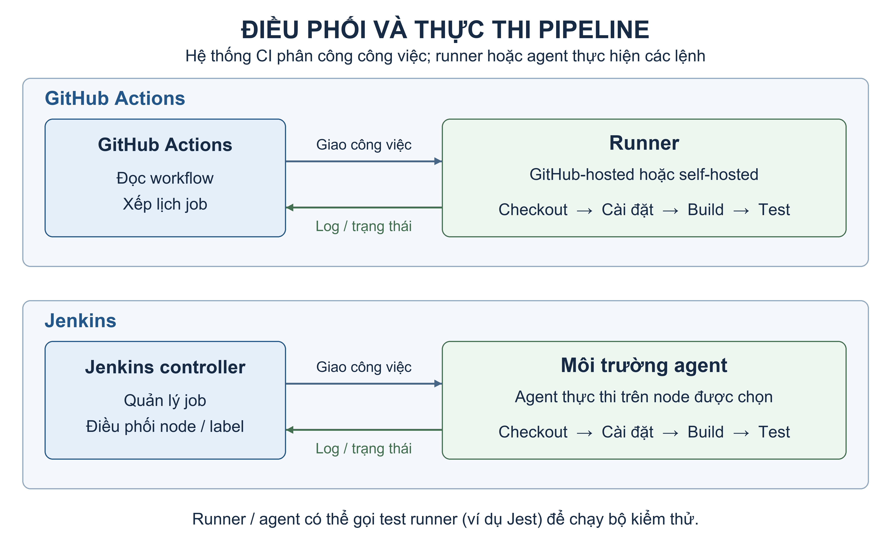

*Hình 3. Phân biệt thành phần điều phối với môi trường thực thi công việc trên GitHub Actions và Jenkins.*

**Môi trường thực thi và độ tin cậy của kết quả**

Kết quả kiểm thử phụ thuộc cả mã nguồn lẫn điều kiện chạy. Một test pass trên máy cá nhân nhưng fail trên CI có thể liên quan đến khác biệt runtime, dependency, dữ liệu hoặc dịch vụ phụ thuộc. Các điều kiện như múi giờ, tốc độ máy và mức độ chạy song song cũng có thể làm lộ hành vi không ổn định. Do đó, lựa chọn runner hoặc agent cần đi kèm việc xác định rõ môi trường và ghi nhận những thông tin cần thiết để chạy lại khi có lỗi.

Các thông tin quan trọng gồm phiên bản mã nguồn, hệ điều hành, runtime, trình quản lý package, bộ lệnh và cấu hình kiểm thử. Workspace cần được chuẩn bị để tránh dùng nhầm dữ liệu hoặc báo cáo cũ. Đồng thời, cần phân biệt việc làm sạch workspace với việc giữ cache có chủ đích, vì cache có thể được lưu ngoài workspace. Container hỗ trợ đóng gói môi trường, nhưng dữ liệu, cấu hình và dịch vụ bên ngoài vẫn cần được quản lý.

Môi trường thực thi cũng ảnh hưởng thời gian chạy. Hai pipeline sử dụng cùng bộ test có thể cho thời gian khác nhau do cấu hình máy, mạng, cache hoặc các công việc khác đang chia sẻ tài nguyên. Khi đối chiếu GitHub Actions với Jenkins, cần ghi nhận các điều kiện này và phân biệt thời gian chờ, thời gian chuẩn bị môi trường, thời gian test với tổng thời gian pipeline. Đây là cơ sở để diễn giải phép đo phù hợp với cấu hình thực tế đã sử dụng.

### 2.4. Cache và artifact

**Khái niệm và mục đích sử dụng**

Trong quá trình chạy pipeline, nhiều dữ liệu được tải về hoặc tạo ra trong workspace. Nếu môi trường thực thi được thu hồi sau khi job kết thúc, những dữ liệu này không còn sẵn cho lần chạy tiếp theo hoặc cho người cần xem lại kết quả. Cache và artifact cung cấp hai cách giữ dữ liệu với mục đích khác nhau: cache phục vụ tái sử dụng để giảm công việc lặp lại, còn artifact lưu đầu ra của một lần chạy để sử dụng hoặc kiểm tra sau đó.

**Cache** thường được dùng cho dữ liệu có thể tạo lại nhưng tốn thời gian, chẳng hạn package đã tải hoặc kết quả trung gian của quá trình build. **Artifact** có thể là gói ứng dụng, log, báo cáo kiểm thử, coverage hoặc ảnh chụp lỗi. Một pipeline có thể sử dụng cả hai: khôi phục cache để cài dependency nhanh hơn, sau đó lưu báo cáo của lượt kiểm thử hiện tại làm artifact.

**Cơ chế hoạt động của cache**

Cache hoạt động bằng cách lưu dữ liệu có thể tái sử dụng và khôi phục chúng khi có nhu cầu phù hợp. Ví dụ, trong lần chạy đầu, trình quản lý package tải các thư viện từ registry. Nếu dữ liệu package đã tải được lưu lại, lần chạy sau có thể dùng chúng để giảm lượng dữ liệu phải tải qua mạng. Tuy nhiên, pipeline vẫn phải có khả năng tải hoặc tạo lại dữ liệu khi cache không tồn tại; cache là cơ chế tối ưu, không phải điều kiện bắt buộc để kết quả kiểm tra đúng.

**Khóa cache** dùng để nhận diện tập dữ liệu cần khôi phục. Khóa có thể kết hợp hệ điều hành, thông tin công cụ và hash của lockfile, tùy loại dữ liệu được lưu. Khi lockfile thay đổi, hash thay đổi để phân biệt tập dependency tương ứng. Cách thiết kế khóa cần phản ánh những yếu tố làm dữ liệu cũ không còn phù hợp, thay vì dùng chung một khóa cho mọi trạng thái của dự án.

Kết quả tra cứu thường được mô tả bằng **cache hit** và **cache miss**. Với `actions/cache`, hit có nghĩa tìm được khóa khớp chính xác. Khi không có khóa khớp chính xác, công cụ có thể thử các khóa dự phòng nếu được cấu hình. Vì vậy, việc khôi phục được một cache theo khóa dự phòng chưa đồng nghĩa cache đó khớp hoàn toàn với khóa hiện tại. Cơ chế lưu cache mới cũng có điều kiện riêng; chẳng hạn, cách lưu mặc định của `actions/cache` phụ thuộc việc job kết thúc thành công.

Đối với npm, cần phân biệt cache package với thư mục `node_modules`. Cơ chế cache npm của `actions/setup-node` giữ dữ liệu cache của trình quản lý package, không lưu `node_modules`. Sau khi khôi phục cache, `npm ci` vẫn cài dependency theo lockfile. Lệnh này xóa `node_modules` có sẵn, không tự cập nhật lockfile và báo lỗi nếu dependency khai báo trong `package.json` không phù hợp với lockfile. Nhờ đó, tái sử dụng package đã tải và tạo lại cây dependency là hai công việc có thể kết hợp trong cùng một lượt chạy.

Cache hit không bảo đảm tổng pipeline luôn nhanh hơn. Pipeline còn có thể mất thời gian khôi phục cache, giải nén, cài đặt hoặc thực hiện những công việc khác. Mức cải thiện cần được quan sát ở đúng bước chịu tác động, đồng thời ghi nhận điều kiện của các lượt đo. Với môi trường tồn tại lâu dài, dữ liệu được giữ trên máy cũng cần được quản lý có chủ đích; chỉ có file còn lại từ lần chạy trước chưa đủ chứng minh cơ chế cache đã được cấu hình và hoạt động đúng.

**Artifact và khả năng truy vết kết quả**

Artifact giữ sản phẩm hoặc bằng chứng được tạo ra trong một run/build cụ thể. Trong pipeline kiểm thử, log cho biết quá trình thực thi, báo cáo JUnit XML mô tả kết quả từng test, còn báo cáo coverage cung cấp dữ liệu về phần mã được thực thi. Những file này giúp người review xem lại kết quả sau khi job kết thúc và hỗ trợ điều tra mà không phải chạy lại ngay từ đầu.

Việc tạo file và việc lưu file thành artifact là hai bước riêng. File nằm trong workspace chưa chắc có thể truy cập sau khi môi trường chạy bị thu hồi. Pipeline cần chỉ rõ dữ liệu cần upload hoặc archive, đặt tên dễ nhận diện và áp dụng thời hạn lưu phù hợp. GitHub Actions có cơ chế upload/download artifact; Jenkins có thể dùng `archiveArtifacts` để lưu file cùng build. Artifact cũng có thể được dùng để chuyển đầu ra giữa các job hoặc các giai đoạn của quy trình.

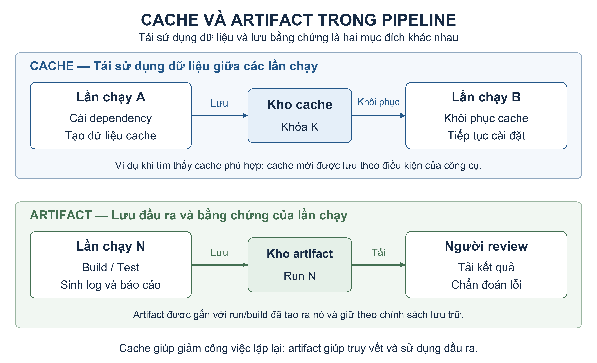

*Hình 4. Cache phục vụ tái sử dụng dữ liệu, còn artifact giữ đầu ra gắn với một lần chạy cụ thể.*

Các lần kiểm thử thất bại đặc biệt cần log và báo cáo để xác định nguyên nhân. Vì vậy, bước thu thập bằng chứng cần được cấu hình để vẫn thực hiện khi bước test lỗi, đồng thời giữ nguyên trạng thái thất bại của bước kiểm tra. Nếu lỗi xảy ra trước khi test tạo báo cáo, pipeline chỉ có thể lưu những dữ liệu đã có, chẳng hạn log cài dependency. Thu thập bằng chứng không có nghĩa mọi trường hợp thất bại đều sinh đầy đủ báo cáo test và coverage.

**Phân biệt và sử dụng trong pipeline kiểm thử**

*Bảng 3. Phân biệt cache và artifact*

| Tiêu chí | Cache | Artifact |
| --- | --- | --- |
| Mục đích chính | Giảm công việc phải thực hiện lại | Lưu sản phẩm và bằng chứng của lần chạy |
| Dữ liệu thường dùng | Package đã tải, dữ liệu build có thể tái sử dụng | Log, báo cáo test, coverage, gói ứng dụng |
| Cách nhận diện | Khóa, phiên bản và phạm vi cache | Run/build và tên artifact |
| Khi dữ liệu không có | Có thể tải hoặc tạo lại theo quy trình | Có thể thiếu bằng chứng để xem lại lần chạy |
| Quan hệ với lần chạy sau | Có thể được khôi phục nếu phù hợp | Được dùng khi cần đúng đầu ra đã lưu |

Cache và artifact không nên thay thế vai trò cho nhau. Đưa báo cáo cũ vào cache rồi khôi phục như kết quả kiểm thử mới sẽ làm sai ý nghĩa của bằng chứng. Ngược lại, lưu toàn bộ dữ liệu dependency thành artifact chưa tạo ra cơ chế lựa chọn và khôi phục cache phù hợp cho những lần chạy sau.

Để kết quả có thể truy vết, mỗi bộ artifact cần gắn với phiên bản mã nguồn, run/build và điều kiện thực thi tương ứng. Thư mục báo cáo nên được chuẩn bị để tránh lưu nhầm file còn sót từ lượt trước. Việc giữ đúng dữ liệu đầu vào có thể tái sử dụng và đúng đầu ra cần kiểm tra giúp pipeline vừa giảm thời gian xử lý, vừa cung cấp bằng chứng đáng tin cậy cho quá trình đánh giá.

### 2.5. Coverage và quality gate

**Khái niệm code coverage**

Code coverage là phép đo mức độ mã nguồn được thực thi khi chạy một bộ kiểm thử. Công cụ coverage ghi nhận những phần mã đã được chạy và tổng hợp thành các tỷ lệ trên phạm vi mã được đưa vào thống kê. Thông tin này giúp nhận diện những phần chưa được test chạm tới, từ đó định hướng việc bổ sung kiểm thử.

Công thức tổng quát là:

`Coverage (%) = số phần tử mã đã được thực thi / tổng số phần tử mã thuộc phạm vi đo × 100`

“Phần tử mã” có thể là câu lệnh, dòng mã, hàm hoặc nhánh, tùy tiêu chí đang xét. Ví dụ minh họa, nếu có 80 trong tổng số 100 câu lệnh thuộc phạm vi đo được thực thi, statement coverage là 80%. Đây là tỷ lệ thực thi câu lệnh, không có nghĩa 80% yêu cầu nghiệp vụ đã được kiểm tra hoặc phần mềm có xác suất đúng 80%.

Coverage cũng khác với tỷ lệ test pass. Một bộ test có thể đều pass nhưng chỉ chạm tới một phần nhỏ mã nguồn; ngược lại, một lượt chạy có test fail vẫn có thể tạo báo cáo coverage. Khi diễn giải kết quả, cần xem riêng test nào đạt yêu cầu và phần mã nào đã được thực thi.

**Các mức coverage thường dùng**

*Bảng 4. Các tiêu chí code coverage thường dùng*

| Tiêu chí | Nội dung đo | Ý nghĩa khi đọc báo cáo |
| --- | --- | --- |
| Statement coverage | Tỷ lệ câu lệnh được thực thi | Chỉ ra những câu lệnh chưa được chạy |
| Line coverage | Tỷ lệ dòng mã thực thi được đã được chạy | Giúp xác định vị trí chưa được test chạm tới trong mã nguồn |
| Function coverage | Tỷ lệ hàm được gọi ít nhất một lần | Chỉ ra những hàm chưa được sử dụng trong lần kiểm thử |
| Branch coverage | Tỷ lệ nhánh được đi qua theo cách công cụ ghi nhận | Cho biết những nhánh xử lý chưa được thực thi |

Các tiêu chí cung cấp những góc nhìn khác nhau. Một dòng có thể chứa nhiều câu lệnh nên line coverage và statement coverage không nhất thiết bằng nhau. Một hàm đã được gọi có thể vẫn còn các nhánh chưa chạy. Branch coverage giúp quan sát các nhánh rẽ, nhưng không đồng nghĩa đã kiểm tra mọi đường đi hoặc mọi tổ hợp điều kiện trong chương trình.

Ví dụ, một hàm có điều kiện `quantity > 0`: nếu đúng thì chấp nhận, nếu sai thì từ chối. Test với `quantity = 1` đã gọi hàm nhưng chỉ đi qua nhánh chấp nhận. Thêm test với `quantity = 0` giúp đi qua cả nhánh từ chối. Tuy nhiên, nếu đặc tả yêu cầu số lượng phải là số nguyên dương, hai test này vẫn có thể bỏ sót việc hàm chấp nhận `quantity = 1.5`. Đi qua cả hai nhánh chưa chứng minh việc kiểm tra dữ liệu đầu vào đã đầy đủ.

**Ý nghĩa và giới hạn của coverage**

Coverage phản ánh việc thực thi mã, không trực tiếp đánh giá độ mạnh của assertion. Chẳng hạn, một test checkout có thể chạy qua logic tính tổng tiền nhưng chỉ kiểm tra mã HTTP trả về. Nếu tổng tiền sai mà response vẫn thành công, test có thể pass dù phần mã tính tiền đã được coverage ghi nhận. Vì vậy, cần kết hợp coverage với việc xem xét đặc tả, dữ liệu đầu vào, điều kiện biên và các assertion thực sự được sử dụng.

Giá trị của coverage là giúp tìm khoảng trống kiểm thử và ưu tiên những phần cần kiểm tra thêm, đặc biệt ở nhánh lỗi hoặc chức năng có ảnh hưởng lớn. Không có một ngưỡng coverage duy nhất phù hợp cho mọi dự án. Mức yêu cầu cần dựa trên rủi ro, độ quan trọng của chức năng và mục tiêu kiểm thử; việc tăng tỷ lệ bằng các test ít giá trị không thay thế được kiểm tra hành vi nghiệp vụ.

Phạm vi thống kê cũng ảnh hưởng kết quả. Nếu chỉ tính những file được test import, các file hoàn toàn chưa có test có thể không xuất hiện trong mẫu số. Trong Jest, cấu hình `collectCoverageFrom` cho phép xác định tập file cần đưa vào phép đo, kể cả những file chưa được test thực thi. Khi so sánh các lượt chạy, cần giữ rõ phạm vi file, cấu hình công cụ và loại coverage được sử dụng.

Dữ liệu coverage có thể được xuất thành bảng trên console, báo cáo HTML, JSON hoặc XML như Cobertura. Các định dạng phục vụ cách đọc và tích hợp khác nhau; khi so sánh tỷ lệ cần xác định đúng nguồn và tiêu chí, tránh lấy line coverage của nguồn này so với branch coverage của nguồn khác. Báo cáo nên cho phép truy từ tỷ lệ tổng hợp đến file hoặc vị trí mã còn thiếu kiểm thử.

**Quality gate, status check và branch protection**

Quality gate là tập điều kiện dùng để quyết định một thay đổi có được chuyển sang bước tiếp theo hay không. Trong pipeline kiểm thử, điều kiện có thể gồm lint và build thành công, test không có lỗi, hoặc coverage đạt ngưỡng đã thống nhất. Ví dụ minh họa, một dự án có thể yêu cầu toàn bộ test pass, line coverage ít nhất 80% và branch coverage ít nhất 70%. Những tỷ lệ này chỉ minh họa cách đặt điều kiện, không phải cấu hình thực nghiệm của nhóm hay tiêu chuẩn chung cho mọi dự án.

Thu thập dữ liệu và thực thi điều kiện là hai công việc riêng. Chỉ tạo báo cáo hoặc badge coverage chưa làm pipeline thất bại khi tỷ lệ thấp. Muốn dùng coverage làm quality gate, pipeline cần có bước đánh giá ngưỡng và phản ánh việc không đạt vào kết quả kiểm tra. Với Jest, `coverageThreshold` có thể được dùng để cấu hình yêu cầu coverage; nếu không đạt ngưỡng đã đặt, lần chạy sẽ thất bại.

Status check công bố trạng thái của một hoạt động kiểm tra trên commit hoặc pull request. Trên GitHub, thông tin có thể được cung cấp qua checks hoặc commit statuses; GitHub Actions tạo checks khi workflow chạy. Kết quả này giúp người review biết công việc đang chờ, đang chạy hay đã hoàn thành. Tuy nhiên, một check thất bại chỉ thực sự ngăn merge khi nó được yêu cầu bởi quy tắc áp dụng cho nhánh đích.

Branch protection cho phép đặt các yêu cầu như review và status check bắt buộc trước khi merge vào nhánh được bảo vệ. Quy trình cần chọn đúng check, bảo đảm check chạy những công việc dự kiến và kiểm tra quyền bypass. Đặc biệt, một job bị bỏ qua có thể vẫn có kết quả được GitHub chấp nhận cho yêu cầu merge; vì vậy, trạng thái thỏa điều kiện không tự chứng minh toàn bộ bộ test đã được thực hiện.

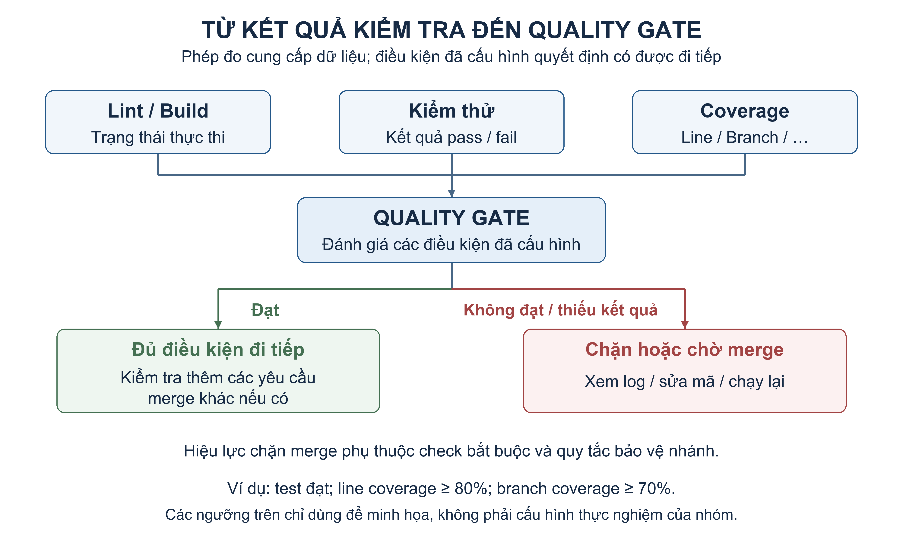

*Hình 5. Kết quả kiểm tra được đối chiếu với các điều kiện đã cấu hình; hiệu lực chặn merge phụ thuộc quy tắc bảo vệ nhánh.*

Một quality gate có ý nghĩa cần đánh giá đúng phiên bản mã, giữ nguyên kết quả thất bại và được áp dụng trong quy trình tích hợp. Khi gate không đạt, log và báo cáo giúp xác định điều kiện nào chưa đáp ứng để nhóm xử lý và kiểm tra lại. Khi gate đạt, thay đổi đã thỏa những điều kiện được khai báo, nhưng kết quả đó vẫn cần được xem cùng các yêu cầu review và những giới hạn của bộ kiểm thử.

### 2.6. Flaky test

**Khái niệm và cách nhận diện**

Flaky test là test có thể cho cả kết quả pass và fail qua các lần thực thi trên cùng phiên bản mã. Theo cách định nghĩa của Google Testing Blog, dấu hiệu quan trọng là sự xuất hiện của hai kết quả với cùng code. Không cần biết nguyên nhân trước mới nhận diện dấu hiệu flaky; phân tích nguyên nhân là bước tiếp theo. Khi đối chiếu, vẫn cần kiểm tra dữ liệu, cấu hình và môi trường, vì cùng commit không bảo đảm mọi điều kiện thực thi đều giống nhau. [Google Testing Blog](https://testing.googleblog.com/2016/05/flaky-tests-at-google-and-how-we.html).

Flaky mô tả tính không ổn định của kết quả, không phải một cấp kiểm thử riêng. Unit test, API test hoặc smoke test đều có thể có đặc tính này. Một test luôn fail vì cùng sai lệch nghiệp vụ chưa cho thấy flakiness; ngược lại, sửa mã rồi test chuyển từ fail sang pass cũng chưa chứng minh kết quả trước đó không ổn định. Cần phân biệt thay đổi hành vi theo phiên bản với thay đổi kết quả giữa những lượt dự kiến tương đương.

**Nguyên nhân và vấn đề đồng bộ**

Kết quả có thể phụ thuộc vào những điều kiện chưa được kiểm soát như thứ tự test, trạng thái dùng chung, tác vụ bất đồng bộ, thời gian hoặc dịch vụ bên ngoài. Ví dụ, nếu một test để lại dữ liệu mà test sau sử dụng, việc chạy riêng và chạy cả suite có thể cho kết quả khác nhau. Cô lập fixture, quản lý setup/teardown và kiểm tra những phụ thuộc ngầm là các hướng điều tra cần thiết. [pytest documentation](https://docs.pytest.org/en/stable/explanation/flaky.html).

Đối với thao tác bất đồng bộ, một khoảng sleep cố định chỉ cho biết test đã chờ một thời gian, không bảo đảm công việc cần đợi đã hoàn tất. Chẳng hạn, test bắt đầu đặt hàng rồi chờ 120 ms trước khi đọc lịch sử tài khoản. Nếu thao tác đặt hàng chưa hoàn tất, assertion có thể kiểm tra snapshot quá sớm. Hướng xử lý là đồng bộ với điều kiện hoàn tất phù hợp, thay vì chỉ kéo dài sleep. Tài liệu Android Developers cũng minh họa rủi ro này khi kiểm thử ứng dụng có tác vụ nền; nguyên tắc chờ trạng thái được vận dụng cho test API trong thực nghiệm của nhóm. [Test synchronization](https://developer.android.com/training/testing/instrumented-tests/stability).

Nguyên nhân không nhất thiết luôn nằm ở test. Test có thể phát hiện lỗi đồng thời thật trong sản phẩm hoặc bị ảnh hưởng bởi môi trường. Vì vậy, nhãn flaky không phải lý do để thay expected result, bỏ assertion hoặc mặc định chức năng đã đúng. Cần truy từ triệu chứng tới bằng chứng rồi mới quyết định sửa test, harness, môi trường hay mã sản phẩm. [Martin Fowler — Eradicating Non-Determinism in Tests](https://martinfowler.com/articles/nonDeterminism.html).

**Run history, retry và ảnh hưởng đến CI**

Lịch sử chạy ghi các lượt thực thi và kết quả; retry history ghi những lần thực thi lại gắn với lượt thất bại. Cần phân biệt dispatch một workflow mới, rerun workflow/job và retry một test bên trong runner. Trong v2, một run là một tiến trình Jest mới, một attempt là một lần chạy toàn bộ test body và mỗi attempt có fixture mới. Chính sách tối đa hai retry cho phép nhiều nhất ba attempt: lần đầu và hai lần thử lại nếu còn fail; pass thì dừng. Jest cung cấp `jest.retryTimes` cho cơ chế chạy lại test thất bại. [Jest — retryTimes](https://jestjs.io/docs/jest-object#jestretrytimesnumretries-options).

Retry có thể làm kết quả cuối chuyển xanh dù lần đầu đã fail. Do đó, khi phân tích cần giữ kết quả các attempt và chính sách retry, không chỉ verdict cuối. Việc chạy lại thành công không tự chứng minh nguyên nhân đã được sửa. Google ghi nhận các biện pháp chạy lại có thể giảm một số gián đoạn nhưng vẫn để lại chi phí điều tra và nguy cơ bỏ qua lỗi thật. [Google Testing Blog](https://testing.googleblog.com/2016/05/flaky-tests-at-google-and-how-we.html).

Trong CI, một kết quả đỏ cần giúp nhóm xác định hành động tiếp theo. Flake làm nhiễu tín hiệu đó vì cùng mã có thể bị chặn ở lượt này nhưng vượt qua ở lượt khác. Log, report và thông tin phiên bản của mỗi lượt tạo cơ sở để phân biệt lỗi nghiệp vụ, lỗi thực thi và kết quả không ổn định. Chương 8 trình bày thí nghiệm order history v2 được tạo có chủ đích, ghi riêng kết quả lần đầu, retry history và verdict cuối; chương 9 đối chiếu cách người và AI sử dụng cùng bằng chứng để đưa ra giả thuyết và bước xác minh.

## 3. Khảo sát và lựa chọn công cụ

Việc lựa chọn công cụ xuất phát từ hai nhu cầu của đề tài: tự động thực thi bộ kiểm thử backend EShop và hỗ trợ phân tích các kết quả không ổn định. Nhóm xem xét khả năng chạy các lệnh kiểm tra hiện có, tích hợp với kho mã nguồn, lưu báo cáo, công sức cấu hình và yêu cầu vận hành. Đối với hướng AI, tiêu chí bổ sung là khả năng sử dụng log làm đầu vào, đưa ra giả thuyết có thể kiểm chứng và lưu lại quá trình phân tích để đối chiếu với cách làm thủ công.

Phần khảo sát tập trung vào khả năng và mức độ phù hợp của từng phương án với phạm vi seminar. Các nhận xét về công sức triển khai là đánh giá định tính theo nhu cầu của nhóm; số liệu về thời gian chạy và kết quả so sánh AI với người được trình bày ở các chương thực nghiệm.

### 3.1. Công cụ CI truyền thống

**GitHub Actions**

GitHub Actions là nền tảng tự động hóa gắn với repository trên GitHub. Workflow có thể được kích hoạt bởi các sự kiện như push hoặc pull request, sau đó giao job cho runner để thực hiện những bước đã khai báo. Đối với EShop, workflow có thể chuẩn bị Node.js, cài dependency, chạy các lệnh kiểm tra và lưu báo cáo; các thao tác này sử dụng lại bộ lệnh của dự án thay vì yêu cầu viết một bộ test riêng cho nền tảng CI.

Điểm phù hợp với nhóm là mã nguồn và phản hồi kiểm tra được quản lý trong cùng hệ thống. Người review có thể theo dõi kết quả ngay trên pull request và liên kết các check cần thiết với quy tắc bảo vệ nhánh. Việc sử dụng GitHub-hosted runner cũng giúp giảm phần hạ tầng phải tự quản lý khi bắt đầu triển khai.

Nhóm vẫn cần hiểu YAML, sự kiện kích hoạt, quyền truy cập và cách bố trí job. Tính đúng của workflow phụ thuộc vào việc cấu hình đúng bộ lệnh, thu thập báo cáo và giữ nguyên trạng thái lỗi. Về chi phí, standard GitHub-hosted runner được sử dụng miễn phí cho repository công khai; larger runner và việc lưu trữ có chính sách riêng. Vì vậy, lựa chọn công cụ cần xét loại runner và nhu cầu lưu bằng chứng, không chỉ nhìn chi phí chạy test.

**Jenkins**

Jenkins là máy chủ tự động hóa mã nguồn mở, hỗ trợ mô tả quy trình bằng Jenkinsfile và mở rộng chức năng thông qua plugin. Với agent được chuẩn bị phù hợp, Jenkins có thể thực hiện cùng các lệnh npm và bộ kiểm thử mà nhóm sử dụng trên GitHub Actions. Khả năng tự quản lý môi trường cho phép nhóm chủ động công cụ, dữ liệu được giữ giữa các build và cách công bố báo cáo.

Trong seminar, Jenkins cung cấp một mô hình triển khai khác để đối chiếu: nhóm phải thiết lập controller, agent, kết nối repository và những plugin cần cho pipeline. Qua đó, việc so sánh có thể xét cả định nghĩa pipeline, báo cáo kiểm thử lẫn công sức vận hành, thay vì chỉ so cú pháp YAML với Jenkinsfile.

Jenkins được phân phối theo giấy phép MIT, nhưng việc sử dụng vẫn cần tài nguyên máy chạy, dung lượng lưu trữ và công sức quản trị. Nhóm phải duy trì phiên bản công cụ, plugin và cấu hình kết nối. Đây là phần công việc cần tính đến khi đánh giá một hệ thống CI tự quản lý, dù không có chi phí giấy phép sử dụng Jenkins.

**GitLab CI/CD**

GitLab CI/CD hỗ trợ mô tả pipeline bằng file `.gitlab-ci.yml`, trong đó khai báo các job, stage, biến và điều kiện thực thi. Các job được thực hiện bởi runner. Về khả năng kiểm thử, nền tảng này cũng có thể chạy một dự án Node.js với các lệnh cài dependency và Jest nếu môi trường được chuẩn bị phù hợp.

GitLab CI/CD là phương án phù hợp để xem xét khi dự án sử dụng hệ sinh thái GitLab. Nền tảng cũng hỗ trợ tích hợp repository bên ngoài như GitHub; tuy nhiên, cần xem xét thêm cách đồng bộ, quyền truy cập và điều kiện của gói sử dụng. Với đề tài đã tổ chức mã nguồn và pull request trên GitHub, triển khai thêm GitLab sẽ tăng đầu mối cấu hình. Nhóm vì vậy khảo sát GitLab như một phương án thay thế, đồng thời giới hạn thực nghiệm ở hai nền tảng GitHub Actions và Jenkins để tập trung vào yêu cầu đối chiếu của đề tài.

**Đối chiếu theo nhu cầu của seminar**

*Bảng 5. Đối chiếu định tính các nền tảng CI được khảo sát*

| Tiêu chí | GitHub Actions | Jenkins | GitLab CI/CD |
| --- | --- | --- | --- |
| Định nghĩa pipeline | YAML trong `.github/workflows` | Jenkinsfile | `.gitlab-ci.yml` |
| Thành phần thực thi | GitHub-hosted hoặc self-hosted runner | Agent trên node được cấu hình | GitLab-hosted hoặc runner tự quản lý |
| Công việc cần học và thiết lập | Workflow, sự kiện, job, quyền truy cập | Pipeline, controller, agent, plugin | Job/stage, biến, điều kiện chạy, runner |
| Phù hợp với EShop | Tích hợp trực tiếp với repo và PR trên GitHub | Chạy cùng bộ lệnh; cần cấu hình kết nối GitHub | Chạy cùng bộ lệnh; cần thêm tổ chức dự án hoặc tích hợp repo ngoài |
| Chi phí và vận hành | Xét runner, hạn mức và lưu trữ; giảm phần máy chủ nếu dùng hosted runner | Giấy phép MIT; tự quản lý hạ tầng và công cụ | Phụ thuộc gói sử dụng và mô hình runner |
| Nguồn học tập và mở rộng | GitHub Docs, action và workflow mẫu | Jenkins Docs và hệ sinh thái plugin | GitLab Docs và cấu hình CI/CD mẫu |

Cả ba nền tảng đều có thể phục vụ việc chạy kiểm thử tự động. Với phạm vi này, khác biệt có ý nghĩa nằm ở cách tích hợp vào quy trình hiện có, mức độ tự quản lý và khả năng cung cấp bằng chứng dễ kiểm tra. Bảng khảo sát là cơ sở lựa chọn, chưa phải kết luận nền tảng nào chạy nhanh hơn hay cho kết quả kiểm thử tốt hơn.

### 3.2. Hướng AI

**Trợ lý ngôn ngữ hỗ trợ phân tích log**

Một hướng áp dụng AI là cung cấp log và bối cảnh cho trợ lý ngôn ngữ để hỗ trợ tóm tắt lỗi, tổ chức giả thuyết và đề xuất bước kiểm tra tiếp theo. ChatGPT được nhóm chọn để khảo sát theo cách này. Lượt triage v2 được lưu theo model thực hiện là GPT-6.1 Sol, áp dụng skill `ci-log-triage`; hồ sơ và kết quả cụ thể ở chương 9. Đầu vào được chuẩn bị từ kết quả CI; phản hồi cần nêu rõ quan sát nào hỗ trợ giả thuyết và thông tin nào còn thiếu.

Trong phạm vi seminar, ChatGPT được sử dụng để hỗ trợ triage trên dữ liệu nhóm cung cấp, không được tích hợp thành thành phần tự quyết định trạng thái pipeline. Cách tiếp cận này cho phép nhóm chuẩn bị cùng một bộ log cho người phân tích và AI, đồng thời lưu prompt và phản hồi để xem xét lại. Nó cũng phù hợp với bài toán muốn quan sát cách lập luận từ bằng chứng, thay vì chỉ nhận một nhãn pass/fail.

Hiệu quả phụ thuộc vào bối cảnh được cung cấp và cách đặt yêu cầu. Prompt cần nêu mục tiêu phân tích, dữ liệu được phép sử dụng và đầu ra mong muốn. Chẳng hạn, nhóm có thể yêu cầu phân biệt quan sát trong log với suy đoán, viện dẫn bằng chứng cho từng giả thuyết và đưa ra bước xác minh. Phản hồi vẫn phải được review vì lời giải thích có vẻ hợp lý có thể thiếu căn cứ hoặc bỏ sót thông tin quan trọng.

**Công cụ theo dõi kiểm thử và hỗ trợ xử lý flake**

Một hướng khác là tích hợp công cụ quan sát kiểm thử vào pipeline để thu thập dữ liệu thực thi qua nhiều lượt chạy. Datadog Test Optimization là ví dụ được khảo sát: công cụ cung cấp thông tin về các lần chạy, thời gian, lỗi và tình trạng không ổn định của test. Flaky Tests Management hỗ trợ theo dõi, triage và quản lý các test có flake trong một giao diện tập trung.

Hướng này phù hợp khi cần quan sát bộ test thường xuyên trên nhiều nhánh hoặc nhiều pipeline. Tuy nhiên, cần cấu hình thu thập dữ liệu và bảo đảm framework kiểm thử nằm trong phạm vi được hỗ trợ. Các khả năng AI như phân loại nguyên nhân hoặc gợi ý sửa còn có điều kiện dữ liệu và tích hợp tương ứng. Vì vậy, việc có một test fail rồi pass chưa đồng nghĩa đã sử dụng đầy đủ chức năng phân tích nguyên nhân bằng AI của nền tảng.

Cần phân biệt **phát hiện kết quả không ổn định** với **phân tích nguyên nhân**. Phát hiện có thể dựa trên việc quan sát cả pass và fail trong lịch sử chạy; phân tích nguyên nhân cần thêm bối cảnh và phép xác minh. Tính năng thống kê hoặc retry không tự trở thành chức năng AI. Khi đánh giá công cụ, nhóm cần chỉ rõ chức năng nào đang được sử dụng và bằng chứng nào cho thấy nó hỗ trợ được bài toán.

*Bảng 6. Đối chiếu hai cách tiếp cận hỗ trợ phân tích flaky test*

| Tiêu chí | ChatGPT với log do nhóm chuẩn bị | Công cụ tích hợp như Datadog Test Optimization |
| --- | --- | --- |
| Đầu vào | Log, lịch sử chạy, bối cảnh và prompt | Dữ liệu test được thu thập qua tích hợp |
| Cách sử dụng | Yêu cầu phân tích một trường hợp cụ thể | Theo dõi và quản lý kết quả qua nhiều lượt chạy |
| Đầu ra quan tâm | Tóm tắt, giả thuyết, bằng chứng và bước xác minh | Lịch sử, chỉ số, trạng thái flake và chức năng phân tích được hỗ trợ |
| Chuẩn bị | Chọn dữ liệu, đặt yêu cầu và lưu phản hồi | Cấu hình dịch vụ, thư viện thu thập dữ liệu và quyền truy cập |
| Giới hạn cần kiểm tra | Suy đoán thiếu căn cứ, bối cảnh thiếu, phản hồi chưa được xác minh | Điều kiện tích hợp, dữ liệu cần thiết và phạm vi tính năng của gói sử dụng |
| Vai trò trong seminar | Công cụ AI được dùng cho thí nghiệm đối chiếu | Phương án khảo sát, không triển khai trong phạm vi báo cáo |

Để phù hợp với giới hạn thời gian và mục tiêu seminar, nhóm chọn cách chuẩn bị dữ liệu rồi dùng ChatGPT hỗ trợ phân tích. Lựa chọn này giúp tập trung việc đánh giá vào chất lượng triage trên cùng đầu vào. Nó chưa khẳng định ChatGPT chính xác hơn công cụ chuyên dụng hoặc phân tích thủ công; những nhận xét về hiệu quả phải dựa trên kết quả thí nghiệm.

### 3.3. Lựa chọn của nhóm và lý do

Nhóm lựa chọn GitHub Actions làm CI chính, Jenkins làm nền tảng đối chiếu và ChatGPT làm công cụ hỗ trợ phân tích log. Ba công cụ đảm nhiệm những vai trò bổ sung cho nhau trong quy trình thực hiện.

*Bảng 7. Công cụ được chọn và vai trò trong đề tài*

| Công cụ | Vai trò | Nội dung cần thể hiện |
| --- | --- | --- |
| GitHub Actions | CI chính gắn với repository và pull request | Tự động kiểm tra, chạy test, lưu bằng chứng và cung cấp check cho quy trình merge |
| Jenkins | Nền tảng CI đối chiếu | Chạy bộ lệnh tương ứng, công bố báo cáo và so sánh cấu hình, môi trường, thời gian, vận hành |
| ChatGPT | Hỗ trợ triage flaky test | Phân tích cùng dữ liệu với người, đưa ra giả thuyết và bước kiểm chứng để đối chiếu |

**Lý do chọn GitHub Actions làm CI chính**

EShop của nhóm được quản lý trên GitHub, nên GitHub Actions phù hợp để gắn kiểm thử với các sự kiện push và pull request. Kết quả kiểm tra có thể được xem cùng thay đổi mã nguồn, thuận tiện cho review và áp dụng quy tắc bảo vệ nhánh. Nhóm cũng có thể sử dụng runner do GitHub cung cấp để giảm công việc chuẩn bị máy chủ CI ban đầu. Việc triển khai tập trung vào workflow và bộ lệnh kiểm thử mà dự án đã chuẩn bị.

**Lý do triển khai thêm Jenkins**

Jenkins cho phép đối chiếu với mô hình CI mà nhóm trực tiếp quản lý hạ tầng và công cụ. Việc sử dụng cùng bộ kiểm thử trên hai nền tảng giúp xem xét những khác biệt về định nghĩa pipeline, môi trường chạy, cách lưu và hiển thị báo cáo. Nhóm vì vậy sử dụng Jenkins như một phần thực nghiệm đối chiếu, thay vì chỉ mô tả nó như phương án dự phòng.

Các phép so sánh cần ghi nhận phiên bản mã nguồn, bộ lệnh và điều kiện thực thi. Nếu hai môi trường khác nhau về runtime, tài nguyên hoặc trạng thái cache, phần nhận xét phải giải thích những khác biệt đó. Mục tiêu là xác định đặc điểm phù hợp của từng cấu hình và những yêu cầu vận hành đi kèm, không suy ra ưu thế chung chỉ từ một lượt chạy.

**Lý do chọn ChatGPT cho hướng AI**

Bài toán AI của nhóm là phân tích log và lịch sử chạy của một trường hợp flake có nguyên nhân đã biết. ChatGPT phù hợp với cách tổ chức thí nghiệm này vì nhóm có thể cung cấp đầu vào cụ thể, yêu cầu định dạng câu trả lời và giữ lại phản hồi để đánh giá. Thời gian chuẩn bị được tập trung vào chất lượng dữ liệu, cách phân tích và phép xác minh, thay vì xây dựng thêm một hệ thống thu thập test telemetry.

Việc đánh giá cần tách bản phân tích thủ công khỏi phản hồi AI, sử dụng cùng dữ liệu và đối chiếu theo tiêu chí thống nhất. Những đề xuất của AI được kiểm tra bằng log và kết quả thực thi, không dùng trực tiếp để thay đổi expected result hoặc bỏ test cho pipeline thành công. Thiết kế thí nghiệm và kết quả cụ thể được trình bày ở các chương về flaky test và AI triage.

GitLab CI/CD và Datadog được giữ ở phạm vi khảo sát để làm rõ những phương án có thể áp dụng trong bối cảnh khác. Với phạm vi hiện tại, tổ hợp GitHub Actions, Jenkins và ChatGPT đáp ứng ba phần việc của đề tài: kiểm thử tự động, đối chiếu hai nền tảng CI và đánh giá hỗ trợ AI khi phân tích lỗi không ổn định.

## 4. Hệ thống kiểm thử

### 4.1. SUT: backend EShop

**Đối tượng và phạm vi kiểm thử**

Hệ thống được kiểm thử (System Under Test – SUT) trong seminar là backend của ứng dụng thương mại điện tử EShop. Toàn bộ ứng dụng còn có giao diện web, trang quản trị và ứng dụng mobile; tuy nhiên, bộ kiểm thử của nhóm tập trung vào các chức năng được cung cấp qua backend API. Việc giới hạn phạm vi này giúp nhóm xây dựng một bộ test có thể chạy tự động, không cần thao tác giao diện và có thể sử dụng lại trên cả GitHub Actions lẫn Jenkins.

Backend sử dụng Node.js, Express, SQLite và JSON Web Token (JWT). Mã nguồn được tổ chức theo CommonJS; `backend/server.js` khai báo ứng dụng Express, middleware xác thực và các route xử lý nghiệp vụ. `backend/database.js` quản lý kết nối SQLite, tạo cấu trúc bảng và nạp dữ liệu ban đầu. Các nhóm chức năng được chọn kiểm thử gồm xác thực, truy cập tài nguyên theo quyền, danh mục sản phẩm, giỏ hàng, checkout, đơn hàng và mã giảm giá.

**Đặc điểm kiến trúc ảnh hưởng đến kiểm thử**

Dữ liệu của SUT tồn tại ở hai nơi. Các bảng `users`, `products`, `categories`, `orders`, `coupons` và `coupon_usage` được lưu trong SQLite. Riêng giỏ hàng được giữ trong đối tượng `userCarts` ở bộ nhớ của tiến trình Node.js. Vì vậy, chỉ tạo lại database chưa đủ để đưa ứng dụng về trạng thái ban đầu: nếu tái sử dụng cùng instance ứng dụng, dữ liệu giỏ hàng của test trước vẫn có thể ảnh hưởng đến test sau. Harness của nhóm phải cô lập cả database lẫn trạng thái trong bộ nhớ.

Khi chạy trực tiếp, `server.js` mở cổng HTTP để phục vụ ứng dụng. Khi được import trong môi trường kiểm thử, module export `app` và `authenticateToken`, không tự mở cổng cố định 3000. Cách tổ chức này cho phép Supertest gửi request tới ứng dụng Express thật mà không yêu cầu thành viên khởi động server thủ công trước mỗi lần chạy test.

**Cơ sở xác định kết quả mong đợi**

Đặc tả nghiệp vụ trong `README.md` của repository mã nguồn là cơ sở xác định expected result; `api_specification.md` mô tả giao diện HTTP phục vụ việc xây dựng request. Kết quả thực tế được đối chiếu với yêu cầu, thay vì coi hành vi hiện có của chương trình là đáp án đúng. Ví dụ, yêu cầu checkout quy định backend phải tính tổng tiền; nếu chương trình lưu trực tiếp tổng tiền do client gửi lên thì test phải ghi nhận sai lệch đó.

Trong phạm vi đề tài, nhóm không sửa lỗi nghiệp vụ của SUT. Các thay đổi phục vụ kiểm thử cho phép import ứng dụng và cô lập môi trường; các assertion vẫn giữ theo đặc tả. Bộ test vì vậy có thể chạy hoàn chỉnh nhưng trả kết quả fail khi phát hiện chức năng chưa đáp ứng yêu cầu. Đây là dữ liệu đầu vào cho phần triển khai và đánh giá CI ở các chương sau.

### 4.2. Bộ kiểm thử

**Cấu trúc và vai trò của các nhóm test**

Bộ kiểm thử sử dụng Jest làm test runner, thư viện assertion và công cụ đo coverage; Supertest được dùng để gửi request HTTP tới ứng dụng Express. Tại baseline được trình bày ở mục 4.4, bộ test gồm **39 ca trong 6 file test**, bao gồm 36 ca kiểm tra chức năng ở ba tầng unit, API, smoke và 3 ca kiểm tra tính đúng đắn của harness.

*Bảng 8. Cấu trúc bộ kiểm thử backend EShop*

| Nhóm | File trong `backend/tests/` | Số ca | Nội dung chính |
| --- | --- | ---: | --- |
| Unit | `unit/authentication.test.js` | 5 | Middleware JWT: thiếu token, token sai định dạng, sai khóa ký, hết hạn và hợp lệ |
| API | `api/catalog-auth.test.js` | 11 | Danh sách và tìm kiếm sản phẩm, đăng nhập, hồ sơ, xác thực và quyền xem danh sách người dùng |
| API | `api/cart-orders.test.js` | 10 | Giỏ hàng, checkout, lịch sử đơn cá nhân và điều kiện chuyển trạng thái đơn |
| API | `api/coupons.test.js` | 9 | Điều kiện sử dụng, giá trị biên và công thức giảm giá |
| Smoke | `smoke/purchase.test.js` | 1 | Luồng xem sản phẩm → đăng nhập → thêm giỏ → checkout → xem lịch sử đơn |
| Harness | `harness/isolation.test.js` | 3 | Cô lập database, cô lập giỏ hàng và khả năng gọi cleanup nhiều lần |
| **Tổng** | **6 file test** | **39** | **5 unit, 30 API, 1 smoke, 3 harness** |

Trong bảng trên, số ca được tính theo từng lần thực thi test. Chẳng hạn, một khai báo `test.each` kiểm tra ba endpoint thiếu token được tính thành ba ca riêng. Ba ca harness kiểm tra hạ tầng chạy test, không được cộng vào số ca kiểm tra nghiệp vụ của EShop.

**Unit test cho middleware xác thực**

Các unit test gọi trực tiếp hàm `authenticateToken` với đối tượng request, response và hàm `next` được chuẩn bị cho từng trường hợp. Database được mock vì không tham gia hành vi đang kiểm tra; không có request HTTP hoặc câu lệnh SQL được thực thi. Phần xác minh JWT vẫn sử dụng middleware và thư viện JWT thật. Với token không hợp lệ, test kiểm tra phản hồi từ chối và việc không gọi `next`; với token hợp lệ, test kiểm tra danh tính được gán vào request và `next` được gọi đúng một lần.

Cách kiểm tra này giúp xác định lỗi của middleware trong phạm vi nhỏ. Tuy nhiên, middleware xác thực hoạt động đúng chưa chứng minh từng route đã kiểm tra đầy đủ quyền truy cập. Vì vậy, bộ API test còn có trường hợp người dùng thông thường truy cập tài nguyên quản trị để kiểm tra việc áp dụng quyền ở cấp endpoint.

**API test cho tích hợp và quy tắc nghiệp vụ**

Các API test gửi request qua route Express thật, sử dụng JWT thật và SQLite thật trong bộ nhớ. Theo phạm vi kỹ thuật, đây cũng là các phép kiểm tra tích hợp giữa định tuyến, middleware, xử lý nghiệp vụ và truy cập dữ liệu. Nhóm không mock phản hồi API hay thay thế công thức tính tiền của SUT; vì vậy, sai lệch trong những thành phần này có thể thể hiện qua status code, response body hoặc trạng thái dữ liệu sau request.

Các trường hợp được lựa chọn theo hành vi và rủi ro của chức năng. Nhóm xác thực có cả đầu vào hợp lệ và không hợp lệ. Nhóm phân quyền phân biệt chưa đăng nhập, người dùng thông thường và quản trị viên. Nhóm đơn hàng kiểm tra các trạng thái `pending`, `shipping`, `canceled` và điều kiện chuyển trạng thái. Nhóm coupon kết hợp các điều kiện mã tồn tại, còn hiệu lực, đủ giá trị đơn và chưa vượt giới hạn sử dụng.

Phân tích giá trị biên được thể hiện ở ngưỡng áp dụng coupon `BIGBUY`: các tổng tiền 499.999, 500.000 và 500.001 đồng lần lượt nằm ngay dưới, đúng và ngay trên ngưỡng 500.000 đồng. Thiết kế này giúp phát hiện khác biệt giữa điều kiện “lớn hơn” và “lớn hơn hoặc bằng”, vốn khó nhận ra nếu chỉ chọn một giá trị cách xa ngưỡng. Với coupon phần trăm, expected result được tính độc lập: giảm 10% của 500.000 đồng phải bằng 50.000 đồng, số tiền còn lại là 450.000 đồng.

Mỗi test có mã định danh như `U-AUTH-01`, `A-COUPON-05` hoặc `S-PURCHASE-01`; tên test thể hiện hành vi và, khi phù hợp, mã yêu cầu FR tương ứng. Mã định danh giúp theo dõi cùng một ca qua log local và báo cáo CI. Khi đặc tả chỉ yêu cầu từ chối mà chưa quy định status code cụ thể, assertion kiểm tra lỗi thuộc nhóm 4xx cùng các điều kiện liên quan, tránh áp đặt một mã HTTP không có căn cứ từ yêu cầu.

**Smoke test và giới hạn bao phủ**

Smoke test nối các bước chính của luồng mua hàng trong cùng một kịch bản: đọc danh sách sản phẩm, đăng nhập, thêm sản phẩm vào giỏ, checkout và kiểm tra đơn vừa tạo trong lịch sử của người dùng. Kịch bản kiểm tra các bước có thể kết nối với nhau và dữ liệu đơn hàng cơ bản được trả về đúng người dùng, tổng tiền và trạng thái ban đầu.

Đây là smoke test qua API; nó không chạy trình duyệt, giao diện web hoặc ứng dụng mobile. Kịch bản sử dụng tổng tiền hợp lệ và không kiểm tra tất cả điều kiện của checkout, nên smoke pass vẫn có thể đi cùng API test fail ở trường hợp client sửa tổng tiền hoặc giỏ hàng chưa được xóa. Bộ test cũng chưa bao phủ toàn bộ yêu cầu EShop, các thuộc tính giao diện, kiểm thử tải hoặc đánh giá bảo mật đầy đủ. Các kết luận ở chương này được giới hạn trong những hành vi đã có assertion.

### 4.3. Fixture và tính độc lập

**Tạo môi trường riêng cho từng test**

Fixture dùng chung được tổ chức trong `backend/tests/helpers/harness.js`. Với các test API và smoke, `beforeEach` gọi `createHarness()` để tạo instance ứng dụng cùng database mới; `afterEach` đóng database sau khi test kết thúc, kể cả khi assertion fail. Các test harness có thể tạo nhiều instance trong cùng một ca để đối chiếu trạng thái, sau đó đóng toàn bộ instance đã tạo.

Harness sử dụng `jest.isolateModules` khi nạp `server.js` và `database.js`. Mỗi lần tạo harness vì vậy có phạm vi module riêng, bao gồm cả đối tượng giỏ hàng trong bộ nhớ. Constructor SQLite được thay tạm thời để chuyển đường dẫn database sang `:memory:`. Việc thay thế này chỉ thay nơi lưu dữ liệu: SQL tạo bảng, SQL seed, truy vấn và logic xử lý request vẫn chạy bằng mã thật của SUT. Sau bước nạp module, mock constructor được khôi phục trong khối `finally`.

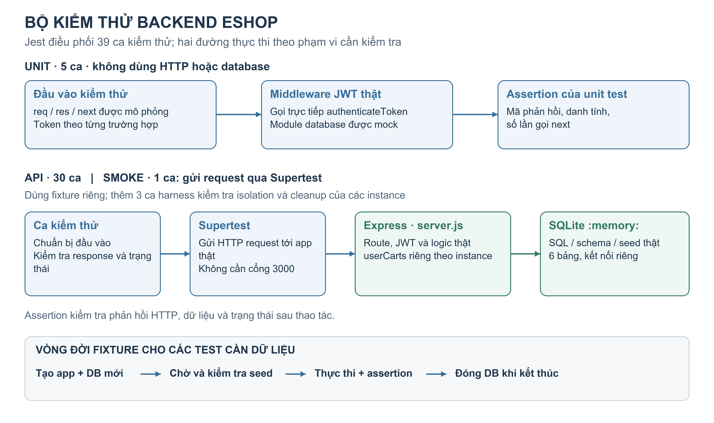

*Hình 6. Hai đường thực thi của bộ kiểm thử EShop và vòng đời fixture cho các test cần dữ liệu. Unit test gọi trực tiếp middleware; API, smoke và các ca kiểm tra harness sử dụng instance cô lập.*

**Bảo đảm fixture đã sẵn sàng**

Khởi tạo database là quá trình bất đồng bộ. Nếu test gửi request trước khi seed hoàn tất, lỗi thiếu dữ liệu có thể bị hiểu nhầm thành lỗi nghiệp vụ. Để tránh tình huống đó, `createHarness()` chờ một truy vấn kiểm tra dữ liệu được xếp sau các lệnh khởi tạo, đồng thời xác nhận số bản ghi ở cả sáu bảng: 2 người dùng, 5 sản phẩm, 4 coupon, 3 danh mục, 0 đơn hàng và 0 lượt sử dụng coupon. Chỉ khi các điều kiện này thỏa mãn, helper mới trả về ứng dụng cho test sử dụng.

Các helper `login`, `product`, `order` và `exhaustCoupon` hỗ trợ chuẩn bị trạng thái theo mục tiêu từng ca. `login` lấy token qua API đăng nhập thật; `product` tìm sản phẩm theo tên thay vì cố định ID; `order` và `exhaustCoupon` sử dụng SQL để tạo trạng thái đơn hàng hoặc lượt dùng coupon cần kiểm tra. Việc chuẩn bị trực tiếp bằng SQL được dùng cho điều kiện đầu vào, trong khi hành vi đang được đánh giá vẫn phải được thực hiện qua thao tác tương ứng và kiểm tra bằng assertion. Ví dụ, test hủy đơn có thể tạo trước đơn `shipping`, rồi gọi API hủy và kiểm tra trạng thái sau đó.

**Cleanup và bảo vệ dữ liệu gốc**

Mỗi instance giữ kết nối SQLite riêng và cung cấp hàm `close()`. Hàm này lưu lại Promise đóng kết nối, nên việc gọi nhiều lần sử dụng cùng kết quả cleanup. Nếu setup thất bại sau khi đã mở database, helper thực hiện đóng kết nối trước khi đưa lỗi ra ngoài. Lỗi cleanup không bị bỏ qua vì một kết nối chưa đóng có thể làm tiến trình test không kết thúc hoặc ảnh hưởng đến các lần chạy tiếp theo.

Database `:memory:` được hủy khi kết nối tương ứng đóng. Bộ test không cần xóa hoặc reset file `backend/database.sqlite` đang dùng cho ứng dụng. Việc tạo lại cả database và app giúp test tiếp theo nhận trạng thái ban đầu, đồng thời không reset trạng thái của một instance khác còn đang tồn tại.

**Kiểm chứng tính độc lập**

Ba ca `H-ISOLATION-01/02/03` kiểm tra lần lượt việc thay đổi dữ liệu không lan sang database khác, giỏ hàng riêng theo instance và cleanup có thể gọi lặp lại. Ngoài ra, lệnh `npm run test:isolation` chạy toàn bộ bộ test bằng ba tiến trình Jest kế tiếp với seed 101, 202 và 303 để xáo thứ tự test trong mỗi file. Script đối chiếu trạng thái từng tên test, danh sách mười test fail đã biết, số test bị bỏ qua và số tài nguyên còn mở được Jest phát hiện; đồng thời so sánh SHA-256 của file database gốc trước và sau phép kiểm tra.

Kết quả ở baseline cho thấy cả ba seed đều có 39 test, 29 pass, 10 fail, không có open handle được báo cáo và hash database gốc không đổi. Lệnh chẩn đoán isolation trả exit code 0 vì đáp ứng các tiêu chí trên; từng lượt Jest vẫn trả exit code 1 do các assertion nghiệp vụ fail. Do đó, kết quả kiểm tra tính độc lập không thay thế kết quả kiểm thử chức năng hoặc quality gate của pipeline.

Bộ test hiện chạy tuần tự bằng `--runInBand`; helper module isolation này không được thiết kế để dùng với `test.concurrent`. Ba seed là bằng chứng về các thứ tự đã kiểm tra, chưa chứng minh bộ test ổn định với mọi thứ tự, mức tải hoặc cách thực thi song song. Khi thêm test hay sửa lỗi SUT, danh sách kết quả kỳ vọng trong script chẩn đoán cũng cần được cập nhật dựa trên kết quả đã xác minh.

### 4.4. Baseline

**Mục đích và điều kiện ghi nhận**

Baseline là mốc kết quả ban đầu dùng để đối chiếu khi đưa cùng bộ kiểm thử lên các nền tảng CI. Mốc này cần xác định được phiên bản mã nguồn, môi trường, câu lệnh và kết quả quan sát, để phân biệt lỗi nghiệp vụ đã có với lỗi mới do cấu hình pipeline hoặc thay đổi mã nguồn. Baseline của chương này sử dụng lần kiểm chứng B-04 trên clone local sạch ngày 13/10/2026, được lưu trong repository mã nguồn; các số liệu dưới đây là kết quả của lần chạy đã lưu, không phải một lần chạy mới khi biên soạn báo cáo.

*Bảng 9. Điều kiện của baseline local B-04*

| Nội dung | Giá trị ghi nhận |
| --- | --- |
| Phiên bản mã nguồn | Commit `a7f0923a168b5228920c27be04452c2dfcfe4de7` |
| Ngày kiểm chứng | 13/10/2026, múi giờ Asia/Bangkok (UTC+07:00) |
| Môi trường | Windows, PowerShell; Node.js `v24.14.0`, npm `11.21.0` |
| Trạng thái clone | Không có sẵn `node_modules` và báo cáo coverage; dùng lại runtime và npm cache của máy |
| Cài dependency | `npm ci --no-audit --no-fund` trong thư mục `backend` |
| Lượt Jest dùng để lấy số liệu coverage và thời gian | `npm run test:ci` kèm `--detectOpenHandles --json --outputFile=<đường-dẫn-report-tạm>` |
| Log minh chứng | `docs/evidence/B-04/clean-clone.log` |
| Snapshot coverage | `docs/evidence/B-04/cobertura-coverage.xml` |

Các đường dẫn trong bảng được tính từ gốc repository mã nguồn EShop. Snapshot XML đã chuẩn hóa đường dẫn nguồn thành `backend`, giữ nguyên các bộ đếm coverage. Clone sạch ở đây mô tả dependency và báo cáo trong thư mục dự án, không có nghĩa đây là phép đo với npm cache rỗng.

**Kết quả thực thi**

Quy trình kiểm chứng gồm cài dependency, lint, kiểm tra cú pháp, chạy test và thu coverage. Backend là ứng dụng CommonJS chạy trực tiếp; lệnh `build` gọi script kiểm tra cú pháp bằng Node, không tạo bundle hoặc thư mục `dist`. Vì vậy, build pass cho biết mã vượt qua phép kiểm tra cú pháp đã cấu hình, chưa khẳng định đúng nghiệp vụ.

*Bảng 10. Kết quả các bước tại baseline B-04*

| Bước | Kết quả | Ý nghĩa |
| --- | --- | --- |
| Cài dependency | Exit code 0 | Hoàn tất cài đặt theo lockfile |
| Lint | Exit code 0 | Không có lỗi hoặc warning theo cấu hình ESLint áp dụng |
| Build | Exit code 0 | Các file thuộc phạm vi script vượt qua kiểm tra cú pháp |
| Bộ kiểm thử đầy đủ | 39 ca: 29 pass, 10 fail, 0 skip; exit code 1 | Các test được thực thi; còn assertion nghiệp vụ chưa thỏa |
| Tổng hợp suite | 3 suite pass, 3 suite fail | Các file API có lỗi; unit, smoke và harness pass |
| Chẩn đoán isolation | Exit code 0 ở ba seed | Trạng thái từng test ổn định theo phép kiểm tra, database gốc không đổi |

Theo từng nhóm, unit có 5/5 ca pass, API có 20/30 ca pass, smoke có 1/1 ca pass và harness có 3/3 ca pass. Thời gian Jest của lượt `test:ci` dùng để thu coverage là **2,443 giây**. Đây là thời gian Jest báo cho lượt chạy đó, không bao gồm toàn bộ quá trình cài đặt, lint, build hoặc thời gian chờ của một pipeline CI; một lần đo local cũng chưa đủ để đánh giá hiệu năng chung.

**Các sai lệch nghiệp vụ đã ghi nhận**

Mười test fail được giữ nguyên expected result theo đặc tả. Bảng 11 tóm tắt hành vi quan sát để làm mốc nhận diện khi đọc kết quả CI.

*Bảng 11. Các test fail ở baseline*

| Test ID | Kết quả mong đợi | Hành vi quan sát |
| --- | --- | --- |
| `A-AUTH-03` | Một lần đăng nhập sai tăng bộ đếm đúng 1 | Bộ đếm tăng 2 |
| `A-ACCESS-02` | Người dùng thường bị từ chối xem danh sách người dùng quản trị | API trả HTTP 200 |
| `A-CART-03` | Thêm lại cùng sản phẩm gộp thành một dòng, tổng số lượng 3 | Giỏ hàng có hai dòng |
| `A-CHECKOUT-02` | Backend tự tính tổng 60.000.000 đồng từ sản phẩm và số lượng | Đơn lưu tổng tiền 1 đồng do client gửi |
| `A-CHECKOUT-03` | Checkout thành công làm rỗng giỏ hàng | Sản phẩm vẫn còn trong giỏ |
| `A-ORDER-03` | Người dùng không được hủy đơn đang giao (`shipping`) | API chấp nhận, trả HTTP 200 |
| `A-ORDER-04` | Đơn đã hủy không chuyển tiếp sang `delivered`, kể cả bởi admin | API chấp nhận, trả HTTP 200 |
| `A-COUPON-05` | Tổng tiền đúng ngưỡng 500.000 đồng được áp dụng `BIGBUY` | API từ chối bằng HTTP 400 |
| `A-COUPON-07` | Request chưa xác thực bị từ chối dù body có `user_id` | API chấp nhận, trả HTTP 200 |
| `A-COUPON-09` | `SAVE10` giảm 50.000 đồng trên tổng 500.000 đồng, còn 450.000 đồng | Giá trị giảm là −4.500.000 đồng, tổng còn lại 5.000.000 đồng |

Các kết quả này thể hiện mười ca kiểm thử không được đáp ứng; không tự suy ra có đúng mười nguyên nhân gốc độc lập. Việc cùng các ID fail xuất hiện lại ở ba seed giúp phân biệt các sai lệch lặp lại trong baseline với dấu hiệu kết quả thay đổi theo thứ tự chạy. Tuy nhiên, khi CI xuất hiện lỗi mới hoặc kết quả khác baseline, vẫn phải kiểm tra log và điều kiện thực thi trước khi kết luận nguyên nhân.

**Coverage và cách diễn giải**

Jest được cấu hình đo `server.js` và `database.js`, bao gồm cả phần mã trong hai file chưa được test gọi; mã test và helper không nằm trong phạm vi tính tỷ lệ này. Kết quả summary của lượt B-04 được ghi nhận như sau.

*Bảng 12. Coverage của backend tại baseline B-04 theo Jest*

| Tiêu chí | Số phần tử được thực thi / tổng số | Tỷ lệ |
| --- | ---: | ---: |
| Statement | 178/307 | 57,98% |
| Branch | 52/133 | 39,09% |
| Function | 29/73 | 39,72% |
| Line | 174/283 | 61,48% |

Line coverage 61,48% cho thấy bộ test đã thực thi một phần đáng kể mã backend, đồng thời còn nhiều dòng chưa được đi qua. Branch coverage 39,09% cho thấy phạm vi thực thi các nhánh điều kiện còn hạn chế. Những tỷ lệ này mô tả mức độ mã được thực thi trong phạm vi đo; chúng không phải tỷ lệ yêu cầu được kiểm tra đầy đủ hoặc tỷ lệ chức năng đúng. Việc có mười test fail nhưng vẫn sinh được coverage cũng cho thấy báo cáo độ bao phủ và verdict test là hai loại thông tin cần đọc cùng nhau.

Cấu hình baseline chưa đặt `coverageThreshold`; không có cơ sở để xem các tỷ lệ này là đã đạt một ngưỡng nghiệm thu. Các ngưỡng minh họa ở phần cơ sở lý thuyết không phải ngưỡng đã triển khai cho EShop. Khi đưa bộ test lên CI, kết quả test fail vẫn phải được giữ lại, cùng log và coverage để người đọc có thể kiểm tra nguyên nhân.

**Bộ lệnh dùng lại trên CI**

Từ thư mục `backend`, các lệnh chuẩn hóa là:

```sh
npm ci
npm run lint
npm run build
npm run test:ci
```

Các lệnh được chạy thành những bước riêng để ghi nhận đúng trạng thái từng bước và vẫn thu báo cáo khi test fail. Trong phiên bản cấu hình hiện tại, `test:ci` còn có reporter `jest-junit` để tạo `test-results/junit.xml`, bên cạnh console và coverage. Reporter JUnit được bổ sung sau mốc local B-04; không coi file này là đầu ra đã có của lần baseline nói trên. Các chương triển khai CI sẽ trình bày cách hai nền tảng gọi bộ lệnh, công bố kết quả và lưu bằng chứng.

## 5. Triển khai pipeline trên GitHub Actions

### 5.1. Kiến trúc và thành phần

**Tổ chức pipeline trong repository**

Pipeline CI chính của EShop được khai báo trong `.github/workflows/ci.yml`, với tên workflow là `Backend CI`. Workflow có một job mang ID `quality`, tên hiển thị `Backend quality gates`. Các công việc chuẩn bị môi trường, cài dependency, lint, kiểm tra cú pháp, kiểm thử và xuất báo cáo được tổ chức thành các step trong cùng job. Thiết kế này giúp mỗi bước sử dụng cùng workspace và theo dõi được vị trí phát sinh lỗi trong một luồng thực thi.

GitHub nhận sự kiện từ repository và điều phối job tới GitHub-hosted runner có nhãn `ubuntu-22.04`. Runner checkout mã nguồn, thiết lập Node.js `22.14.0`, sau đó gọi các npm script đã chuẩn hóa ở chương 4. Bộ test vẫn sử dụng harness tạo Express app và SQLite trong bộ nhớ; workflow không cần khởi động server ở cổng 3000 hay chuẩn bị một dịch vụ database bên ngoài.

*Bảng 13. Các thành phần của pipeline GitHub Actions*

| Thành phần | Cấu hình trong EShop | Vai trò |
| --- | --- | --- |
| Workflow | `.github/workflows/ci.yml`, tên `Backend CI` | Khai báo sự kiện, môi trường và trình tự thực thi |
| Job | `quality`, tên `Backend quality gates` | Tổng hợp kết quả các bước kiểm tra backend |
| Runner | GitHub-hosted, `ubuntu-22.04` | Cung cấp môi trường Linux thực thi job |
| Runtime | Node.js `22.14.0`, cài bằng `actions/setup-node@v4` | Chọn phiên bản Node cho các npm script |
| Mã nguồn | `actions/checkout@v4` | Đưa mã của lượt chạy vào workspace |
| Cache | `actions/cache/restore@v4` và `actions/cache/save@v4` | Khôi phục, lưu dữ liệu npm ở `~/.npm` |
| Báo cáo | Jest JSON, Cobertura XML, coverage summary | Cung cấp kết quả và dữ liệu phục vụ phân tích |
| Artifact | `actions/upload-artifact@v4` | Lưu các file báo cáo gắn với lượt chạy |

Các lệnh `run` có thư mục làm việc mặc định là `backend`. Các action được khai báo bằng `uses` có cấu hình đường dẫn riêng; vì vậy, danh sách upload vẫn ghi đầy đủ `backend/coverage/...` và `backend/test-results/...`. Job có giới hạn 15 phút và quyền `contents: read`, phù hợp với nhiệm vụ checkout và kiểm tra mã nguồn. Pipeline dừng ở kiểm thử và lưu báo cáo, chưa có bước triển khai ứng dụng.

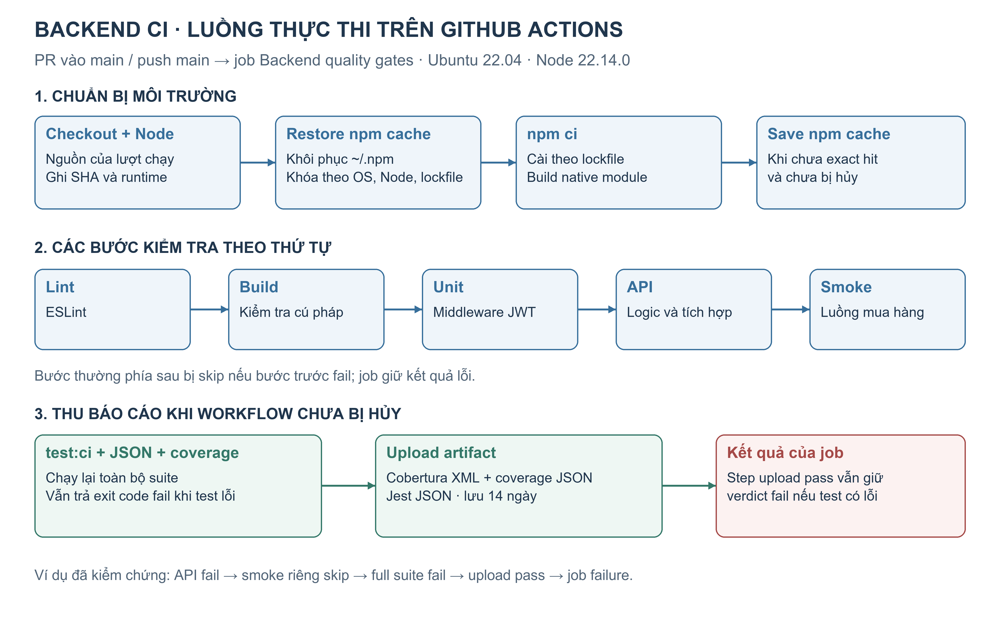

*Hình 7. Luồng thực thi của workflow `Backend CI`: kiểm tra theo thứ tự, sau đó thu báo cáo khi chưa bị hủy. Job vẫn fail nếu có bước kiểm thử fail, dù upload artifact thành công.*

**Phạm vi tái lập môi trường**

Việc ghi rõ phiên bản Node và nhãn hệ điều hành giúp thu hẹp khác biệt giữa các lượt chạy. Workflow cũng in phiên bản Node, npm, commit SHA và runner OS vào log để có thể kiểm tra lại môi trường thực tế. Tuy nhiên, nhãn `ubuntu-22.04` không cố định toàn bộ nội dung image theo thời gian; npm không được cài riêng bằng một phiên bản khóa trong workflow này. Khi đối chiếu các lượt chạy, vẫn cần đọc thông tin runtime đã ghi thay vì chỉ dựa vào tên runner.

Môi trường này khác baseline local B-04 sử dụng Windows và Node.js `24.14.0`. Do đó, kết quả local ở chương 4 là mốc đối chiếu hành vi bộ test, không được dùng thay số liệu thời gian hoặc coverage của một run GitHub Actions chưa được kiểm chứng.

### 5.2. Workflow và trigger

**Sự kiện kích hoạt**

Workflow khai báo hai sự kiện:

```yaml
on:
  pull_request:
    branches:
      - main
  push:
    branches:
      - main
```

Với `pull_request`, bộ lọc `branches` áp dụng cho nhánh đích của PR. Khi PR hướng vào `main` được mở hoặc cập nhật theo các hoạt động mặc định của sự kiện, workflow chạy để cung cấp phản hồi trước khi tích hợp. Với `push`, workflow kiểm tra thay đổi được đẩy vào chính nhánh `main`, bao gồm thay đổi sau khi merge PR.

Một lần push lên nhánh chức năng chưa có PR vào `main` không tự thỏa điều kiện `push` của cấu hình trên. Workflow cũng không đặt bộ lọc đường dẫn, nên PR hoặc push phù hợp có thể kích hoạt kiểm tra dù thay đổi nằm ngoài `backend`. Đây là phạm vi trigger hiện có, cần phân biệt với việc chỉ chạy CI khi mã backend thay đổi.

**Quản lý các lượt chạy chồng lấn**

Cấu hình concurrency sử dụng nhóm `backend-ci-${{ github.workflow }}-${{ github.ref }}` và bật `cancel-in-progress: true`. Khi có lượt mới trong cùng nhóm, lượt cũ đang chạy có thể bị hủy để tập trung tài nguyên vào phiên bản mới hơn. Các PR có ref khác nhau không bị gộp thành một nhóm duy nhất.

Một lượt bị hủy cần được đọc đúng trạng thái `cancelled`; không dùng nó làm bằng chứng test pass hoặc fail. Các bước xuất và upload báo cáo dùng điều kiện `!cancelled()`, nên báo cáo của lượt bị hủy không được bảo đảm sẽ hoàn tất. Khi thu bằng chứng, nhóm cần chọn một lượt đã chạy xong và ghi rõ commit, event, run ID cùng trạng thái cuối.

Repo còn có workflow `flaky-experiment.yml` chạy thủ công để phục vụ thí nghiệm ở chương 8. Workflow đó có runtime và phạm vi test riêng; các lượt thí nghiệm không được dùng thay minh chứng cho job `Backend quality gates` của chương này.

### 5.3. Các bước của pipeline

**Chuẩn bị nguồn và dependency**

Sau checkout, workflow thiết lập Node, khôi phục npm cache và ghi thông tin runtime. Bước cài đặt luôn gọi `npm ci` để cài dependency theo lockfile, kể cả khi cache được khôi phục. Harness và bộ test được chạy từ chính mã nguồn đã checkout trong workspace của job.

Dependency `sqlite3` có native binding nên việc cài đặt còn phụ thuộc khả năng tương thích với môi trường Linux. Tài liệu triển khai C-02 ghi nhận lỗi ban đầu `GLIBC_2.38 not found` khi nạp binary của module này. Workflow bổ sung biến `npm_config_build_from_source: "true"` ở bước `npm ci` để build native module từ source trên runner. Đây là biện pháp xử lý vấn đề môi trường; nó không sửa các assertion hay quy tắc nghiệp vụ của SUT.

**Các bước kiểm tra chất lượng**

*Bảng 14. Trình tự kiểm tra và thu báo cáo trong workflow*

| Step | Lệnh hoặc hành động | Cách thực thi |
| --- | --- | --- |
| Lint | `npm run lint` | Chạy sau khi các bước chuẩn bị trước đó thành công |
| Build and syntax check | `npm run build` | Chạy tiếp nếu các bước trước thành công; kiểm tra cú pháp backend |
| Unit tests | `npm run test:unit` | Kiểm tra riêng middleware xác thực |
| API tests | `npm run test:api` | Kiểm tra route, dữ liệu và quy tắc nghiệp vụ |
| Smoke tests | `npm run test:smoke` | Chạy riêng luồng mua hàng nếu các bước trước thành công |
| Generate coverage and Jest report | `npm run test:ci -- --json --outputFile=test-results/jest-report.json` | Được phép chạy sau lỗi ở bước trước, nếu workflow chưa bị hủy |
| Upload coverage and test report | Upload các đường dẫn báo cáo đã cấu hình | Được phép chạy sau lỗi, nếu workflow chưa bị hủy |

Các bước lint, build và test theo tầng sử dụng điều kiện thành công mặc định của GitHub Actions. Nếu một bước fail, các bước thông thường phía sau bị bỏ qua. Trong tình huống baseline, unit có thể pass còn API fail; khi đó step smoke riêng có trạng thái skipped. Trạng thái này chỉ cho biết step chưa chạy, không cho biết smoke test đã thất bại.

**Chạy đầy đủ suite để thu bằng chứng sau lỗi**

Hai step tạo báo cáo và upload khai báo điều kiện:

```yaml
if: ${{ !cancelled() }}
```

Điều kiện này cho phép tiếp tục thu bằng chứng dù bước kiểm tra trước đã fail. `test:ci` chạy lại toàn bộ suite thuộc cấu hình Jest thông thường, bao gồm unit, API, smoke và harness, đồng thời bật coverage. Vì vậy, smoke có thể bị bỏ qua ở step riêng nhưng vẫn được thực thi trong lượt full suite tạo báo cáo. Muốn biết kết quả của ca smoke trong tình huống này phải đọc log hoặc JSON của lượt full suite.

Cách tổ chức hiện tại có sự lặp lại: những nhóm test đã chạy ở step riêng sẽ chạy thêm một lần trong `test:ci`. Đổi lại, giao diện job chỉ rõ tầng nào làm chuỗi kiểm tra dừng, còn báo cáo cuối thu kết quả của đầy đủ suite trong một lượt có coverage. Khi phân tích thời gian, cần tính đến hai lần thực thi này thay vì coi tổng thời gian job là thời gian chạy một bộ 39 test duy nhất.

Workflow không sử dụng `continue-on-error` hoặc đổi exit code của test thành thành công. Nếu `test:ci` phát hiện assertion fail, step tạo báo cáo vẫn đỏ dù các file được sinh ra. Upload thành công cũng không xóa lỗi đã xảy ra hoặc biến verdict của job thành pass. Ngược lại, nếu dependency chưa cài được hoặc runner gặp sự cố, điều kiện tiếp tục chạy không bảo đảm Jest có thể thực thi và tạo đủ báo cáo; khi đó cần đọc lỗi ở bước chuẩn bị trước tiên.

### 5.4. Cache và artifact

**Thiết kế npm cache**

Workflow cache thư mục `~/.npm`, chứa dữ liệu npm có thể tái sử dụng khi cài dependency. Nó không cache `node_modules`, database hay kết quả test. Khóa cache gồm runner OS, phiên bản Node và hash của lockfile:

```yaml
key: ${{ runner.os }}-node-22.14.0-npm-${{ hashFiles('backend/package-lock.json') }}
restore-keys: |
  ${{ runner.os }}-node-22.14.0-npm-
```

Khi có cache khớp chính xác khóa, output `cache-hit` phản ánh exact hit. Nếu không có exact hit, `restore-keys` cho phép tìm cache theo tiền tố để tận dụng một phần dữ liệu đã tải. Vì vậy, `cache-hit` khác `true` chưa đủ để kết luận runner không khôi phục được dữ liệu nào; cần đọc cả log khóa được khôi phục. Trong mọi trường hợp, `npm ci` vẫn chịu trách nhiệm tạo dependency theo lockfile của mã nguồn đang kiểm tra.

Nhóm tách cache thành hai bước restore và save. Restore chạy trước cài đặt; save được đặt ngay sau cài đặt, trước các bước lint và test. Bước save dùng lại `cache-primary-key` từ restore và điều kiện `!cancelled() && steps.npm-cache.outputs.cache-hit != 'true'`. Thiết kế này cho phép lưu cache trước khi gặp các lỗi API đã biết của baseline, thay vì phụ thuộc việc toàn bộ job phải xanh. Tuy vậy, save thành công phải được xác nhận bằng log của chính step; sự có mặt của cấu hình chưa chứng minh một lượt đã lưu được cache hoặc lượt sau đã hit.

Để đánh giá hiệu quả, cần đối chiếu các lượt có cùng điều kiện phù hợp, ghi khóa cache, trạng thái khôi phục và thời gian từng bước. Với cấu hình này, một exact hit có thể giảm tải dữ liệu từ mạng nhưng không loại bỏ `npm ci` hoặc bước build native module. Chỉ nhìn một job chạy nhanh hơn chưa đủ để quy toàn bộ chênh lệch cho cache.

**Báo cáo được lưu dưới dạng artifact**

Artifact được đặt tên `backend-ci-reports-${{ github.run_id }}` và có thời hạn lưu cấu hình là 14 ngày. Mục đích là giữ kết quả của một lượt chạy để tải về, đối chiếu assertion và kiểm tra coverage, kể cả khi job fail.

*Bảng 15. Các file được khai báo upload trong workflow*

| File tính từ gốc repository | Nội dung và cách sử dụng |
| --- | --- |
| `backend/coverage/cobertura-coverage.xml` | Coverage ở định dạng XML để công cụ khác đọc và tổng hợp |
| `backend/coverage/coverage-summary.json` | Các bộ đếm và tỷ lệ statement, branch, function, line |
| `backend/test-results/jest-report.json` | Tổng số test, trạng thái từng ca và thông tin lỗi assertion |

Step upload dùng `if-no-files-found: error` để báo lỗi khi không tìm thấy file phù hợp trong các đường dẫn khai báo. Tùy chọn này không thay thế phép kiểm tra rằng từng file trong danh sách đều tồn tại, có nội dung hợp lệ và thuộc đúng lượt chạy. Ảnh step upload pass chỉ xác nhận action đã hoàn tất, chưa tự xác nhận đầy đủ nội dung bên trong artifact.

Trong cấu hình npm hiện tại, `test:ci` còn sinh JUnit XML, nhưng đường dẫn `backend/test-results/junit.xml` chưa được thêm vào danh sách upload của workflow GitHub Actions này. Console log được xem trên trang run của GitHub và cũng không nằm trong ba file artifact đã khai báo. Khi cần giữ bằng chứng lâu hơn thời hạn artifact, nhóm phải xuất và lưu riêng các file cần thiết kèm định danh run; không dùng cache làm nơi lưu báo cáo kiểm thử.

### 5.5. Status check và branch protection

**Kết quả kiểm tra trên pull request**

Job `Backend quality gates` cung cấp kết quả kiểm tra gắn với lượt chạy của PR. Người review có thể đi từ PR tới run, mở step bị lỗi và đối chiếu báo cáo. Các PR #19 và #20 được dùng để kiểm tra hai trạng thái failure và success; kết quả chi tiết được trình bày ở mục 5.7.

Với sự kiện `pull_request`, cần phân biệt commit đầu nhánh PR với commit merge mà runner thực sự checkout. Chẳng hạn, run #11 có head SHA `cbdcb885cc3974bea7f3b1749f28aa2f9a9bfd91`, nhưng log ghi `GITHUB_SHA` là `d450424190c213b85c314603b6830d3a7ac0b604`. Đây là hai định danh có vai trò khác nhau trong cùng lượt chạy, không phải bằng chứng dữ liệu bị trộn. Khi lưu minh chứng, nhóm giữ cả metadata run và SHA trong log để nhận diện đúng mã đã thực thi.

**Cấu hình bảo vệ nhánh được kiểm chứng**

Tại lần đọc cấu hình repository ngày 23/10/2026 (UTC+07:00), API GitHub xác nhận `main` đã có branch protection. Cấu hình yêu cầu một review chấp thuận, yêu cầu chấp thuận đối với lần push gần nhất theo quy tắc đã bật và áp dụng bảo vệ cả cho quản trị viên. Force push và xóa nhánh đều không được cho phép trong cấu hình trả về.

Tuy nhiên, hai danh sách `required_status_checks.contexts` và `required_status_checks.checks` đều rỗng; trường `strict` có giá trị `false`. API truy vấn các ruleset áp dụng cho `main` cũng trả danh sách rỗng. Như vậy, nhánh đã có bảo vệ ở khía cạnh review nhưng **chưa chọn một check CI cụ thể làm điều kiện bắt buộc** trong snapshot được kiểm tra.

Việc PR có check đỏ và việc GitHub bắt buộc check đó pass trước khi merge là hai điều kiện cần được xác minh riêng. Một PR đang bị chặn do thiếu review chưa chứng minh branch protection đang chặn vì CI fail. Với cấu hình quan sát được, báo cáo chưa kết luận đã hoàn tất yêu cầu “CI fail thì không được merge vào `main`”.

Để hoàn thiện cơ chế này, quy tắc bảo vệ cần chọn đúng check `Backend quality gates` do workflow phát ra và được kiểm chứng lại bằng PR fail/pass cùng trạng thái merge tương ứng. Bằng chứng cần thể hiện cả cấu hình required check và tác dụng của nó, thay vì chỉ chụp màu kết quả job. Phần kiểm chứng của chương này chỉ đọc cấu hình và chạy lại workflow, không thay đổi quy tắc bảo vệ hoặc merge các PR demo.

### 5.6. Coverage badge

**Mục đích và nguồn dữ liệu**

Coverage badge là cách đưa một chỉ số tổng hợp, chẳng hạn line coverage, lên trang giới thiệu dự án để người đọc nhanh chóng nhận biết mức độ thực thi mã của bộ test. Một badge có ý nghĩa cần lấy số liệu từ báo cáo đã xác định nguồn, kèm quy ước nhánh hoặc lượt chạy được đại diện. Việc upload coverage XML và JSON tạo đầu vào cho việc công bố chỉ số, nhưng chưa tự tạo badge trên README.

Tại mốc kiểm chứng, README trên nhánh `main` chưa có coverage badge và workflow `Backend CI` chưa có bước công bố hoặc cập nhật badge. Vì vậy, mục này ghi nhận **chưa triển khai coverage badge**, thay vì chèn một hình có phần trăm cố định rồi coi đó là kết quả tự động.

Nguồn phù hợp để triển khai tiếp là `coverage-summary.json` từ lượt full suite, với phạm vi đo `server.js` và `database.js`. Cần chọn rõ badge theo baseline trên `main` hay theo một nhánh khác. Run #11 trên SUT baseline có line coverage 61,48%, còn run xanh #12 của PR thay đổi SUT có 63,69%; không lấy số của nhánh demo thay cho trạng thái `main`. Khi được triển khai, badge cũng không thay thế verdict test hoặc required status check ở mục 5.5.

### 5.7. Kết quả

**Phương pháp thu và đối chiếu minh chứng**

Ngoài tài liệu C-01/C-02 đã có trong repo, nhóm kiểm tra trực tiếp các run, job, artifact và cấu hình bảo vệ nhánh qua GitHub API và GitHub CLI. Bằng chứng được lưu kèm báo cáo trong `report/assets/github-actions/evidence/`, gồm metadata, log, các file lấy từ artifact và snapshot cấu hình. Dữ liệu run được phân biệt theo run ID và attempt; lần chạy lại không được gộp thành một lần đo với lượt ban đầu.

Hai lượt PR đại diện được đối chiếu là run #11 của PR #19 và run #12 của PR #20. Sau đó, run #11 được chạy lại một lần để kiểm chứng cơ chế thực thi trên cùng phiên bản mã nguồn của run đó. Không tạo commit mới hoặc sửa assertion trong phép kiểm chứng này.

*Bảng 16. Kết quả thực tế của các lượt kiểm tra trên GitHub Actions*

| Nội dung | Run #11, attempt 1 | Run #11, attempt 2 — chạy lại | Run #12, attempt 1 |
| --- | --- | --- | --- |
| Run ID | `39818068371` | `39818068371` | `39820430997` |
| PR / nhánh nguồn | #19 / `testPR` | #19 / `testPR` | #20 / `testPR-Success` |
| Head SHA rút gọn | `cbdcb885` | `cbdcb885` | `7f76d840` |
| Lint / build / unit | Pass | Pass | Pass |
| API riêng | 20 pass, 10 fail | 20 pass, 10 fail | 30 pass, 0 fail |
| Step smoke riêng | Skipped sau API fail | Skipped sau API fail | Pass |
| Full suite tạo báo cáo | 29 pass, 10 fail, 0 skip | 29 pass, 10 fail, 0 skip | 39 pass, 0 fail, 0 skip |
| Upload artifact | Success | Success | Success |
| Kết quả job | Failure | Failure | Success |
| Thời gian job theo API | 90 giây | 65 giây | 66 giây |

Thời gian job trong bảng được tính từ `started_at` đến `completed_at` của chính job, gồm các bước chuẩn bị, cài đặt, kiểm tra và hoàn tất job; không dùng chênh lệch giữa thời điểm tạo và cập nhật workflow để thay thế. Các con số chưa phải phép đo hiệu năng có kiểm soát. Chẳng hạn, hai attempt của run #11 đều exact cache hit nhưng thời gian cài dependency lần lượt là 72 và 46 giây, nên không thể giải thích chênh lệch tổng thời gian chỉ bằng nhãn hit/miss.

**Kiểm chứng lượt fail và khả năng giữ báo cáo**

Artifact của run #11 xác nhận toàn bộ 39 ca được thực thi ở lượt `test:ci`; không có ca bị skip trong JSON tổng hợp. Mười ID fail ở attempt 2 trùng với attempt 1 và danh sách baseline ở chương 4. Step smoke riêng bị bỏ qua nhưng ca smoke vẫn được chạy trong full suite. Ba file đã khai báo upload đều được tải về và đọc được: Jest JSON, coverage summary và Cobertura XML.

Attempt 2 giữ kết quả job failure; step tạo coverage đỏ do test fail, còn upload success. Thời gian Jest của lượt full suite này là 1,449 giây, khác với 65 giây của toàn job. Kết quả này cho thấy luồng báo lỗi và lưu bằng chứng hoạt động trong tình huống assertion nghiệp vụ fail, không phải pipeline chỉ dừng trước khi bộ test được thực thi.

**Phân biệt run xanh với baseline**

Run #12 đạt 39/39 ca và các step đều pass, nhưng PR #20 có thay đổi nghiệp vụ trong `backend/server.js`: bộ đếm đăng nhập sai, phân quyền admin, gộp giỏ hàng, tính tổng checkout, xóa giỏ, điều kiện coupon và chuyển trạng thái đơn. Diff PR không thay đổi các file test. Vì vậy, run xanh thể hiện phản hồi CI trên **một phiên bản SUT khác**, không chứng minh SUT baseline ban đầu đã đạt toàn bộ test.

Trong phạm vi báo cáo giữ nguyên SUT để kiểm thử, baseline 29 pass/10 fail vẫn được dùng cho các đối chiếu tương ứng. PR demo xanh được ghi riêng để giải thích nguồn gốc kết quả; không xem các thay đổi SUT đó là phần sửa lỗi do harness hay cấu hình CI mang lại. Tại thời điểm kiểm chứng, PR #20 chưa được merge.

**Kết quả kiểm chứng cache**

Log run #8 cho thấy runner không tìm thấy exact key đang yêu cầu, nhưng khôi phục được cache theo `restore-keys`, sau đó lưu cache dưới khóa mới. Các run #11 và #12 sử dụng exact key mới này. Đây là bằng chứng về partial restore và exact hit; chưa có lượt cache hoàn toàn rỗng trong tập được đối chiếu dưới đây.

*Bảng 17. Trạng thái cache và thời gian cài dependency được quan sát*

| Lượt chạy | Kết quả restore | Kết quả save | Thời gian `Install dependencies` |
| --- | --- | --- | ---: |
| #8, attempt 1 | Partial restore: khóa cũ có hash bắt đầu `7c08e1ce` | Lưu khóa mới có hash bắt đầu `6bd926b1` | 78 giây |
| #11, attempt 1 | Exact hit khóa có hash bắt đầu `6bd926b1` | Skipped vì đã exact hit | 72 giây |
| #11, attempt 2 | Exact hit cùng khóa | Skipped vì đã exact hit | 46 giây |
| #12, attempt 1 | Exact hit cùng khóa | Skipped vì đã exact hit | 47 giây |

Tiền tố chung của các khóa là `Linux-node-22.14.0-npm-`. Bảng cho thấy cơ chế restore/save đã hoạt động và cache có thể được dùng lại khi test fail. Tuy nhiên, các lượt khác nhau về commit, thời điểm và điều kiện runner; run #8 còn khôi phục một phần dữ liệu. Do đó, chưa dùng bảng này để công bố tỷ lệ tăng tốc giữa cache rỗng và cache hit.

**Coverage và trạng thái các hạng mục**

*Bảng 18. Coverage lấy từ artifact của hai phiên bản SUT trên GitHub Actions*

| Tiêu chí | Run #11 — SUT baseline | Run #12 — SUT thay đổi ở PR #20 |
| --- | --- | --- |
| Statement | 57,98% — 178/307 | 60,24% — 200/332 |
| Branch | 39,09% — 52/133 | 41,93% — 65/155 |
| Function | 39,72% — 29/73 | 44,44% — 36/81 |
| Line | 61,48% — 174/283 | 63,69% — 193/303 |

Coverage của attempt 2 run #11 giữ các tỷ lệ baseline. Run #12 có cả tử số và mẫu số khác vì mã SUT đã thay đổi; chênh lệch không được diễn giải như việc chạy trên GitHub Actions tự làm tăng chất lượng bộ test. Workflow hiện thu coverage để quan sát, chưa có ngưỡng coverage được đặt làm điều kiện pass.

Kết quả kiểm chứng xác nhận workflow chạy trên PR, các bước kiểm tra giữ exit code thật, cache được khôi phục/lưu và artifact vẫn được cung cấp khi test fail. Những phần còn cần hoàn thiện là chọn required CI check trong branch protection, kiểm chứng tác dụng chặn merge của check đó và triển khai coverage badge. Phần thực nghiệm này chưa sửa các cấu hình còn thiếu; báo cáo ghi nhận đúng trạng thái đã quan sát.

Nguồn và các lệnh thu dữ liệu được tổng hợp tại [minh chứng GitHub Actions](assets/github-actions/evidence/README.md). Các snapshot được lưu để kết quả vẫn có thể đối chiếu khi artifact trên GitHub hết hạn.

## 6. Triển khai pipeline trên Jenkins

### 6.1. Kiến trúc và thành phần

**Vai trò của Jenkins trong thực nghiệm**

Jenkins được triển khai làm nền tảng CI đối chiếu với GitHub Actions. Nhóm sử dụng lại backend EShop, harness và các npm script đã chuẩn hóa, đồng thời tự chuẩn bị môi trường điều phối, agent và cơ chế công bố báo cáo. Mục tiêu là kiểm tra khả năng thực thi bộ test, giữ đúng trạng thái lỗi và cung cấp bằng chứng có thể truy vết trên một mô hình CI do nhóm quản lý.

Hệ thống gồm repository GitHub, Jenkins controller và agent riêng. Repository chứa mã nguồn, bộ test và `Jenkinsfile`. Controller quản lý job, đọc định nghĩa pipeline, phân công công việc và lưu kết quả. Agent nhận các bước thực thi, checkout mã nguồn, chạy lệnh npm và tạo các file báo cáo. Pipeline chọn agent bằng label `eshop-node`; tên node trong môi trường triển khai là `eshop-agent`.

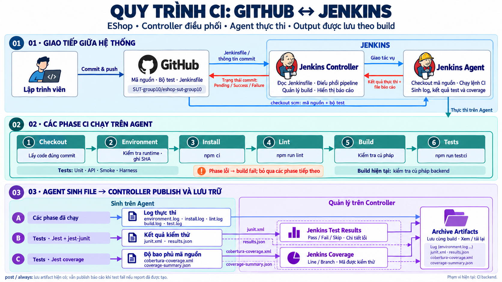

*Hình 8. Mô hình Jenkins của nhóm: controller điều phối, agent thực thi sáu stage; các báo cáo và artifact được gắn với từng build. Sơ đồ được dùng chung với tài liệu hướng dẫn Jenkins.*

**Tổ chức job và kết nối GitHub**

Job `eshop-ci` được tạo theo loại Multibranch Pipeline. Branch Source trỏ tới repository của nhóm; Jenkins quét các nhánh có `Jenkinsfile` để tạo job con tương ứng. Lượt baseline trong chương này thuộc job con của nhánh `cicd/jenkins`. Cách tổ chức này cho phép định nghĩa pipeline đi cùng phiên bản mã nguồn của nhánh, thay vì duy trì toàn bộ các lệnh kiểm tra bằng thao tác cấu hình thủ công trên giao diện.

Trong quy trình đã tài liệu hóa, nhóm dùng Scan Multibranch Pipeline để phát hiện nhánh và Build Now để chạy job con. Webhook là chiều GitHub thông báo thay đổi tới Jenkins khi muốn tự động kích hoạt; commit status là chiều Jenkins gửi kết quả về GitHub. Hai cơ chế này có mục đích và quyền truy cập riêng. Việc một build đã gửi status thành công không tự chứng minh webhook đã được cấu hình hoặc push luôn tự kích hoạt build.

Agent kết nối tới controller qua WebSocket bằng tên node và agent secret. Credential truy cập GitHub được quản lý trong Jenkins và gắn vào Branch Source; nó khác với secret kết nối agent. Các giá trị bí mật không nằm trong `Jenkinsfile` hoặc nội dung báo cáo. Cấu hình node trong hướng dẫn triển khai dùng một executor cho agent và đặt số executor của Built-In Node về 0 để công việc kiểm tra chạy trên agent riêng.

### 6.2. Môi trường triển khai

**Controller và agent bằng Docker Compose**

Hạ tầng được khai báo trong `infra/jenkins/compose.yaml`, `compose.agent.yaml` và `agent.Dockerfile`. Controller dùng image Jenkins có JDK 21; agent được build từ image inbound agent, bổ sung Node/npm, Git và các công cụ cần cho native module như Python, Make và G++. Controller được ánh xạ tới `127.0.0.1:8080` trên máy chạy Docker; agent sử dụng địa chỉ nội bộ `http://controller:8080/` để kết nối.

*Bảng 19. Môi trường được ghi nhận cho thực nghiệm Jenkins*

| Thành phần | Phiên bản hoặc cấu hình |
| --- | --- |
| Máy chủ triển khai | Windows, Docker Desktop với Linux engine |
| Jenkins controller | `jenkins/jenkins:2.580.1-jdk21`, image được chỉ định kèm SHA-256 digest |
| Agent base | `jenkins/inbound-agent`, JDK 21, image được chỉ định kèm digest |
| Node / npm trên agent | `v24.14.0` / `11.9.0` |
| Git trên agent | `2.47.3` tại build baseline |
| Hệ điều hành thực thi test | Debian GNU/Linux 13 (trixie), container Linux |
| Node / label | `eshop-agent` / `eshop-node` |
| Workspace và cache | `/home/jenkins/agent` và `/home/jenkins/.npm` |

Máy chủ là Windows nhưng các lệnh của pipeline chạy trong agent Linux. Đây là lý do `Jenkinsfile` sử dụng `sh` và Bash, không sử dụng PowerShell cho các bước npm. Phiên bản hệ điều hành và runtime trong Bảng 19 được đối chiếu với `environment.log` của build, không suy ra từ hệ điều hành máy cá nhân.

Digest giúp cố định image nguồn; Dockerfile lấy Node/npm từ image Node `24.14.0` đã chỉ định. Tuy nhiên, lệnh cài Git và công cụ hệ thống qua apt không khóa riêng phiên bản từng package. Vì vậy, nhóm ghi nhận Git thực tế của build và kiểm tra Node ngay trong pipeline, thay vì khẳng định mọi lần build lại image đều có toàn bộ package giống hệt nhau.

**Plugin phục vụ pipeline và báo cáo**

*Bảng 20. Các plugin và chức năng được sử dụng*

| Plugin | Vai trò trong triển khai |
| --- | --- |
| Pipeline (`workflow-aggregator`) | Cung cấp khả năng chạy pipeline khai báo trong `Jenkinsfile` |
| Git (`git`) | Checkout mã nguồn vào workspace |
| GitHub Branch Source (`github-branch-source`) | Phát hiện nhánh, tổ chức Multibranch Pipeline và tích hợp GitHub |
| JUnit (`junit`) | Đọc JUnit XML để hiển thị kết quả và lỗi từng test |
| Coverage (`coverage`) | Đọc Cobertura XML, tổng hợp coverage và hiển thị mã nguồn |
| Timestamper (`timestamper`) | Gắn timestamp vào console log |
| Pipeline Graph View / Pipeline: Stage View | Xem luồng stage hoặc bảng kết quả theo build |

Danh sách phiên bản plugin tại thời điểm dựng môi trường được lưu trong minh chứng D-01; Stage View được cài bổ sung để có bảng các stage như Hình 9. Việc cài plugin chỉ cung cấp khả năng hiển thị: pipeline vẫn phải gọi publisher và có file báo cáo hợp lệ thì build mới có trang Tests hoặc Coverage.

Các Docker volume tách dữ liệu controller, workspace agent và npm cache. Nhờ đó, việc dừng rồi khởi động lại container có thể giữ cấu hình và dữ liệu đã lưu. Log kiểm chứng D-01 ghi nhận agent kết nối lại sau thao tác stop/start. Đây là kết quả của phép kiểm tra khởi động lại đã lưu, chưa phải bằng chứng về cơ chế dự phòng hoặc khả năng tự phục hồi trong mọi sự cố hạ tầng.

### 6.3. Thiết kế pipeline

**Sáu stage nối tiếp**

Pipeline được viết bằng Declarative Pipeline trong `Jenkinsfile`, sử dụng một agent cho toàn bộ lượt chạy. Nhóm tắt checkout mặc định bằng `skipDefaultCheckout(true)` và thực hiện checkout tại stage riêng để kiểm soát việc làm sạch workspace.

*Bảng 21. Các stage trong Jenkinsfile*

| Stage | Lệnh hoặc hành vi chính | Mục đích |
| --- | --- | --- |
| Checkout | `deleteDir()`, `checkout scm` | Xóa nội dung workspace rồi lấy mã của phiên bản cần build |
| Environment | Ghi commit, nhánh, Node, npm, Git, OS, kernel và đường dẫn cache | Nhận diện môi trường; dừng nếu Node khác `v24.14.0` |
| Install | `npm ci --no-audit --no-fund` trong `backend` | Cài dependency theo lockfile |
| Lint | `npm run lint` | Kiểm tra mã bằng ESLint với cấu hình của dự án |
| Build | `npm run build` | Kiểm tra cú pháp backend bằng Node |
| Tests | `npm run test:ci -- --json --outputFile=test-results/results.json` | Chạy đầy đủ unit, API, smoke, harness và thu báo cáo |

Việc làm sạch workspace loại bỏ dependency và báo cáo còn lại từ build trước trong thư mục làm việc. npm cache nằm ở volume riêng nên vẫn có thể được dùng khi cài đặt. Hai cơ chế này giải quyết hai nhu cầu khác nhau: tránh đọc nhầm đầu ra cũ và tận dụng dữ liệu tải dependency đã có.

Các stage chạy tuần tự; một lệnh thất bại làm stage tương ứng fail và các stage thông thường phía sau bị bỏ qua. Jenkinsfile hiện gom toàn bộ test vào một stage `Tests`, khác với cách GitHub Actions chạy riêng từng tầng rồi chạy thêm full suite để thu coverage. Trong Jenkins, tên ca và nhóm test được xem qua console, Jest JSON hoặc JUnit report; không có ba stage unit/API/smoke riêng.

**Giữ trạng thái lỗi khi lưu log**

Các lệnh npm chuyển cả stdout và stderr qua `tee` để vừa hiện console vừa lưu file. Ví dụ, stage Tests sử dụng:

```sh
set -euo pipefail
npm run test:ci -- --json --outputFile="$LOG_DIR/results.json" 2>&1 | tee "$LOG_DIR/test.log"
```

Nếu chỉ xét exit code của `tee`, lỗi của lệnh test có thể không được truyền đúng ra shell. Tùy chọn `pipefail` làm pipeline lệnh trả trạng thái lỗi khi một lệnh trong chuỗi thất bại; kết hợp với cách `sh` xử lý exit code, Jenkins ghi nhận Tests fail khi Jest fail. Nhóm không thêm `|| true`, `forceExit` hoặc đổi expected result để làm build xanh.

**Kiểm soát thực thi và lưu lịch sử**

`disableConcurrentBuilds()` xếp các build của cùng job chờ nhau thay vì cho chạy chồng lấn; nó không có nghĩa hủy build cũ khi có build mới. Trong Multibranch Pipeline, tùy chọn này áp dụng cho job nhánh tương ứng, không phải một khóa chung cho mọi nhánh. Môi trường agent còn giới hạn số executor theo cấu hình node.

Pipeline đặt timeout 20 phút và bật timestamp. Với agent khai báo ở cấp pipeline, thời gian chờ được cấp agent không nằm trong timeout thực thi này; một job chờ agent Offline cần được chẩn đoán riêng. Chính sách lưu giữ cấu hình tối đa 20 build và artifact của tối đa 10 build gần nhất. Các giới hạn này là cấu hình vận hành, không được dùng thay thời gian đo của một build cụ thể.

### 6.4. Báo cáo, artifact và cache

**Công bố báo cáo sau khi test thất bại**

Jest tạo kết quả JSON và coverage; reporter `jest-junit` tạo `test-results/junit.xml`. Khối `post { always }` của stage Tests gọi `junit` và `recordCoverage` sau phần thực thi, kể cả khi lệnh test fail. Nhờ đó, người xem có thể mở trang Tests để xem từng assertion, hoặc trang Coverage để xem các vùng mã đã và chưa được thực thi.

Cấu hình `junit` dùng `allowEmptyResults: false`, nên thiếu báo cáo không bị coi là một lượt kiểm thử hợp lệ không có test. `recordCoverage` đọc `coverage/cobertura-coverage.xml`, bật `enabledForFailure: true` và `failOnError: true` để tiếp tục công bố coverage cho build failure, đồng thời báo lỗi khi xử lý báo cáo gặp vấn đề. Lời gọi Coverage đặt trong `finally` của khối xử lý JUnit, nên vẫn được thử nếu bước công bố JUnit phát sinh lỗi.

Các publisher không thay thế việc chạy test và không làm một lệnh test lỗi trở thành thành công. Nếu build thất bại ở Install hoặc Lint trước khi vào Tests, không thể giả định sẽ có báo cáo test mới. Ngay cả khi Tests đã bắt đầu, file XML vẫn phải được sinh đầy đủ và workspace phải còn truy cập được để publisher xử lý thành công.

**Lưu file để truy vết**

Khối `post { always }` của toàn pipeline gọi `archiveArtifacts` để giữ các file hiện có thuộc những đường dẫn đã cấu hình. Bên cạnh giao diện báo cáo, bản lưu này cho phép kiểm tra lại dữ liệu gốc và phân biệt lỗi test với lỗi publisher.

*Bảng 22. Đầu ra được lưu hoặc công bố trong build Jenkins*

| Đầu ra trong `backend/` | Nội dung và vai trò |
| --- | --- |
| `test-results/environment.log` | Commit, nhánh và môi trường thực thi |
| `test-results/install.log`, `lint.log`, `build.log`, `test.log` | Log các bước đã thực thi |
| `test-results/results.json` | Trạng thái từng ca, thông báo assertion và kết quả tổng hợp của Jest |
| `test-results/junit.xml` | Nguồn cho trang Tests của Jenkins |
| `coverage/cobertura-coverage.xml` | Nguồn cho Coverage plugin |
| `coverage/coverage-summary.json` | Bộ đếm coverage do Jest xuất để đối chiếu số liệu |

Archive bật `fingerprint: true` và `allowEmptyArchive: true`. Fingerprint hỗ trợ theo dõi file trong Jenkins; tùy chọn cho phép archive rỗng giúp bước lưu file không tự gây thêm lỗi khi pipeline chưa tạo được đầu ra. Vì vậy, archive success không đủ để khẳng định có đầy đủ báo cáo: cần kiểm tra danh sách artifact và trạng thái publisher của chính build.

Hai publisher JUnit/Coverage đặt `skipPublishingChecks: true`, nên báo cáo của chúng được gắn vào Jenkins, không tự phát hành các checks tương ứng lên GitHub. Cơ chế gửi commit status của tích hợp GitHub là phần riêng; build #4 có log xác nhận đã thông báo kết quả commit. Việc có status này cũng chưa xác nhận nó đã được chọn làm required check trong branch protection.

**Cache qua Docker volume**

Agent đặt npm cache ở `/home/jenkins/.npm` và mount volume `npm-cache` vào đường dẫn này. Mỗi build vẫn thực hiện `npm ci` trong workspace đã làm sạch; dữ liệu cache có thể được giữ lại qua các lần chạy và stop/start container. Cache không chứa verdict test hoặc thay cho artifact.

Khác với khóa cache và log restore của GitHub Actions, bằng chứng Jenkins hiện ghi nhận đường dẫn cùng volume tồn tại nhưng chưa đo hoặc xác nhận hit/miss ở từng build. Do đó, báo cáo không gọi build #4 là cache hit và không tính tỷ lệ tăng tốc từ cache. Muốn đánh giá tiếp cần thiết kế lượt đo có và không có dữ liệu cache, giữ các điều kiện còn lại phù hợp và lưu thời gian cài đặt tương ứng.

### 6.5. Kết quả

**Build được chọn làm mốc**

Kết quả trong chương này lấy từ **build #4 của job `eshop-ci`, nhánh `cicd/jenkins`**, chạy ngày 16/10/2026 lúc 20:04:38,633 (UTC+07:00), tại commit `a559c53acb9a3b03cc05fca8a855bcc59c8eaae8`. Đây là lượt đã hoàn tất và có console, JSON, XML cùng metadata được lưu; các số liệu không phải kết quả của một lần chạy Jenkins mới khi biên soạn chương này.

*Bảng 23. Kết quả thực thi Jenkins build #4*

| Thành phần | Kết quả đã ghi nhận |
| --- | --- |
| Checkout | Pass, đúng commit được chọn |
| Environment / Install / Lint / Build | Pass |
| Tests | Fail; 39 ca trong 6 suite: 29 pass, 10 fail, 0 skip |
| Nhóm test | Unit 5/5 pass; API 20/30 pass; smoke 1/1 pass; harness 3/3 pass |
| Công bố báo cáo | JUnit và Coverage được xử lý thành công |
| Artifact | Có log và các báo cáo đã xuất của cùng build |
| Verdict cuối | `FAILURE`, console ghi `script returned exit code 1` |
| Thời gian build theo metadata Jenkins | 17,600 giây |
| Thời gian Jest trong console | 1,960 giây |


*Hình 9. Stage View hiển thị các build #1–#4. Hàng #4 có các stage trước Tests thành công, Tests thất bại và Post Actions thành công; số liệu của chương được lấy riêng từ build #4.*

Thời gian build bao gồm các công việc của lượt pipeline, còn thời gian Jest chỉ mô tả lần thực thi bộ test. Hai đại lượng không được dùng thay nhau. Một build đơn lẻ trên agent đã chuẩn bị sẵn cũng chưa đủ để kết luận Jenkins nhanh hơn một nền tảng khác có runtime, runner hoặc trạng thái cache khác.

**Đối chiếu kết quả test với baseline**

Jest JSON và JUnit XML cùng ghi nhận 39 ca, 10 lỗi assertion và không có test skip. Danh sách mười ID fail trùng với baseline local B-04 ở chương 4. Đối chiếu Git giữa commit B-04 và commit build #4 cho thấy `server.js`, `database.js`, các file test thực thi, helper và cấu hình Jest không thay đổi; khác biệt liên quan gồm việc bổ sung reporter và cấu hình CI.


*Hình 10. Trang Tests của build #4 hiển thị tổng 39 ca, 29 pass và 10 fail, cho phép đi từ tên ca tới chi tiết assertion.*

Các dữ liệu này cho thấy bộ test đã chạy được trên agent và tiếp tục phát hiện những hành vi chưa đáp ứng đặc tả. Kết luận không dựa riêng vào màu đỏ của build. Khi đọc một build mới, vẫn cần đối chiếu từng ID, thông báo lỗi và stage; cùng tổng số fail chưa đủ để khẳng định đó là cùng tập lỗi đã biết.

**Coverage và sự khác nhau giữa nguồn số liệu**

*Bảng 24. Coverage của build #4 và nguồn dùng để đọc kết quả*

| Tiêu chí | Jest `coverage-summary.json` | Coverage plugin đọc Cobertura |
| --- | --- | --- |
| Statement | 57,98% — 178/307 | Không dùng làm số đối chiếu ở đây |
| Function / Method | Function: 39,72% — 29/73 | Method: 39,73% — 29/73 |
| Branch | 39,09% — 52/133 | 41,74% — 48/115 |
| Line | 61,48% — 174/283 | 61,48% — 174/283 |

Line coverage của hai nguồn trùng nhau. Ở function/method, tỷ lệ hiển thị có khác biệt làm tròn; ở branch, cả bộ đếm và mẫu số đều khác, không chỉ là khác biệt cách viết phần trăm. Bằng chứng hiện có chưa xác định đầy đủ nguyên nhân chênh lệch branch, nên báo cáo giữ riêng từng nguồn và dùng số do Jest xuất khi đối chiếu với baseline hoặc GitHub Actions.

Console của Coverage plugin ghi không có quality gate coverage được đặt. Build #4 fail do exit code của test, không phải vì một ngưỡng phần trăm coverage. Coverage 61,48% cũng không có nghĩa 61,48% yêu cầu nghiệp vụ đã đúng. Các nhận xét so sánh môi trường, thời gian và công sức vận hành được tiếp tục ở chương 7 trên cơ sở các điều kiện đo đã nêu.

Minh chứng được sao chép từ repository mã nguồn và lưu kèm tại [bộ dữ liệu Jenkins build #4](assets/jenkins/evidence/README.md). Định danh bền vững là job, nhánh, số build, SHA và các file đã lưu; URL `localhost` hoặc địa chỉ tunnel tạm thời không phải liên kết mà mọi người đọc đều có thể truy cập.

### 6.6. Minh họa chẩn đoán lỗi

**Trường hợp được chọn: tổng tiền checkout**

Nhóm chọn `A-CHECKOUT-02` để minh họa cách đi từ trạng thái build tới nguyên nhân nghiệp vụ. Yêu cầu FR-08 quy định backend phải tính tổng tiền từ sản phẩm và số lượng, không tin trực tiếp giá trị tổng tiền do client gửi. Ca test thêm sản phẩm fixture có đơn giá 30.000.000 đồng với số lượng 2, gọi `POST /api/checkout` và cố ý gửi `total_amount: 1`.

Test trước tiên xác nhận request trả HTTP 200, sau đó đọc đơn vừa tạo trong database theo `orderId`. Assertion kiểm tra `order.total_amount` phải bằng `product.price * 2`, tức 60.000.000 đồng. Console build #4 ghi:

```text
A-CHECKOUT-02 computes the total instead of trusting the client (FR-08)
Expected: 60000000
Received: 1
```

**Từ bằng chứng tới nguyên nhân**

Bước đầu là xác định lỗi nằm ở stage Tests. Checkout, Environment, Install, Lint và Build đã pass trong lượt này; JSON có kết quả đầy đủ của ca test. Những quan sát đó giúp tập trung vào assertion đang fail, thay vì xử lý như trường hợp runner chưa cài được dependency hoặc Jest chưa khởi chạy. Chúng chưa tự loại trừ mọi khả năng lỗi fixture, nên vẫn cần đọc đầu vào và thao tác kiểm tra.

Tiếp theo, chi tiết assertion trong console/JSON trỏ tới `tests/api/cart-orders.test.js:58:32`. Đối chiếu test cho thấy expected được tính từ giá sản phẩm và số lượng chuẩn bị trong fixture, không lấy từ công thức mà endpoint trả về. Dữ liệu `Received: 1` là tổng tiền đã được lưu trong đơn, sau khi API báo checkout thành công.

Cuối cùng, đọc route `POST /api/checkout` ở đúng commit build #4 cho thấy server lấy `total_amount` từ `req.body` rồi truyền trực tiếp giá trị này vào câu lệnh `INSERT INTO orders`. Đường xử lý đó không tính lại tổng từ giá sản phẩm và giỏ hàng. Sự tương ứng giữa đầu vào 1 đồng, bản ghi nhận 1 đồng và mã nguồn ở cùng SHA hỗ trợ kết luận rằng endpoint đang tin tổng tiền của client, trái yêu cầu FR-08.

**Kết luận và giới hạn của phép chẩn đoán**

Trong trường hợp này, assertion fail phản ánh sai lệch nghiệp vụ của SUT baseline. Hướng sửa ở phía sản phẩm là tính tổng tiền bằng dữ liệu giá và số lượng được backend kiểm soát; việc đổi expected thành 1 đồng sẽ làm mất khả năng phát hiện lỗi. Theo phạm vi giữ nguyên SUT của thực nghiệm, nhóm ghi nhận nguyên nhân và giữ ca test để tiếp tục quan sát qua CI.

Chuỗi chẩn đoán thể hiện giá trị của việc lưu đủ commit, trạng thái stage, request, assertion và dữ liệu đầu ra. Chỉ nhìn `FAILURE` chưa đủ xác định nguyên nhân; ngược lại, việc có JSON/XML giúp người đọc đi tới một kết luận có thể kiểm tra lại. Kết luận của ca này cũng không thay thế phân tích riêng cho chín ca fail còn lại hoặc cho các lỗi xuất hiện trên phiên bản SUT khác.

## 7. So sánh GitHub Actions và Jenkins

### 7.1. Điều kiện đo

Nhóm đối chiếu GitHub Actions run #11, attempt 2 của PR #19 (head SHA `cbdcb885`) với Jenkins build #4 (commit `a559c53`). Hai lượt sử dụng SUT baseline và bộ 39 test, giữ nguyên các assertion nghiệp vụ. Run xanh của PR #20 được trình bày riêng ở chương 5 vì đã thay đổi SUT.

Môi trường chưa hoàn toàn đồng nhất: GitHub Actions dùng Ubuntu 22.04, Node 22.14.0, npm 10.9.2; Jenkins dùng agent Debian trong Docker, Node 24.14.0, npm 11.9.0. GitHub Actions chạy test theo tầng rồi chạy lại full suite; Jenkins chạy full suite một lần. Vì vậy, số liệu thời gian chỉ mô tả các lượt đã quan sát.

### 7.2. Kết quả đo

*Bảng 25. Đối chiếu kết quả hai lượt CI trên SUT baseline*

| Tiêu chí | GitHub Actions | Jenkins |
| --- | --- | --- |
| Kết quả full suite | 39 test: 29 pass, 10 fail, 0 skip | 39 test: 29 pass, 10 fail, 0 skip |
| Verdict job/build | Failure | FAILURE |
| Line coverage theo Jest | 61,48% (174/283) | 61,48% (174/283) |
| Thời gian full suite theo Jest | 1,449 giây | 1,960 giây |
| Thời gian toàn job/build | 65 giây | 17,600 giây |
| Cache trong lượt đối chiếu | Đã xác nhận exact hit | Có volume npm cache, chưa xác nhận hit/miss |
| Lưu báo cáo khi test fail | Upload artifact thành công | Publish JUnit, Coverage và archive thành công |

Danh sách mười ID fail trùng nhau cho thấy hai lượt ghi nhận cùng các sai lệch baseline. Chênh lệch thời gian chưa đủ để kết luận nền tảng nào nhanh hơn do khác môi trường, cách tổ chức bước và điều kiện cache.

### 7.3. So sánh cấu hình và vận hành

GitHub Actions dùng YAML trong `.github/workflows`, tích hợp sự kiện PR/push và kết quả kiểm tra ngay trên GitHub. Với hosted runner, nhóm tập trung vào workflow, dependency và artifact. Jenkins dùng `Jenkinsfile`; nhóm cần dựng controller, kết nối agent và quản lý plugin, volume cùng credential. Đổi lại, cấu hình hiện có cung cấp trang Tests và Coverage để đi từ kết quả tổng hợp tới từng assertion hoặc vùng mã nguồn. GitHub Actions hiện lưu các báo cáo JSON/XML qua artifact.

### 7.4. Nhận xét

GitHub Actions phù hợp làm CI chính của EShop nhờ gắn trực tiếp với quy trình PR trên GitHub. Jenkins là nền tảng đối chiếu giúp nhóm thực hành quản lý môi trường và công bố báo cáo. Cả hai đều giữ verdict fail và cung cấp dữ liệu chẩn đoán khi SUT không đáp ứng yêu cầu. Đánh giá hiện giới hạn ở các lượt đã chọn; cần thêm phép đo có kiểm soát nếu muốn so sánh hiệu năng hoặc hiệu quả cache.

## 8. Thí nghiệm flaky test

### 8.1. Thiết kế flaky test

**Mục tiêu và vị trí trong hệ thống kiểm thử**

Nhóm chủ động tạo một lỗi đồng bộ trong API test để quan sát sự biến thiên kết quả và cách retry ảnh hưởng đến tín hiệu CI. Phiên bản hiện hành là **order history v2**, kiểm tra đơn vừa đặt có xuất hiện trong lịch sử tài khoản hay không. Test sử dụng API EShop thật qua Supertest, Jest và helper `createHarness()` của chương 4. Mỗi attempt tạo application instance và SQLite `:memory:` riêng, đăng nhập người dùng fixture, thêm sản phẩm vào giỏ và xác nhận ban đầu chưa có đơn hàng.

Đây là một test trong `order-history.case.js`, được chọn riêng bằng `jest.flaky.config.cjs`; suite unit/API/smoke thông thường chỉ chọn `*.test.js`. Workflow `Flaky experiment (manual only)` chỉ nhận `workflow_dispatch`, tách khỏi các quality gate chính ở chương 5 và 6. AI được sử dụng sau khi thu log; không có bước AI tự quyết định pass/fail hoặc tự sửa mã trong workflow.

Đợt cart v1 được giữ tại [hồ sơ lịch sử v1 (ZIP)](assets/flaky/cart-v1-archive.zip). V1 gồm 10 dispatch không retry và xác nhận bản sửa local; các kết quả đó không được cộng vào mẫu v2 hoặc dùng thay bằng chứng retry trong chương này.

**Cơ chế tạo sự biến thiên**

Test khởi phát `POST /api/checkout` qua một Express gateway kiểm thử. Gateway ghi nhận request, chờ độ trễ được chọn rồi chuyển POST tới app EShop; GET không chịu bước chờ này. Độ trễ sampled là số nguyên trong khoảng **20–220 ms**, sinh theo seed của batch được lưu cho người tổ chức. Gateway không giả response, trạng thái database hoặc kết quả assertion. Như vậy, nhóm điều khiển thời gian chuyển request trong môi trường thử nghiệm, không kết luận backend thực tế có lỗi mạng tương ứng.

Ở chế độ `timed`, test đợi cố định **120 ms** sau khi khởi phát POST rồi gửi `GET /api/orders/my-orders`, chưa phụ thuộc POST hoàn tất. `await sleep(...)` chỉ tạm dừng phần tiếp theo của test; nó không bảo đảm thao tác đặt hàng đã kết thúc và không khóa toàn bộ tiến trình Node.js. Nếu GET đọc trước khi đơn được tạo, snapshot có thể rỗng dù request trả HTTP 200.

*Bảng 26. Các thành phần của test order history v2*

| Thành phần | Thiết kế |
| --- | --- |
| Điều kiện ban đầu | App và database mới mỗi attempt; người dùng đã xác thực, có sản phẩm trong giỏ, chưa có đơn |
| Thao tác ghi | POST checkout thật; gateway làm biến thiên thời gian chuyển POST, sampled 20–220 ms |
| Lần đọc được đánh giá | Chế độ `timed` đợi 120 ms rồi gửi GET history, giữ nguyên snapshot nhận được |
| Lần đọc xác minh | Sau khi đợi POST hoàn tất, gửi GET `confirmation` trên cùng fixture |
| Oracle | POST/GET trả 200; history có đúng một đơn với ID, owner, tổng tiền và trạng thái mong đợi; confirmation xác nhận đúng đơn |
| Failure mục tiêu | `HISTORY_ORDER_COUNT`, expected 1, actual 0; lỗi setup/HTTP/transport/cleanup được phân loại riêng |
| Cleanup | Đợi request còn lại, đóng harness kể cả khi assertion fail; retry tạo fixture mới |

Confirmation giúp phân biệt snapshot được lấy quá sớm với trạng thái sau khi POST hoàn tất. Kết quả confirmation không thay thế history ban đầu để làm assertion pass. HTTP status, thời điểm client/server, request ID, snapshot và assertion được giữ theo từng attempt; không random trực tiếp verdict hoặc đổi expected theo độ trễ.

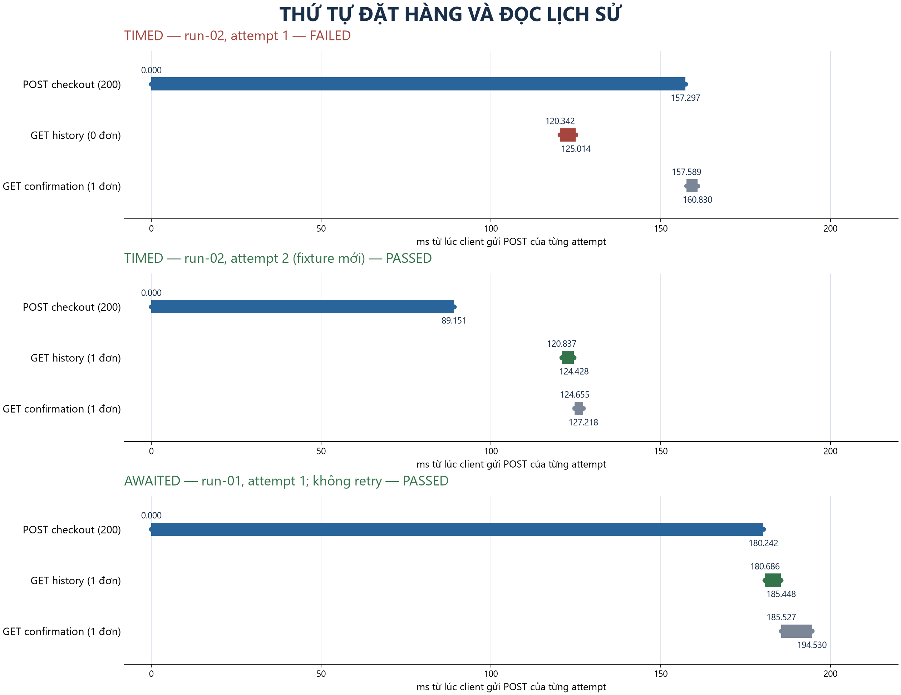

*Hình 11. Dấu vết thực tế của run-02/attempt 1 và 2 trong batch timed, cùng run-01/attempt 1 của batch awaited. Mốc 0 là lúc client gửi POST của từng attempt; đây là phép đổi gốc từ elapsed_ms trong log. Hình biểu diễn thứ tự request, không dùng để so hiệu năng hai batch hoặc coi retry là tiếp tục dữ liệu của fixture trước.*

### 8.2. Protocol thí nghiệm

**Điều kiện và đơn vị thực thi**

[Protocol v2](assets/flaky/v2/order-history-protocol.md) định nghĩa trước cách lấy mẫu, oracle, retry và yêu cầu bằng chứng. Một **run** là một tiến trình Jest mới; một **attempt** là một lần thực thi toàn bộ test body. Batch chính gồm 10 run tuần tự trong **một dispatch** GitHub Actions, trên cùng revision và runner. Không sửa test giữa các run hoặc chạy thêm mẫu để đạt tỷ lệ pass/fail mong muốn.

Jest thực hiện `jest.retryTimes(2, {logErrorsBeforeRetry: true, retryImmediately: true})`: tối đa một lần đầu và hai retry, dừng ngay khi pass. Mỗi attempt có fixture mới. `run_attempt=1` của GitHub cho biết đây là lần thực thi đầu của workflow, không phải số retry bên trong test.

*Bảng 27. Điều kiện và dữ liệu của batch E-03 v2*

| Nhóm điều kiện | Giá trị hoặc quy tắc |
| --- | --- |
| Revision đo | `52e400689109b5423ad04eb2bef41280a0f149ff`, source working tree sạch |
| Workflow / branch | `flaky-experiment.yml`; `test/issue-5-flaky-retry-v2`; variant `timed`, 10 run, retry limit 2 |
| Môi trường | Ubuntu 22.04.5, image `20261012.322.1`; Node v24.14.0, npm 11.9.0, Jest 30.5.2, Python 3.10.12 |
| Lệnh điều phối | `python ../docs/experiments/run-order-history.py --variant timed --runs 10 --retries 2 --output test-results/order-history/ci`, từ backend |
| Dependency và fixture | `npm ci` theo lockfile; SQLite riêng mỗi attempt; không dùng database đang vận hành |
| Điều kiện thời gian | Observation wait 120 ms; latency sampled 20–220 ms; seed `17264554395344709815` |
| Dữ liệu cần giữ | SHA/source state, runtime, URL, UTC, duration, native Jest JSON/console, events, attempts, retry reasons, assertion và source snapshot |

Collector kiểm tra kết quả native Jest với ledger và trace trước khi xuất gói dữ liệu. **Exit 0** nghĩa là mọi run pass cuối; **exit 1** là batch hợp lệ nhưng còn run fail sau hết retry; **exit 2** báo lỗi evidence hoặc lỗi ngoài assertion mục tiêu. Workflow vẫn thử upload artifact khi test step fail và run không bị cancel; upload thành công không đổi verdict của test.

**Log gốc và gói phân tích**

Organizer giữ raw/native Jest, controls, source snapshot và mapping tới revision. Packet analysis chỉ có README, prompt, history cùng `events.jsonl`, console có số dòng, `attempts.json`, `result.json` của 10 run. Đây là 43 file biểu diễn 10 run, không phải 43 lần chạy. Log gốc được giữ riêng; packet xuất theo schema và allowlist, không sửa timing hoặc kết quả thủ công sau khi xem phân tích.

`elapsed_ms` dùng đồng hồ monotonic chung trong từng process, bao gồm setup và retry; chỉ so trực tiếp các mốc trong cùng run. `time_utc` định hướng thời gian; `sequence` ghi thứ tự sự kiện. Duration attempt, duration native Jest và `process_duration_ms` có phạm vi riêng, không dùng thay cho duration toàn job.

### 8.3. Kết quả 10 lần chạy

**Kết quả lần đầu, retry và verdict cuối**

[Batch CI 39860438568](https://github.com/SUT-group10/eshop-sut-group10/actions/runs/39860438568) được thu ngày 22/10/2026 UTC, tương ứng sáng 23/10 UTC+7. [Metadata và artifact](assets/flaky/v2/README.md#hai-batch-ci) ghi đủ 10 run hợp lệ, không evidence error. Bảng 28 giữ riêng chuỗi attempt và kết quả cuối; P là pass, F là fail. Duration đo toàn process, không phải duration attempt cuối.

*Bảng 28. Kết quả 10 run trong batch timed, retry tối đa 2*

| Run | Chuỗi attempt | Retry đã dùng | Kết quả cuối | Process duration (ms) |
| --- | --- | ---: | --- | ---: |
| 01 | P | 0 | PASS | 1170,420 |
| 02 | F → P | 1 | PASS | 1322,723 |
| 03 | F → F → P | 2 | PASS | 1519,160 |
| 04 | F → F → F | 2 | FAIL | 1671,137 |
| 05 | F → F → F | 2 | FAIL | 1571,234 |
| 06 | P | 0 | PASS | 1168,233 |
| 07 | P | 0 | PASS | 1170,982 |
| 08 | F → F → P | 2 | PASS | 1517,776 |
| 09 | P | 0 | PASS | 1118,513 |
| 10 | P | 0 | PASS | 1167,323 |

Nguồn là [history và report từng run trong ZIP analysis](assets/triage/v2/ai-sol/api-analysis-input-39860438568-1.zip), đối chiếu với [batch.json trong ZIP phụ trợ](assets/flaky/v2/supporting-evidence.zip) và native Jest trong organizer. Lần đầu có **5 PASS/5 FAIL**; ba run phục hồi sau retry; verdict cuối **8 PASS/2 FAIL**. Tổng cộng 19 attempt, trong đó 9 retry, 8 attempt pass và 11 fail. Cả 11 failure đều ở `HISTORY_ORDER_COUNT`, expected 1/actual 0; cả 19 confirmation thấy một đơn và 57 response được theo dõi đều HTTP 200.

Tỷ lệ fail lần đầu 5/10, fail cuối 2/10 và fail trên mọi attempt 11/19 có mẫu số khác nhau. Retry dừng sau pass, nên 19 attempt không phải 19 mẫu độc lập được chọn trước. Trong batch này, retry làm ba run có verdict cuối pass dù đã thất bại trước đó; điều đó chưa phải sửa nguyên nhân. Hai run vẫn fail sau ba attempt giải thích workflow đỏ, trong khi collector hoàn tất và hai bước upload artifact thành công.

**Dẫn chứng về thứ tự và phạm vi thời gian**

Ở run-02/attempt 1, console L0005 ghi gửi submit tại 172,552 ms; L0007 gửi history tại 292,894 ms. Client nhận history rỗng tại 297,566 ms, trước khi nhận submit thành công tại 329,849 ms; confirmation nhận một đơn tại 333,382 ms. Assertion vẫn kiểm tra snapshot history ban đầu và fail. Attempt 2 có fixture mới, POST hoàn tất trước khi history được gửi và pass; không phải đơn của attempt 1 vừa xuất hiện sau retry.

Trong cả mẫu, 11 attempt fail có history đến server trước submit server completion; 8 attempt pass có thứ tự ngược lại. Khoảng từ gửi POST đến gửi history là 119,636–121,437 ms. Các mốc hỗ trợ vấn đề thứ tự; thời điểm response hoàn tất không tự là mốc commit DB và ngưỡng gần 120 ms không phải SLA nghiệp vụ.

Cửa sổ từ process Jest đầu bắt đầu tới process cuối kết thúc là 13,418 giây; collector là 13,441 giây; toàn job 104 giây. Ba phạm vi được giữ riêng trong metadata. Chẳng hạn run-03 có native Jest duration 155 ms, gần duration attempt cuối 154,867 ms, trong khi tổng ba attempt là 660,670 ms và process là 1519,160 ms. Chỉ dùng duration attempt cuối sẽ bỏ phần công việc trước retry.

### 8.4. Sửa flake và xác nhận

**Thay đổi quan hệ chờ**

Phiên bản v2 giữ hai cách đồng bộ trong cùng test qua cấu hình `timed` và `awaited`. Ở `awaited`, test đợi đúng Promise của POST, kiểm tra không có transport error và status 200 rồi mới gửi history. Không tăng sleep, thêm retry, đổi oracle hoặc sửa nghiệp vụ SUT. Đoạn điều phối cốt lõi trong source snapshot là:

```javascript
if (variant === 'awaited') {
  const submitted = await pendingSubmit;
  if (submitted.error) throw submitted.error;
  observer.check(attempt, 'SUBMIT_HTTP', submitted.response.status, 200);
} else {
  await sleep(observationWaitMs);
}
const observed = await observer.send(
  gateway, user.token, attempt, 'history', 'GET', '/api/orders/my-orders');
```

Đây là trích đoạn cách chọn điều kiện chờ, không phải toàn bộ test. Source snapshot nằm trong organizer của từng batch; các bước confirmation, giữ snapshot đầu và cleanup vẫn được thực hiện. Việc chọn cấu hình trước batch không thay đổi logic giữa các run.

**Xác nhận trên GitHub Actions**

[Run 39911447981](https://github.com/SUT-group10/eshop-sut-group10/actions/runs/39911447981) thực hiện ngày 23/10/2026, trên revision `13e50679ef6fa9261dfe933babf62a4a5722fb86`, với `awaited`, 10 run và retry=0. [Hồ sơ E-09](assets/flaky/v2/README.md#hai-batch-ci) giữ hai artifact, job logs, metadata và kiểm tra thứ tự của cả 10 run.

*Bảng 29. Đối chiếu hai batch CI trước và sau đổi điều kiện chờ*

| Điều kiện | Timed, batch 39860438568 | Awaited, batch 39911447981 |
| --- | --- | --- |
| Run / retry tối đa | 10 / 2 | 10 / 0 |
| Lần đầu | 5 PASS, 5 FAIL | 10 PASS, 0 FAIL |
| Phục hồi sau retry | 3 run | 0 |
| Verdict cuối | 8 PASS, 2 FAIL | 10 PASS, 0 FAIL |
| Attempt / attempt fail | 19 / 11 | 10 / 0 |
| Evidence error | 0 | 0 |
| Quan hệ xác nhận | 11 failure đọc history trước khi submit hoàn tất phía server | 10/10 nhận POST thành công trước khi gửi history |

Ở run-01 sau sửa, client nhận POST lúc 361,895 ms rồi gửi history lúc 362,339 ms; run-10 có hai mốc tương ứng 328,837 và 329,170 ms. Cả 10 native Jest report có đúng một invocation, không retry reasons; mọi assertion pass, history và confirmation có đúng một đơn, fixture đóng thành công. Nhóm xác nhận bằng trace và dữ liệu, thay vì chỉ dùng màu xanh của workflow.

Hai batch CI có SHA, seed và thời điểm riêng. Metadata đối chiếu cho thấy 12 fingerprint của các file thực thi/dependency trùng nhau; revision khác nhau do cập nhật hồ sơ. Kết quả hỗ trợ sửa quan hệ đồng bộ trong các điều kiện đã chạy, nhưng không dùng hai batch để tính riêng tác động của retry, so tốc độ hoặc bảo đảm không còn mọi lỗi ở mọi môi trường. Các kiểm chứng local và dữ liệu v1 tiếp tục được giữ riêng với mẫu CI này.

## 9. AI triage và so sánh với phân tích thủ công

### 9.1. Phân tích thủ công

**Quan sát, giả thuyết và bước kiểm tra**

Nguyễn Khắc Vượng tự phân tích [gói timed v2](assets/triage/v2/ai-sol/api-analysis-input-39860438568-1.zip) trong **20 phút**, hoàn thiện trước khi xem output AI, theo xác nhận bàn giao. [Bản phân tích gốc](assets/triage/v2/human/phan-tich-order-history.md) được giữ nguyên. Kết quả tổng hợp khớp 10 run, 19 attempt, 9 retry và verdict cuối 8 PASS/2 FAIL.

H1 mạnh nhất của Vượng là history được gửi theo mốc gần cố định khoảng 120 ms, không phụ thuộc submit hoàn tất. Bản phân tích dùng server received/completed, confirmation và quan hệ thời gian trên cả 19 attempt. H2 xét biến thiên thời gian submit như yếu tố làm race thay đổi; H3 về read-after-write được xếp yếu vì các lần đọc sau submit đều thấy đơn. Vượng nêu thiếu source và mốc commit DB, chưa coi cơ chế mã là đã được xác nhận khi triage.

Ba hướng kiểm tra được đề nghị là rà điều phối history, thêm mốc nội bộ checkout/commit và chạy biến thể có kiểm soát. Đề xuất ít nhất 20 lượt mỗi biến thể là kế hoạch của bản phân tích, không phải số lượt đã thực hiện hoặc yêu cầu tối thiểu của đề. Một nhận xét hữu ích là native Jest duration của run có retry chỉ phản ánh attempt cuối trong bộ dữ liệu này, nên cần đọc thêm ledger và process duration.

**Các điểm cần đối chiếu trong bản thủ công**

Nhận xét GET chỉ mất 1–2 ms không đúng cho toàn mẫu: run-10 có history server duration 8,780 ms và confirmation 11,585 ms. Phép tính xác suất khoảng 0,19 từ `(11/19)^3` cũng cần giả định độc lập và cùng xác suất chậm, trong khi các attempt được lấy thêm sau fail và dừng sau pass. Không dùng phép tính này làm ước lượng xác suất lỗi thực tế. Hai điểm đó không bác bỏ H1, nhưng cho thấy phân tích thủ công cũng cần kiểm tra lại dẫn chứng và giới hạn suy luận.

### 9.2. Chuẩn bị dữ liệu và prompt

**Đầu vào chung và ranh giới dữ liệu**

Người và AI sử dụng cùng artifact analysis của batch 39860438568. Collector v2 ghi sự kiện theo schema an toàn và tự xuất packet, thay cho việc sửa log thủ công như ở đợt v1. Dữ liệu timing, status, assertion và retry được giữ; phần source, controls và giải thích thiết kế nằm trong organizer. Các file gốc tiếp tục được lưu để đối chiếu sau triage.

*Bảng 30. Thành phần đầu vào và dữ liệu giữ cho người tổ chức*

| Thành phần | Vai trò và cách bàn giao |
| --- | --- |
| README, prompt, history | Định nghĩa run/attempt/retry, đồng hồ và yêu cầu phân tích; cung cấp cho cả hai bên |
| Events, console đánh số dòng | Cùng tập sự kiện HTTP/assertion; giữ giá trị gốc để viện dẫn, không đếm trùng |
| Attempts và result từng run | Giữ verdict từng attempt, fixture, lỗi, invocation và retry; result đã đối chiếu native Jest |
| Nhãn run/revision | Bí danh `run-01`…`run-10`, `revision-01`; không cấp SHA/branch để bên phân tích tự điều tra source |
| Raw/native Jest, controls, source snapshot | Organizer giữ để xác minh; không đưa đáp án hoặc tham số điều khiển vào prompt |
| Dữ liệu nhạy cảm | Schema không xuất token, header xác thực, địa chỉ hay lỗi thô; chỉ giữ các trường response fixture cần cho phân tích |

Packet không có code frame và tham số latency, nhưng README nói rõ đây là dữ liệu thí nghiệm có controls do người tổ chức giữ. Vì vậy, không mô tả đầu vào như log sản xuất hoặc đã che hoàn toàn mọi gợi ý về bối cảnh. Nhóm giữ nguyên packet đã sử dụng, không sửa lại sau khi xem kết quả phân tích.

**Phương pháp và yêu cầu đầu ra**

Nhóm chọn systematic debugging từ `obra/superpowers`, cố định nguồn tại commit `2ce8aa15d05bd57213e6f746f953aafb7ded7a8b`, rồi điều chỉnh thành `ci-log-triage` chỉ đọc dữ liệu. Kỹ thuật gồm kiểm kê bằng chứng, đối chiếu các trường hợp pass/fail, lập giả thuyết và đề xuất phép xác minh. Đây là lựa chọn theo độ phù hợp; nhóm không suy ra phương pháp tối ưu qua thực nghiệm hoặc nhận là đã thử ba prompt patterns.

*Bảng 31. Cấu trúc bản skill được dùng cho triage*

| Thành phần | Vai trò |
| --- | --- |
| `SKILL.md` | Quy định phạm vi, kiểm kê/đối chiếu bằng chứng và cấu trúc output |
| `SOURCES.md` | Lưu nguồn, revision và các phần giữ/bỏ/thêm so với phương pháp gốc |
| `LICENSE.txt` | Giữ thông báo bản quyền và giấy phép MIT |
| Model | Đọc hướng dẫn và dữ liệu để tạo câu trả lời; skill không tự chạy như parser, Jest hoặc dịch vụ CI |

Yêu cầu output gồm bốn phần: dữ liệu và kết quả; tối đa ba giả thuyết có dẫn chứng, giới hạn và mức chắc chắn; đúng ba next-checks; kết luận hiện tại. AI dừng ở triage, không đọc source hoặc tự chạy test để biến bước đề xuất thành kết quả xác minh. [Bản skill và nguồn](../user_guide/assets/flaky-ai/ci-log-triage/SKILL.md) được giữ cùng hồ sơ phương pháp dùng chung.

Lượt v2 được bàn giao với prompt gọi `ci-log-triage`, yêu cầu giải nén ZIP, bám cấu trúc README và ghi đủ thông tin thời gian. [Prompt được cung cấp lại](assets/triage/v2/ai-sol/prompt.md) có ghi việc lược đường dẫn cá nhân; [output](assets/triage/v2/ai-sol/response.md) và [metadata](assets/triage/v2/ai-sol/metadata.json) lưu riêng. Nhóm không dựng thêm một phiên hoặc prompt gốc đầy đủ hơn bằng suy đoán.

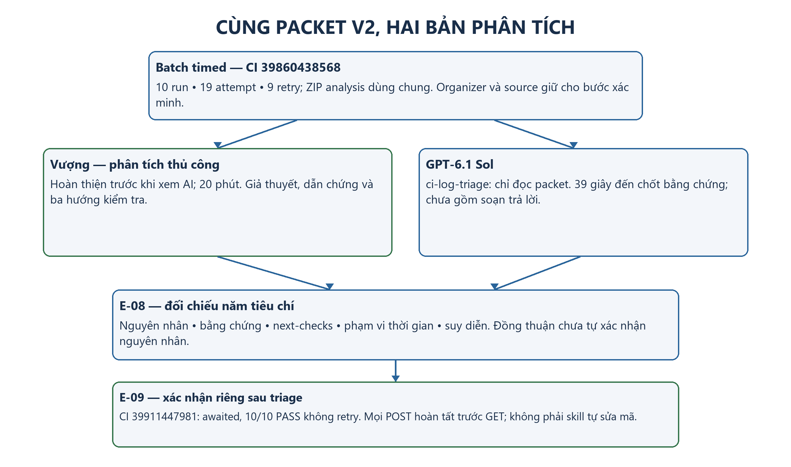

*Hình 12. Cùng packet timed cho hai bản phân tích; Vượng hoàn thiện trước khi xem Sol. Người tổ chức đối chiếu thiết kế và xác nhận awaited trên CI sau triage. Thời lượng AI trong hình chỉ đến mốc chốt bằng chứng, chưa gồm soạn trả lời.*

### 9.3. Kết quả AI triage

**Tổng hợp lịch sử và giả thuyết chính**

Model được xác nhận cho lượt v2 là **GPT-6.1 Sol**, dùng skill `ci-log-triage`. Output tổng hợp đúng 10 run/19 attempt, phân biệt 5 run fail lần đầu với 2 fail cuối và giữ đủ ba run phục hồi. AI không dùng confirmation để thay snapshot fail, cũng không coi retry pass là dữ liệu của fixture trước vừa xuất hiện.

Sol đưa một H1: history được gửi sau khoảng chờ gần cố định trong khi submit có thể còn xử lý. Dẫn chứng run-02 sử dụng mốc client: history nhận rỗng tại 297,566 ms, trước submit response 329,849 ms. Trên toàn mẫu, 11 failure có history nhận trước submit response; 8 pass có submit response trước history gửi. AI ghi mức chắc chắn cao về mẫu thứ tự và trung bình về cơ chế điều phối, chưa xác nhận timer, thiếu `await` hay một lỗi sản phẩm cụ thể.

Ba next-checks là kiểm tra đúng request/Promise được chờ; thay đổi riêng độ trễ submit trong điều kiện kiểm soát; bổ sung mốc ghi/commit và query cùng request ID. Output nói rõ chưa chạy lại, sửa mã hoặc thực hiện các bước xác minh này. Các kiểm chứng source/local/CI do người tổ chức thực hiện ở mục 8.4 được ghi tách khỏi lượt triage.

**Thông tin thời gian và điểm cần làm rõ**

Sol ghi khoảng phân tích **05:10:33–05:11:12 ngày 23/10/2026 UTC+7**, tương ứng 39 giây, gồm giải nén, đọc và đối chiếu đến mốc chốt bằng chứng. Thời gian soạn câu trả lời sau đó nằm ngoài khoảng đo. Tổng thời lượng hoàn thiện chưa xác định, nên chưa tính chênh lệch năng suất với 20 phút của Vượng.

Output gọi khoảng 13,418 giây của các process Jest là “cửa sổ CI”. Các mốc được trích đúng nhưng nhãn quá rộng, dễ bị dùng thành duration toàn pipeline; metadata thực tế ghi job 104 giây. Báo cáo giữ nhận xét này để phân biệt số đúng với ý nghĩa có thể gây nhầm, không đổi output gốc hoặc xem nó như bằng chứng AI bịa thời gian.

### 9.4. So sánh theo rubric

**Tiêu chí và kết quả đối chiếu**

Nhóm dùng năm tiêu chí: nguyên nhân dự đoán, bằng chứng, bước xác minh, thời gian và suy diễn thiếu căn cứ. Đánh giá mang tính định tính trên các hồ sơ đã lưu; không tự tạo điểm số, tỷ lệ chính xác hoặc thứ hạng công cụ.

*Bảng 32. Đối chiếu phân tích thủ công và GPT-6.1 Sol trong v2*

| Tiêu chí | Vượng | GPT-6.1 Sol | Nhận xét |
| --- | --- | --- | --- |
| Nguyên nhân | H1 điều phối; H2 biến thiên submit; H3 read-after-write yếu | Một H1 về khoảng chờ và thứ tự đọc | Đồng thuận cơ chế nghi ngờ; H2 mô tả yếu tố biến thiên, chưa chỉ ra vị trí gateway |
| Bằng chứng | Server received/completed, timing hai nhóm, confirmation, duration attempt cuối | Client sent/received, request ID, retry chain và fixture mới | Hai loại mốc khác nhau, không phải mâu thuẫn; cả hai có dẫn chứng chính đúng |
| Next-checks | Rà điều phối, thêm mốc DB, thực nghiệm hai biến thể | Rà đúng Promise, điều khiển latency, nối commit/query | Cùng có ba hướng khả thi; chưa thực hiện toàn bộ kế hoạch đề xuất |
| Thời gian | 20 phút hoàn thiện | 39 giây tới chốt bằng chứng, chưa gồm soạn trả lời | Khác phạm vi, chưa so tốc độ hoàn thiện |
| Suy diễn | Có giới hạn thiếu source; nhận xét GET và phép tính xác suất cần thu hẹp | Thận trọng về implementation; nhãn “cửa sổ CI” cần làm rõ | Cần kiểm tra cả hai, chưa có chẩn đoán bịa được xác nhận |

Vượng bổ sung nhận xét rõ về duration attempt cuối; Sol tập trung một giả thuyết và trình bày đủ retry chain. Một hoặc ba giả thuyết không tự quyết định chất lượng: cần xét chúng có được dữ liệu hỗ trợ và có phân biệt được bằng kiểm tra tiếp theo hay không.

**Đối chiếu sau triage**

Source snapshot cho thấy history trong `timed` dựa vào sleep 120 ms, trong khi POST đi qua gateway có latency biến thiên. H1 của hai bên phù hợp cơ chế đã biết. Batch `awaited` có 10/10 PASS không retry và 10 trace đúng quan hệ chờ, bổ sung bằng chứng thực nghiệm cho kết luận. Kết quả không chỉ dựa vào việc người và AI đồng thuận.

[Bản đối chiếu E-08](assets/triage/v2/AI_vs_Human_Triage.md) lưu các nhận xét chi tiết. Quy trình review gắn với [PR #21](https://github.com/SUT-group10/eshop-sut-group10/pull/21), có trạng thái tại lúc bàn giao trong source-index của [ZIP phụ trợ](assets/flaky/v2/supporting-evidence.zip). Hồ sơ có một output được bàn giao và model được xác nhận, chưa có toàn bộ tool trace để kiểm toán mọi tài nguyên của phiên gốc. Các giới hạn này được giữ khi đánh giá chương 10.

## 10. Thảo luận

### 10.1. AI hữu ích và gây nhiễu ở đâu

**Giá trị quan sát được**

Trong v2, AI tổ chức được log và retry thành một bản phân tích có thể kiểm tra lại: kết quả lần đầu/cuối, request ID, snapshot và các bước xác minh được nối rõ. Việc chỉ giữ một giả thuyết chính khi chưa có bằng chứng cho nguyên nhân khác giúp tránh mở rộng điều tra không cần thiết. Output phân biệt dấu vết trực tiếp với phần cần source và thực nghiệm.

Vượng cũng nhận diện đúng vấn đề thứ tự. AI có giá trị như một bản phân tích thứ hai có cấu trúc, nhưng mẫu này chưa chứng minh AI tìm được điều người bỏ sót hoặc chính xác hơn người. Vì thời gian 39 giây chưa gồm soạn trả lời và chưa đo đủ công sức review/xác minh, nhóm chưa lượng hóa mức tiết kiệm thời gian hay hiệu quả riêng của skill.

**Nhiễu và công sức kiểm chứng**

Một nhãn không rõ vẫn có thể làm sai report dù số liệu đúng. Nếu dùng “cửa sổ CI” 13,418 giây như duration toàn job, phần cài dependency và upload sẽ bị bỏ khỏi phép so. Tương tự, khi rút gọn output thành “8/10 pass”, người dùng có thể mất thông tin 5 run fail lần đầu và 3 run chỉ pass sau retry. Sol đã giữ được thông tin retry; đây là điểm cần bảo toàn khi sử dụng lại kết quả.

Người review vì vậy cần kiểm tra trường nguồn, phạm vi số đo, đơn vị quan sát và trạng thái giả thuyết. Phân tích thủ công cũng chịu yêu cầu này: nhận xét GET chỉ 1–2 ms hoặc phép tính xác suất không kiểm tra giả định có thể gây nhiễu nếu được chép nguyên như kết luận chung.

**Ví dụ thực tế về "Bẫy ảo giác" của AI trong cấu hình CI:**
Khi yêu cầu LLM (Gemini 4 Argon) thiết lập lưu trữ `npm cache` cho một pipeline đang có baseline lỗi (fails 10 assertions), AI đã đề xuất sử dụng tham số `save-always: true` với kỳ vọng runner sẽ luôn lưu cache ở bước `Post`.

* **Phân tích lỗi:** Đề xuất này hoàn toàn vô giá trị (INVALID) trên môi trường thực tế. Tham số này đã bị GitHub đánh dấu *deprecated*. Quan trọng hơn, cơ chế hoạt động của runner sẽ tự động bỏ qua (skip) các `Post` hooks ngay khi phát hiện một test step thất bại (exit code != 0). Hậu quả là cache không bao giờ được ghi lại, làm sai lệch toàn bộ phép đo hiệu năng của pipeline.
* **Cách nhóm khắc phục:** Người kỹ sư phải tự thiết kế lại luồng bằng kỹ thuật "Decoupled Cache". Nhóm đã tách tác vụ thành `actions/cache/restore@v4` và `actions/cache/save@v4`, đặt lệnh Save ngay sau bước `npm ci` và trước khi kiểm thử bắt đầu, kèm cờ `if: ${{ !cancelled() }}`. Điều này đảm bảo cache luôn được lưu an toàn trước khi Test Harness báo đỏ. Việc kiểm chứng đề xuất của AI trong trường hợp này đòi hỏi kiến thức chuyên sâu về vòng đời thực thi của CI, điều mà bản thân LLM chưa cập nhật kịp.

### 10.2. Failure modes của AI

**Cơ chế gây hiểu nhầm và bằng chứng**

Đề T07 yêu cầu User Guide nêu ba cách công cụ có thể gây hiểu nhầm. [E-10 v2](assets/triage/v2/E-10.md) đánh giá ba failure modes có dữ liệu minh họa, tách điểm xuất hiện trong output khỏi rủi ro đã được Sol tránh. Kết luận không phải ba lần AI chẩn đoán sai.

*Bảng 33. Ba failure modes khi sử dụng AI triage và biện pháp kiểm chứng*

| Failure mode | Dữ kiện và tình trạng trong lượt Sol | Biện pháp kiểm chứng |
| --- | --- | --- |
| Nhầm phạm vi thời gian | Nhãn “cửa sổ CI” cho 13,418 giây dễ bị hiểu là toàn job 104 giây. Đây là điểm diễn đạt đã xuất hiện; số liệu gốc không bị bịa | Ghi trường nguồn, đơn vị và hai đầu mốc; phân biệt attempt, process, job và thời gian phân tích |
| Bỏ failure trước retry | Run-02 F → P; run-03/08 F → F → P. Chỉ dùng final status sẽ bỏ ba run phục hồi. Sol đã giữ đúng chuỗi retry và fixture mới | Đối chiếu initial/final status, invocations, attempts và native retry reasons; không coi retry là bản sửa |
| Biến tương quan thành nguyên nhân đã xác nhận | Đọc sớm rỗng và HTTP 200 chưa xác định thiếu await, vị trí latency hay mốc commit DB. Sol nêu giới hạn này và chưa nhận đã xác minh | Tách quan sát/giả thuyết/kết quả kiểm tra; rà source, hợp đồng API và chạy biến thể sau sửa không retry |

FM-01 cần làm rõ khi đưa output vào báo cáo; FM-02 và FM-03 là rủi ro được tình huống thực tế minh họa nhưng chưa xảy ra như lỗi của lượt Sol đã bàn giao. Phân loại đó giữ đánh giá công bằng: không bịa thêm failure để đủ số lượng, đồng thời vẫn đưa ra được cách sử dụng công cụ thận trọng. [User Guide](../user_guide/flaky-ai.md) chuyển các bài học thành thao tác đọc dữ liệu và kiểm chứng.

### 10.3. Hạn chế

**Dữ liệu và bối cảnh phân tích**

Thí nghiệm chỉ có một API test được chủ động tạo lỗi đồng bộ, gateway điều khiển latency và log khá đầy đủ. Mười run của mỗi batch không đại diện cho log sản xuất nhiều dịch vụ, thiếu context hoặc có nhiều lỗi đồng thời. Metadata cho biết đây là thí nghiệm, nên không coi đầu vào đã loại bỏ mọi gợi ý thiết kế.

Vượng hoàn thiện phân tích thủ công trước khi xem AI, theo xác nhận bàn giao. Hồ sơ AI gồm prompt được cung cấp lại, output và model xác nhận; chưa có đầy đủ phiên gốc để kiểm toán ngữ cảnh hay xác định mọi lần thử. Một output đúng cũng chưa chứng minh chất lượng trên mọi CI log hoặc quan hệ nhân quả giữa việc dùng skill và độ đúng.

**Retry, môi trường và khả năng khái quát**

V2 đã có retry history thực tế: 9 attempt bổ sung, ba run phục hồi và hai run hết budget vẫn fail. Tuy nhiên, policy dừng sau pass làm các attempt có cấu trúc phụ thuộc và được chọn sau failure; 11/19 không phải ước lượng từ 19 mẫu độc lập được lên kế hoạch trước. Muốn đo riêng ảnh hưởng policy cần đối chứng cùng revision, lịch latency và điều kiện đo.

Batch `timed` và `awaited` trên CI có seed và thời điểm riêng, dù các fingerprint thực thi/dependency khớp. Báo cáo dùng chúng để kiểm tra quan hệ chờ và kết quả sau sửa, không suy tốc độ hoặc hiệu quả retry từ hai duration. Các kiểm chứng local dùng cùng seed cho những biến thể tương ứng được giữ riêng; không cộng chúng vào mẫu CI. Số mẫu hữu hạn và một môi trường runner không bảo đảm loại bỏ mọi lỗi tương lai.

## 11. Áp dụng cho dự án khác

**Hợp đồng kiểm thử và dữ liệu khởi đầu**

Phần có thể tái sử dụng là quy trình thực thi, lưu bằng chứng và xác minh, không phải endpoint checkout, ngưỡng 120 ms hoặc kết luận của ca order history. Dự án mới cần xác định hành vi mong đợi, lệnh chạy thật, assertion và điều kiện fail. Fixture phải tạo trạng thái đã biết, cô lập dữ liệu thay đổi và cleanup khi assertion fail; dependency bên ngoài, đồng hồ và dữ liệu ngẫu nhiên cần được kiểm soát hoặc ghi nhận.

Trước khi đưa lên CI, chạy từ clone sạch và xác nhận report thực sự phản ánh test đã chạy. Không thay expected hoặc bỏ test để làm trạng thái xanh khi SUT không đạt đặc tả. Nếu sản phẩm không cần compile, bước build có thể kiểm tra cú pháp với phạm vi được nói rõ, thay vì một lệnh chỉ in thông báo thành công.

**Pipeline và hợp đồng log**

Pipeline gọi lại bộ lệnh dự án, cố định runtime/lockfile và ghi SHA thực thi. Runner vẫn chịu trách nhiệm discovery, setup/teardown, assertion và report; cache không thay thế fixture hoặc cài dependency. Kiểm tra cả lượt pass và fail, giữ exit code và lấy được artifact khi có thể. Status check/branch protection cần kiểm chứng cấu hình và hành vi riêng, không tự phát sinh chỉ vì có YAML.

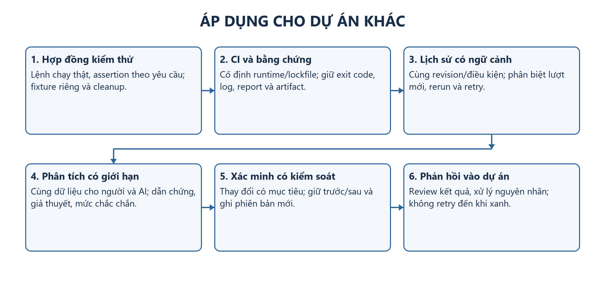

*Hình 13. Quy trình chung từ hợp đồng test tới phản hồi vào dự án. Công nghệ runner và schema có thể thay đổi; phiên bản, dữ liệu khởi đầu, nguồn bằng chứng và phép xác minh cần được giữ rõ.*

*Bảng 34. Các thành phần cần cấu hình khi chuyển sang dự án khác*

| Thành phần | Phần cần thay | Điều kiện kiểm tra được |
| --- | --- | --- |
| Test và fixture | Luồng, expected, dữ liệu, dependency, cleanup | Chạy riêng/cả suite không phụ thuộc trạng thái cũ ngoài thiết kế |
| Runner và retry | Framework, discovery, timeout, budget, điều kiện dừng | Đếm được lần đầu, retry, verdict cuối và fixture của từng attempt |
| Pipeline | Trigger, runtime, agent, cache, lockfile, upload | Đúng revision, giữ exit code và đọc được dữ liệu khi fail |
| Log và lịch sử | Run/test/request ID, snapshot, assertion, clocks, source state | Nối được sự kiện và không đếm nhiều file thành nhiều run |
| Packet cho AI | Bối cảnh cho phép, định nghĩa trường, nội dung nhạy cảm, tách organizer | Hai bên có cùng dữ liệu; không cấp trước đáp án hoặc source ngoài phạm vi |
| Xác minh và bàn giao | Biến thể có mục tiêu, cấu hình/patch, trước/sau, hướng dẫn | Kiểm tra quan hệ nguyên nhân và giữ đủ bằng chứng của bản sửa |

Schema nên nối được request ID, attempt và fixture; có UTC để định hướng và đồng hồ phù hợp để suy thứ tự. Nếu framework không có native retry report, cần phương pháp tương đương và ghi hạn chế. Phân biệt retry bên trong runner với rerun job/workflow; các cách đó có thể khởi tạo lại môi trường khác nhau. Một status cuối không thay được toàn bộ lịch sử.

**Tổ chức người–AI triage**

Khi gặp lỗi không ổn định, giữ cả pass và fail cùng revision/điều kiện; không mặc định mọi job đỏ là flaky. Một log fail có thể hỗ trợ phân tích triệu chứng nhưng chưa chứng minh biến thiên. Packet nên được tạo bằng quy tắc rõ ràng, loại secrets và đáp án thiết kế, giữ bản gốc để đối chiếu. Nếu so người với AI, người phân tích lưu bài trước khi xem output AI; bên AI dùng ngữ cảnh chưa biết lời giải và cùng bộ dữ liệu được giao.

Phương pháp `ci-log-triage` giữ được cách kiểm kê, đối chiếu, đưa tối đa ba giả thuyết và ba next-checks; không áp đặt endpoint hay nguyên nhân order history cho log khác. Khi thiếu timing, commit marker hoặc source, output phải ghi thông tin thiếu. Lưu prompt, hướng dẫn, model, output và các lần thử thực tế. Muốn so năng suất cần cùng phạm vi thời gian, kể cả phần review/xác minh theo mục tiêu đo.

**Xác minh và phản hồi vào dự án**

Chuyển giả thuyết thành phép kiểm tra có kết quả hỗ trợ/bác bỏ. Nếu thay code, lưu revision/patch; nếu thay cấu hình có sẵn như `timed`/`awaited`, ghi rõ variant và policy. Chỉ thay yếu tố cần kiểm tra, giữ oracle và lưu dữ liệu cả trước/sau. Trong ca này, chờ thao tác hoàn tất thay cho sleep là bản sửa; retry chỉ cho quan sát thêm và không tự xử lý nguyên nhân.

Sau sửa, chạy xác nhận không dựa vào retry và đọc lại trace/trạng thái nghiệp vụ, thay vì chỉ nhìn màu job. Cập nhật hướng dẫn, trách nhiệm xử lý và chất lượng tín hiệu CI. Workflow thí nghiệm riêng của EShop tránh đưa flake có chủ đích vào required checks; dự án khác cần cách tổ chức phù hợp rủi ro và chính sách của mình.

[User Guide flaky/AI](../user_guide/flaky-ai.md) cung cấp bước thực hành từ lấy packet, chuẩn bị workspace, chạy triage tới kiểm chứng; [GitHub Actions](../user_guide/github-actions.md) và [Jenkins](../user_guide/jenkins.md) hướng dẫn hai pipeline. Khả năng tái sử dụng ở chương này là quy trình có điều kiện từ trải nghiệm EShop; nhóm chưa triển khai và đo lại toàn bộ trên một dự án thứ hai.


## 12. Kết luận và bài học

### 12.1. Kết quả đạt được theo mục tiêu

*Bảng 35. Đối chiếu kết quả với mục tiêu ở mục 1.2*

| Mục tiêu | Kết quả | Mức độ |
| --- | --- | --- |
| 1. Test harness | 39 test (unit, API, smoke, harness), SQLite trong bộ nhớ cho từng test; kết quả từng test giữ nguyên qua ba thứ tự xáo trộn | Đạt |
| 2. GitHub Actions | Workflow chạy trên PR/push, giữ exit code thật, khôi phục/lưu cache, upload artifact cả khi test fail (run #11, #12) | Đạt |
| 3. Jenkins | Pipeline sáu stage cho cùng kết quả 29 pass/10 fail, line coverage 61,48% như GitHub Actions; trang Tests/Coverage đủ để chẩn đoán đến từng assertion | Đạt |
| 4. Flaky test | Batch `timed`: lần đầu 5 PASS/5 FAIL, retry làm ba run chuyển sang pass, verdict cuối 8/2. Sau khi đổi sang chờ đúng Promise (`awaited`, retry = 0): 10/10 PASS, 10/10 trace đúng thứ tự | Đạt |
| 5. Người và AI | Vượng và GPT-6.1 Sol cùng xác định vấn đề thứ tự giữa submit và history; mỗi bên có điểm cần làm rõ (nhãn "cửa sổ CI"; nhận xét GET, phép tính xác suất) | Đạt |
| 6. Bài học | Xem mục 12.2 và chương 11 | Đạt |

Tóm lại, nhóm đã xây được một quy trình CI có thể tái lập: bộ kiểm thử độc lập, hai pipeline cho cùng verdict trên cùng SUT, và quy trình phân tích flaky test có kiểm chứng bằng thực nghiệm. Pipeline đỏ trên SUT baseline không phải dấu hiệu CI hỏng; đó là kết quả đúng của quality gate khi SUT chưa đáp ứng đặc tả.

### 12.2. Bài học

**Về pipeline**

- **Một verdict đỏ trung thực có giá trị hơn một verdict xanh giả tạo.** Không đổi expected, skip test hay nuốt exit code là điều kiện để kết quả CI còn ý nghĩa.
- **Màu của build chưa đủ để kết luận.** Với 10 lỗi baseline, cần đối chiếu danh sách ID fail; run xanh của PR #20 cũng phải được ghi rõ là đến từ một phiên bản SUT khác.
- **Bằng chứng phải được giữ lại khi thất bại.** Bước upload/publish chạy cả khi test fail, cùng snapshot metadata và log, giúp đối chiếu được kể cả khi artifact trên CI đã hết hạn.
- **Số đo phải đi kèm phạm vi.** Thời gian Jest, thời gian job và thời gian cài dependency là các đại lượng khác nhau; nhãn cache hit cũng không tự giải thích chênh lệch thời gian.

**Về flaky test**

- **Retry che triệu chứng, không sửa nguyên nhân.** Ba run chuyển từ fail sang pass nhờ retry, nhưng chỉ khi đổi điều kiện chờ thì lỗi mới hết.
- **Xác nhận một bản sửa bằng trace, không chỉ bằng màu xanh.** 10/10 run sau sửa đều có mốc thời gian chứng minh POST hoàn tất trước khi đọc history.

**Về AI**

- **AI hữu ích như một bản phân tích thứ hai có cấu trúc.** Nó tổ chức tốt log và chuỗi retry, nhưng trong mẫu này chưa cho thấy phát hiện được điều mà người bỏ sót.
- **Mọi đề xuất của AI là giả thuyết.** Cả trong triage (nhãn "cửa sổ CI") lẫn trong cấu hình CI (đề xuất `save-always` không còn dùng được), người kỹ sư vẫn phải kiểm chứng với tài liệu, source và lần chạy thật.
- **Phân tích thủ công cũng cần được review như output AI.** So sánh công bằng đòi hỏi cùng dữ liệu đầu vào, cùng rubric, và phân tích của người phải được lưu trước khi xem AI.

### 12.3. Hướng phát triển

- Chọn `Backend quality gates` làm required check, kiểm chứng tác dụng chặn merge và bổ sung coverage badge.
- Đo lại GitHub Actions và Jenkins trên cùng commit, cùng phiên bản Node và trạng thái cache được kiểm soát (cache rỗng và cache hit), mỗi nền tảng ít nhất 3 lượt.
- Đặt ngưỡng coverage làm điều kiện của quality gate khi bộ test đã ổn định.
- Thử AI triage trên log có nhiều nguồn lỗi hơn, với nhiều lượt và nhiều model, để đánh giá độ ổn định thay vì dựa trên một output.

## 13. Tài liệu tham khảo

1. [GitHub Actions Documentation](https://docs.github.com/en/actions).
2. [Jenkins User Documentation](https://www.jenkins.io/doc/).
3. [Jest Documentation](https://jestjs.io/docs/getting-started).
4. [Supertest Documentation](https://github.com/forwardemail/supertest).
5. [npm Documentation](https://docs.npmjs.com/).
6. [Docker Documentation](https://docs.docker.com/).
7. [GitLab CI/CD Documentation](https://docs.gitlab.com/ci/).
8. [ChatGPT Help Center](https://help.openai.com/en/collections/3742473-chatgpt).
9. [Datadog Documentation](https://docs.datadoghq.com/).
10. [Google Testing Blog — Flaky Tests at Google and How We Mitigate Them](https://testing.googleblog.com/2016/05/flaky-tests-at-google-and-how-we.html).
11. [pytest documentation — Flaky tests](https://docs.pytest.org/en/stable/explanation/flaky.html).
12. [Martin Fowler — Eradicating Non-Determinism in Tests](https://martinfowler.com/articles/nonDeterminism.html).
13. [Android Developers — Big test stability](https://developer.android.com/training/testing/instrumented-tests/stability).
14. [Jest — jest.retryTimes](https://jestjs.io/docs/jest-object#jestretrytimesnumretries-options).
15. [obra/superpowers — systematic-debugging, bản nguồn được cố định](https://github.com/obra/superpowers/blob/2ce8aa15d05bd57213e6f746f953aafb7ded7a8b/skills/systematic-debugging/SKILL.md).
