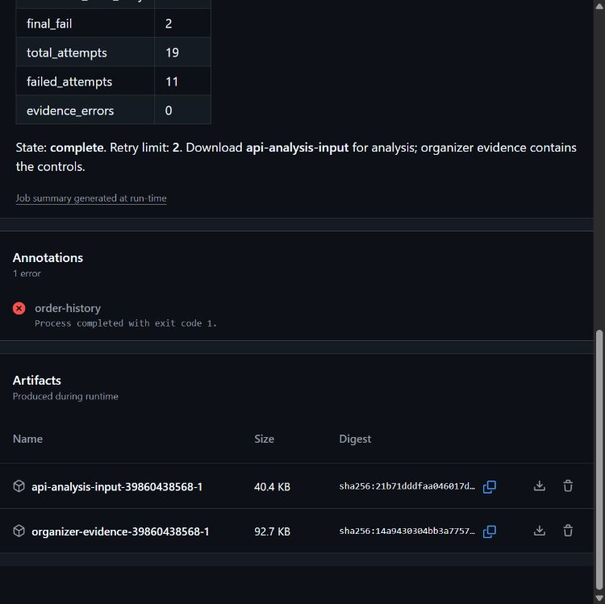
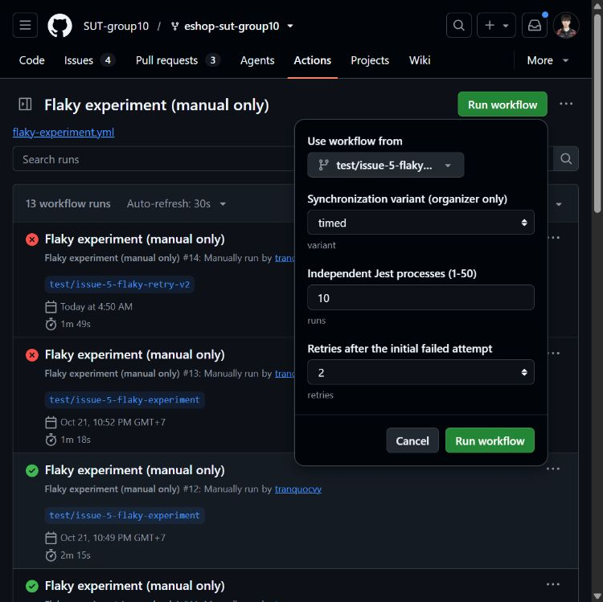
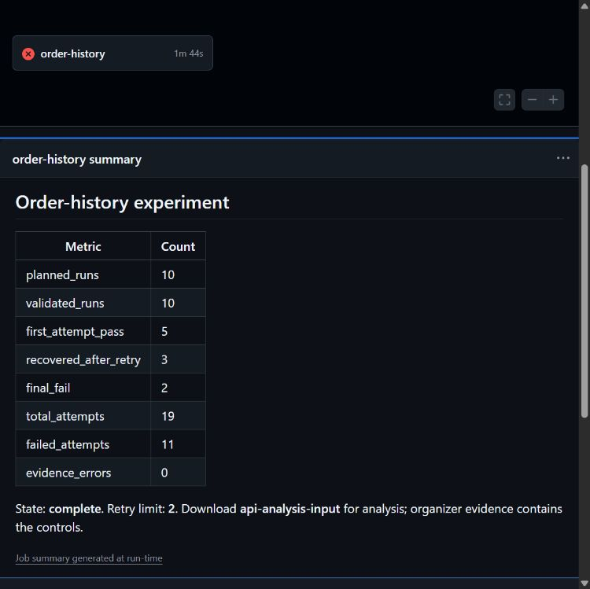

# Flaky test và AI log triage — thí nghiệm v2

## 1. Mục tiêu và cách sử dụng

Phần này hướng dẫn lấy log từ CI, phân tích bằng `ci-log-triage`, đọc kết quả và kiểm chứng giả thuyết trên EShop. Ca thực hành là **order history v2**; dữ liệu cart v1 được giữ riêng với các batch order history của guide này.

Người học có thể bắt đầu ngay bằng ZIP đi kèm. Chỉ cần cài dependency EShop khi thực hiện bước chạy thí nghiệm hoặc xác minh sau phân tích.

| Nhu cầu | Lộ trình |
| --- | --- |
| Thực hành triage với dữ liệu đã có | Làm mục 2–6; lưu phân tích rồi đối chiếu mục 7 |
| Thu một batch CI mới | Người tổ chức làm mục 8, sau đó bàn giao ZIP analysis để làm mục 3–6 |
| Xác minh giả thuyết và bản sửa | Sau khi lưu phân tích, làm mục 9 |

Nếu tổ chức so sánh người–AI, người phân tích thủ công lưu bài trước khi xem AI. AI nhận cùng ZIP trong một chat mới. Chỉ gửi ZIP analysis và hướng dẫn skill cho bên phân tích; phần giải thích thiết kế, kết quả mẫu và organizer dành cho bước đối chiếu sau đó.

## 2. Chuẩn bị và các khái niệm cần biết

| Thành phần | Dùng khi nào | Điều kiện |
| --- | --- | --- |
| Codex có công cụ đọc file/giải nén | Chạy triage | Đăng nhập tài khoản sử dụng được; mở được thư mục thực hành cục bộ |
| ZIP analysis và folder skill đi kèm | Mọi lượt thực hành | Có trong `user_guide/assets/flaky-ai/` của repo docs |
| PowerShell trên Windows | Các lệnh trong guide | Mở terminal tại thư mục gốc repo docs trước mục 3 |
| Tài khoản GitHub | Tải artifact hoặc chạy workflow | Quyền đọc để tải; quyền write để dispatch |
| Git, Node.js, npm, Python 3 | Chạy EShop ở mục 9 | Workflow v2 dùng Node 24.14.0; Python chạy bộ thu thập log |

Nếu chưa có ứng dụng, làm theo [hướng dẫn desktop trên Windows của OpenAI](https://learn.chatgpt.com/docs/windows/windows-app), đăng nhập tài khoản và chọn Codex. Hướng dẫn [bắt đầu với desktop app](https://learn.chatgpt.com/docs/app) mô tả cách mở folder và tạo **New chat**. Các bước thực hành dưới đây dùng thư mục cục bộ để AI đọc/giải nén được ZIP.

Không cần dựng database server hoặc Docker cho ca này. Mỗi attempt có application instance và SQLite trong RAM riêng.

- **Run:** một tiến trình Jest mới. Một batch chính gồm 10 run.
- **Attempt:** một lần thực thi toàn bộ test body, gồm setup và cleanup.
- **Retry:** attempt bổ sung sau lần fail. Retry tối đa 2 nghĩa là tối đa 3 attempt trong một run; pass thì dừng.
- **Rerun workflow:** chạy lại workflow trên GitHub, khác retry bên trong Jest.
- **Triage:** đọc bằng chứng, lập giả thuyết và đề xuất cách xác minh. Phản hồi AI chưa tự chứng minh đã tìm hoặc sửa đúng nguyên nhân.

## 3. Bước 1 — Lấy đúng dữ liệu và chuẩn bị workspace

### 3.1. Chọn ZIP đầu vào

Dùng [ZIP CI v2 đi kèm](assets/flaky-ai/input/api-analysis-input-39860438568-1.zip). Bản này được sao chép nguyên byte từ artifact của [run 39860438568](https://github.com/SUT-group10/eshop-sut-group10/actions/runs/39860438568), batch `20261022T215153Z-1abf079b`, revision `52e400689109b5423ad04eb2bef41280a0f149ff`.

Nếu lấy từ GitHub: mở run → **Summary** → cuộn tới **Artifacts** → tải `api-analysis-input-<run_id>-<run_attempt>`. Đăng nhập GitHub bằng tài khoản có quyền đọc repository. Khi artifact hết hạn, dùng ZIP đi kèm để thực hành lại đúng ca mẫu.



*Hình 1. Artifact analysis là dữ liệu bàn giao; organizer giữ source, controls và lời giải thiết kế. Ảnh chụp giao diện thật ngày 23/10/2026.*

| Gói | Cách sử dụng |
| --- | --- |
| `api-analysis-input-…zip` hoặc `analysis-input-<batch-id>.zip` | Gửi cùng gói cho người và AI; hai cách đặt tên tương ứng artifact GitHub và ZIP do collector tạo |
| `organizer-evidence-…zip` | Người tổ chức giữ để đối chiếu và xác minh sau phân tích |

ZIP analysis chứa `README.md`, `prompt.md`, `history.json` và 10 thư mục `run-01` đến `run-10`. Mỗi thư mục có `events.jsonl`, `console.log`, `attempts.json`, `result.json`: tổng cộng **43 file**. Console và JSONL thể hiện cùng các sự kiện.

### 3.2. Tạo workspace riêng và đặt skill

Mở PowerShell **tại thư mục gốc repo docs**, rồi chạy:

```powershell
$triageDir = Join-Path $env:TEMP ('t07-triage-' + [guid]::NewGuid().ToString('N').Substring(0, 8))
$triageSkillsDir = Join-Path $triageDir '.agents\skills'
New-Item -ItemType Directory -Path $triageSkillsDir -Force | Out-Null
Copy-Item -LiteralPath '.\user_guide\assets\flaky-ai\input\api-analysis-input-39860438568-1.zip' -Destination $triageDir
Copy-Item -LiteralPath '.\user_guide\assets\flaky-ai\ci-log-triage' -Destination $triageSkillsDir -Recurse
Write-Host "Workspace triage: $triageDir"
Get-ChildItem -LiteralPath $triageDir -Force
```

Giữ đường dẫn được in ra để mở trong Codex. Thư mục mới chỉ có ZIP và `.agents/skills/ci-log-triage/`; thư mục skill gồm `SKILL.md`, `SOURCES.md`, `LICENSE.txt`. Source và giấy phép được giữ cùng bản skill đã chọn ở E-06.

Codex hỗ trợ skill tại `.agents/skills` của thư mục làm việc. Khi mở đúng workspace, chọn `ci-log-triage` trong danh sách skill; CLI/IDE có thể gọi bằng `$ci-log-triage` hoặc `/skills`. Nếu chưa thấy, mở lại workspace hoặc khởi động lại ứng dụng. Cơ chế nạp và gọi skill được đối chiếu với [OpenAI Docs — Build skills](https://learn.chatgpt.com/docs/build-skills).

Folder cài này là skill phân tích log được bàn giao cùng bài. Nó hướng dẫn model làm việc; không phải chương trình tự chạy Jest hoặc tự truy cập lịch sử CI.

## 4. Bước 2 — Mở chat mới và chạy triage

1. Tạo **New chat** trong Codex. Đặt thư mục làm việc là đường dẫn `Workspace triage` của mục 3.2; không dùng chat đã thiết kế test hoặc đã đọc organizer.
2. Chọn model sử dụng được trên tài khoản và ghi lại đúng tên hiển thị. Với một lượt so sánh, giữ nguyên model và lưu mọi lần thử thực tế.
3. Chọn skill `ci-log-triage`. Nếu phiên bản ứng dụng chưa hiện skill, chỉ rõ đường dẫn `.agents/skills/ci-log-triage/SKILL.md` trong prompt để model đọc hướng dẫn cục bộ.
4. Chỉ đưa ZIP analysis vào ngữ cảnh. Không đính kèm cả guide này, source EShop, organizer hoặc output mẫu.
5. Bắt đầu đo thời gian khi gửi prompt. Dùng prompt sau:

```text
Dùng $ci-log-triage để phân tích duy nhất file
api-analysis-input-39860438568-1.zip trong thư mục hiện tại.
Đọc hướng dẫn .agents/skills/ci-log-triage/SKILL.md và giải nén ZIP vào input/.
Đọc README.md và prompt.md trong gói để hiểu dữ liệu và yêu cầu đầu ra.

Chỉ đọc dữ liệu được cấp; không mở source, Git history, web, organizer hoặc
output của bên khác. Không chạy test/API, không sửa mã hoặc bằng chứng.
Trả lời đủ bốn phần: dữ liệu và kết quả; tối đa ba giả thuyết có dẫn chứng,
giới hạn và mức chắc chắn; đúng ba bước kiểm tra tiếp theo; kết luận hiện tại.
Phân biệt run, attempt, retry, kết quả đầu và kết quả cuối.

Nếu đo được, ghi mốc bắt đầu/chốt bằng chứng, múi giờ và phạm vi đo;
không dùng timestamp CI làm thời gian phân tích hoặc tự ước lượng thời lượng.
Lưu đầy đủ câu trả lời vào analysis.md và trả kết quả trong hội thoại.
```

6. Theo dõi việc AI đọc hướng dẫn skill, kiểm kê ZIP và các file trong gói. Nếu AI yêu cầu source hoặc đề xuất chạy test ngay, giữ phạm vi ở bước lập giả thuyết; các hoạt động xác minh thuộc mục 9.
7. Khi có câu trả lời đầy đủ, dừng đồng hồ và lưu prompt, `analysis.md`, công cụ/model, thời điểm bắt đầu/kết thúc, phạm vi đo. Nếu phải gửi lại prompt hoặc đổi model, lưu lượt đó riêng.

**Đầu ra mong đợi:** folder `input/` có dữ liệu đã giải nén; `analysis.md` có bốn phần, dẫn chứng có thể mở lại và đúng ba bước xác minh. Không yêu cầu AI dùng đúng câu chữ hoặc đúng số giả thuyết của bản mẫu.

Nếu AI không giải nén được, tại workspace triage có thể dùng `Expand-Archive -LiteralPath '.\api-analysis-input-39860438568-1.zip' -DestinationPath '.\input'`, rồi yêu cầu đọc folder `input/`. Ghi rõ việc giải nén được thực hiện trước lượt AI khi đo thời gian.

## 5. Bước 3 — Đọc output theo bốn phần

| Phần | Cần tìm trong câu trả lời | Cách kiểm tra |
| --- | --- | --- |
| Dữ liệu và kết quả | Đã đọc file nào, bao nhiêu run/attempt, kết quả đầu/cuối, lỗi chính, retry | Đối chiếu `history.json`, `result.json` và `attempts.json`; không đếm các bản thể hiện cùng dữ liệu thành lượt mới |
| Giả thuyết | Tối đa ba cơ chế được hỗ trợ, dẫn chứng, giới hạn và mức chắc chắn | Mở đúng run/file/dòng hoặc JSON field; kiểm tra dấu vết có hỗ trợ cơ chế hay chỉ nhắc lại lỗi |
| Ba bước kiểm tra | Đúng ba bước, mỗi bước có kết quả hỗ trợ/bác bỏ giả thuyết | Xác định bước nào cần source hoặc chạy lại để giao cho người xác minh sau |
| Kết luận hiện tại | Tách điều đã quan sát khỏi điều còn cần xác minh | Không coi câu trả lời thuyết phục hoặc đồng thuận giữa hai bên là phép kiểm chứng nguyên nhân |

Giữ riêng thời gian trong log và thời gian làm bài. `elapsed_ms` dùng cùng gốc trong **một run**, bao gồm setup và retry; không so trực tiếp giá trị này giữa hai tiến trình. `sequence` cho thứ tự sự kiện. `time_utc` định hướng thời gian. `process_duration_ms` đo toàn tiến trình; `jest_test_duration_ms` là trường duration riêng của runner.

Sau khi `analysis.md` đã lưu, có thể đối chiếu [output v2 đã bàn giao](assets/flaky-ai/reference/ai-response.md). Bản đó ghi **39 giây từ bắt đầu đến chốt bằng chứng**, chưa gồm soạn trả lời; model đã được xác nhận là **GPT-6.1 Sol**. Phân tích thủ công v2 do Vượng thực hiện trong 20 phút, trước khi xem output AI; hai thời lượng có phạm vi khác nhau. Khi làm lại, ghi thời lượng của chính lượt mới với phạm vi rõ ràng.

## 6. Bước 4 — Tự kiểm tra số liệu bằng dữ liệu gốc

Mở PowerShell tại workspace triage, nơi đã có `input/`:

```powershell
$history = Get-Content -LiteralPath '.\input\history.json' -Raw | ConvertFrom-Json
$history.runs | Select-Object run_id, initial_status, status, invocations, test_retries_used | Format-Table
$firstPass = @($history.runs | Where-Object initial_status -eq 'passed').Count
$finalPass = @($history.runs | Where-Object status -eq 'passed').Count
$attemptsTotal = ($history.runs | Measure-Object -Property invocations -Sum).Sum
$retriesTotal = ($history.runs | Measure-Object -Property test_retries_used -Sum).Sum
Write-Host "Runs=$($history.runs.Count); firstPASS=$firstPass; finalPASS=$finalPass; attempts=$attemptsTotal; retries=$retriesTotal"
```

Để kiểm tra một câu như “run-02 fail rồi pass”, đọc:

```powershell
Get-Content -LiteralPath '.\input\run-02\attempts.json' -Raw | ConvertFrom-Json | Select-Object attempt, retry_of_attempt, fixture_id, status, observed_order_count, confirmation_order_count | Format-Table
```

Tiếp tục mở `input/run-02/console.log`; tìm các dòng AI đã dẫn. Mở cùng `request_id` trong `events.jsonl` để nối client gửi → server nhận → server hoàn tất → client nhận. So sánh bên trong cùng attempt/fixture. Source và native Jest gốc nằm ngoài gói analysis; người tổ chức kiểm tra chúng bằng organizer ở bước xác minh.

Khi review, phân biệt **sai số liệu**, **dẫn chứng không tồn tại**, **giả thuyết thiếu căn cứ** và **đề xuất còn cần kiểm tra**. Giữ output gốc, ghi nhận xét riêng thay vì sửa câu trả lời AI cho khớp đáp án.

## 7. Đối chiếu ca mẫu — xem sau khi lưu phân tích

Gói đi kèm có kết quả sau; batch mới có thể cho phân bố khác:

| Run | Chuỗi attempt | Retry dùng | Kết quả cuối |
| --- | --- | --- | --- |
| 01 | PASS | 0 | PASS |
| 02 | FAIL → PASS | 1 | PASS |
| 03 | FAIL → FAIL → PASS | 2 | PASS |
| 04 | FAIL → FAIL → FAIL | 2 | FAIL |
| 05 | FAIL → FAIL → FAIL | 2 | FAIL |
| 06 | PASS | 0 | PASS |
| 07 | PASS | 0 | PASS |
| 08 | FAIL → FAIL → PASS | 2 | PASS |
| 09 | PASS | 0 | PASS |
| 10 | PASS | 0 | PASS |

Tổng: **5 PASS/5 FAIL lần đầu; 3 run phục hồi; 8 PASS/2 FAIL cuối; 19 attempt = 10 lần đầu + 9 retry**. Trong 19 attempt có 8 PASS và 11 FAIL. Các attempt fail có `HISTORY_ORDER_COUNT`, expected 1, actual 0; confirmation đều ghi một đơn hàng.

Ví dụ kiểm tra dẫn chứng ở **run-02, attempt 1**:

| Dòng console | Sự kiện phía client | `elapsed_ms` | Quan sát |
| --- | --- | --- | --- |
| L0005 | Gửi submit | 172.552 | Request bắt đầu |
| L0007 | Gửi history | 292.894 | Request đọc lịch sử bắt đầu |
| L0010 | Nhận history | 297.566 | HTTP 200, 0 đơn |
| L0012 | Nhận submit | 329.849 | HTTP 200, order ID 1 |
| L0017 | Nhận confirmation | 333.382 | HTTP 200, 1 đơn |

Quan hệ này hỗ trợ giả thuyết đọc trước khi thao tác ghi sẵn sàng. Thời điểm nhận response POST không tự là thời điểm transaction commit; nếu cần kết luận sâu hơn phải kiểm tra mốc server và trạng thái dữ liệu. Confirmation của attempt 1 không làm snapshot history cũ đổi thành PASS. Attempt 2 dùng fixture mới, nên PASS sau retry cũng không chứng minh dữ liệu của fixture trước vừa xuất hiện.

## 8. Thu batch CI mới — dành cho người tổ chức

Workflow thí nghiệm nằm ở `.github/workflows/flaky-experiment.yml`, chỉ chạy khi **Run workflow** (`workflow_dispatch`); thao tác push/PR không tự chạy thí nghiệm này. Pipeline CI chính được hướng dẫn riêng tại [GitHub Actions](github-actions.md).

| Bước trong job `order-history` | Việc thực hiện và dấu hiệu cần đọc |
| --- | --- |
| Checkout → Setup Node | Lấy đúng revision, dùng Node 24.14.0 và npm cache; kiểm tra SHA/runtime |
| Install dependencies | `npm ci` theo lockfile; lỗi ở đây thuộc cài đặt, chưa phải flake assertion |
| Record source and runtime | Ghi SHA, Node, npm và Python để truy lại môi trường |
| Run independent tests and retain every retry | Python collector lần lượt mở 10 process Jest; mỗi process chạy cùng một test, retry theo input; mỗi attempt tạo fixture mới, gửi HTTP thật, ghi snapshot/assertion và cleanup |
| Validate và đóng gói trong collector | Đối chiếu native Jest với ledger/trace; tạo Summary, packet analysis và organizer; exit 0/1/2 có ý nghĩa khác nhau |
| Hai bước Upload | Khi workflow không bị cancel, thử lưu analysis và organizer kể cả test step fail; kiểm tra file thực sự có trong Artifacts |

Một dispatch tạo một batch. Có 10 run bên trong batch, không cần bấm Run workflow 10 lần. Chuỗi dữ liệu là **CI tạo log → đưa cùng ZIP cho người/AI → lưu giả thuyết → xác minh → chạy bản sửa không retry**.

### 8.1. Chọn branch và nhập cấu hình

1. Mở [repo EShop](https://github.com/SUT-group10/eshop-sut-group10), chọn **Actions**.
2. Chọn **Flaky experiment (manual only)**, bấm **Run workflow** ở phía trên danh sách run.
3. Trong **Use workflow from**, chọn branch có implementation v2. Batch mẫu chạy trên `test/issue-5-flaky-retry-v2`; khi phiên bản đó đã được tích hợp, có thể dùng `main` chứa v2.
4. Đợi form tải lại input, kiểm tra `variant=timed`, `runs=10`, `retries=2`.
5. Bấm nút **Run workflow** bên trong form một lần. Mở run mới và đối chiếu SHA thực thi với revision đã chốt.



*Hình 2. Form thật trên branch v2, với timed, 10 run và 2 retry. Chọn branch làm GitHub tải lại input; ảnh chụp form không tạo một lượt đo mới.*

Workflow cần có `workflow_dispatch` được đăng ký trên default branch; người chạy cần quyền write. Nếu không có quyền, dùng gói mẫu hoặc nhờ người tổ chức chạy. Không cần đổi default branch để thực hành. Các điều kiện và thao tác được đối chiếu với [GitHub Docs — Manually running a workflow](https://docs.github.com/en/actions/how-tos/manage-workflow-runs/manually-run-a-workflow).

### 8.2. Đọc Summary và tải dữ liệu

1. Đợi run hoàn tất. Mở **Summary**, kiểm tra `planned_runs=10`, `validated_runs=10`, `State: complete`, `evidence_errors=0`.
2. Đọc riêng `first_attempt_pass`, `recovered_after_retry`, `final_fail`, `total_attempts`, `failed_attempts`. Một workflow ở đây điều phối 10 tiến trình Jest, không phải 10 dispatch.
3. Cuộn tới **Artifacts**, tải analysis cho bên phân tích; người tổ chức giữ thêm organizer. Lưu run URL, SHA, runtime, cấu hình và cả hai gói gốc theo batch.
4. Nếu job đỏ, đọc exit code và failure category. Dữ liệu hợp lệ vẫn có thể chứa run fail sau hết retry; không chạy bù hoặc xóa run để đạt tỷ lệ mong muốn.



*Hình 3. Run mẫu có 19 attempt và 3 run phục hồi; `final_fail=2` giải thích job đỏ, trong khi `evidence_errors=0` và batch complete.*

| Exit của collector | Ý nghĩa | Xử lý |
| --- | --- | --- |
| `0` | Tất cả run có kết quả cuối PASS | Vẫn xem các attempt đầu và retry |
| `1` | Batch hợp lệ, còn run FAIL sau hết retry | Giữ nguyên dữ liệu để phân tích |
| `2` | Batch/evidence chưa hợp lệ hoặc có lỗi ngoài assertion mục tiêu | Giữ raw, điều tra lỗi; tách khỏi đợt đo hợp lệ |

Tải artifact cần đăng nhập và quyền đọc. Workflow thí nghiệm đặt retention 90 ngày; ZIP mẫu trong guide giúp đọc lại ca này sau thời hạn. Xem [GitHub Docs — Downloading workflow artifacts](https://docs.github.com/en/actions/how-tos/manage-workflow-runs/download-workflow-artifacts).

Artifact organizer từ GitHub có một lớp ZIP bọc ngoài; giải nén tiếp ZIP bên trong để thấy `organizer.json`, `raw/` và `source/`. Artifact analysis mẫu mở trực tiếp ra README/history và các thư mục run.

## 9. Xác minh giả thuyết — thực hiện sau triage

### 9.1. Hiểu phép thay đổi cần kiểm tra

Thiết kế v2 gửi đặt hàng qua gateway kiểm thử, tạo độ trễ có kiểm soát rồi gọi API EShop thật. `timed` dùng mốc chờ 120 ms trước khi đọc; `awaited` đợi POST thành công rồi đọc. Đây là hai cấu hình của cùng test; retry giữ nguyên cấu hình đã chọn. Bản sửa thay quan hệ chờ, giữ oracle và dữ liệu nghiệp vụ.

Khi xác minh, chỉ thay yếu tố cần kiểm tra, giữ revision/môi trường và lưu batch riêng. Cần thấy POST hoàn tất trước GET trong bản sửa, kết quả snapshot đúng, fixture đóng được; không dùng confirmation thay snapshot đã fail hoặc thêm retry để gọi là đã sửa.

### 9.2. Chạy trên một checkout riêng

Mở PowerShell tại thư mục cha muốn đặt bản thực hành; dùng tên thư mục chưa tồn tại:

```powershell
git clone https://github.com/SUT-group10/eshop-sut-group10.git t07-eshop-v2
cd t07-eshop-v2
git fetch origin 713a56bfec82196298edfba60664073085b62de0
if ($LASTEXITCODE -ne 0) { throw 'Không tải được revision thực hành' }
git checkout --detach 713a56bfec82196298edfba60664073085b62de0
cd backend
node --version
python --version
npm ci
if ($LASTEXITCODE -ne 0) { throw 'Cài dependency thất bại; kiểm tra log trước khi chạy test' }
npm run experiment:orders -- --runs 10 --variant timed --retries 2 --seed 20261023
$timedExit = $LASTEXITCODE
npm run experiment:orders -- --runs 10 --variant awaited --retries 0 --seed 20261023
$awaitedExit = $LASTEXITCODE
Write-Host "timed=$timedExit; awaited=$awaitedExit"
```

Revision `713a56b` dùng cho thực hành sau khi chốt hồ sơ; packet triage vẫn giữ revision đo `52e4006`. Các file thực thi/dependency khớp giữa các revision này; không đổi SHA của dữ liệu gốc. Lệnh fetch tường minh giúp tải đúng commit trước khi checkout.

Node 24.14.0 khớp môi trường workflow; Python cần là phiên bản 3.10 trở lên cho bộ chạy này. `npm ci` cần hoàn tất thành công trước khi chạy hai batch. Không cần khởi động server hoặc nối database đang dùng của EShop.

Seed trên là ví dụ đã chốt trước hai lệnh, không bảo đảm tỷ lệ PASS/FAIL nào. Bộ chạy in thư mục và tên ZIP mới cho từng batch, không ghi đè. Nếu muốn đo tác động của retry, bổ sung một batch `timed --retries 0` cùng seed/môi trường; hai workflow có seed khác nhau không tự là cặp đối chứng tương đương.

### 9.3. Chạy xác nhận trên CI

Làm lại mục 8 với `variant=awaited`, `runs=10`, `retries=0` và lưu run URL mới. Đối chiếu log từng run để xác nhận POST trả thành công trước khi gửi GET history. Không dùng **Re-run** của run cũ để lấy mã mới: rerun giữ SHA/ref của run ban đầu; dùng dispatch mới trên revision muốn đo.

Đã có [run xác nhận 39911447981](https://github.com/SUT-group10/eshop-sut-group10/actions/runs/39911447981), đo tại `13e5067`: **10/10 PASS ngay lần đầu, retry=0, evidence_errors=0**; cả 10 trace nhận POST thành công trước khi gửi history. Đây là dữ liệu kiểm chứng riêng, không thay thế ZIP timed dùng cho triage. Khi tự chạy, đối chiếu cùng các điều kiện đó trên run mới của chính lượt thực hành.

Kết quả sau sửa phải lấy từ chính batch được thực thi. Các con số trong mục 7 là dữ liệu `timed` của ca mẫu, không phải kết quả `awaited`. Source, protocol và bộ điều phối có thể tra ở [revision v2 đã chốt](https://github.com/SUT-group10/eshop-sut-group10/tree/52e400689109b5423ad04eb2bef41280a0f149ff).

## 10. Failure modes — ba cách công cụ dễ gây hiểu nhầm

Ba failure modes dưới đây được minh họa bằng dữ liệu v2 và kết luận E-10. **Mode 1 có nhãn dễ gây hiểu nhầm trong output Sol; mode 2–3 được Sol xử lý đúng ở lượt mẫu.** Phân biệt rủi ro với lỗi thật đã xuất hiện, giữ output gốc để kiểm tra.

| Failure mode khi dùng AI | Dẫn chứng trong ca thực hành | Kiểm chứng/phòng tránh |
| --- | --- | --- |
| Nhầm phạm vi thời gian | Sol gọi 13.418 giây là “cửa sổ CI”, trong khi đó là khoảng các process Jest; job thực tế mất 104 giây. 39 giây của AI cũng chưa gồm soạn trả lời | Ghi trường nguồn, đơn vị và hai mốc; phân biệt process, attempt, job và thời gian phân tích; không so các phạm vi khác nhau |
| Bỏ failure trước retry | Run-02 cuối PASS nhưng FAIL → PASS; run-03/08 có hai FAIL trước PASS. Chỉ đọc final status sẽ bỏ 3 run phục hồi | Bắt AI báo kết quả đầu/cuối, retry chain và mẫu số; đối chiếu history/attempts/fixture. Sol đã giữ đủ các mục này |
| Khẳng định nguyên nhân mã từ tương quan log | HTTP 200 và mẫu đọc sớm nhận 0 đơn hỗ trợ giả thuyết, nhưng packet thiếu source và mốc commit DB | Tách quan sát, giả thuyết, xác minh; kiểm tra quan hệ chờ và chạy bản sửa không retry. Sol không tự xác nhận thiếu await hoặc lỗi DB |

Xem [E-10 v2](https://github.com/SUT-group10/eshop-sut-group10/blob/713a56bfec82196298edfba60664073085b62de0/docs/evidence/E-10/order-history-v2-39860438568/README.md) để đọc đủ dẫn chứng và cách đánh giá. Một ca đúng chưa bảo đảm các output sau đều đúng.

## 11. Xử lý vướng mắc thường gặp

| Dấu hiệu | Kiểm tra và cách xử lý |
| --- | --- |
| Không thấy skill | Mở đúng workspace có `.agents/skills/ci-log-triage/SKILL.md`; mở lại ứng dụng hoặc yêu cầu đọc đúng file hướng dẫn cục bộ |
| AI đọc source hoặc truy cập repo/web | Dừng lượt đó, ghi nhận sai phạm vi; bắt đầu lượt mới với chỉ ZIP và skill trong workspace riêng |
| ZIP không mở được hoặc artifact đã hết hạn | Dùng ZIP đi kèm, kiểm tra giải nén đủ 43 file; không kết luận từ một gói thiếu file |
| Không thấy `history.json` ngay sau giải nén | Kiểm tra có thư mục bọc ngoài không; trỏ AI tới thư mục thật chứa README/history |
| Nhận 19 “run” hoặc 40 “test” | Đếm lại 10 run theo `history.runs`; cộng `invocations` để ra 19 attempt; nhiều file không tạo thêm lượt chạy |
| Không thấy input v2 trên form GitHub | Chọn branch có v2, đợi form tải lại; kiểm tra quyền write và workflow_dispatch nếu không có Run workflow |
| Bộ chạy từ chối thư mục output | Chọn thư mục mới hoặc bỏ `--output` để tự tạo batch ID; giữ bộ cũ |
| `npm ci` fail hoặc không nạp được `sqlite3` | Kiểm tra Node/lockfile và log cài native module; xử lý dependency trước, không tính là flake assertion mục tiêu |
| Có source/setup/HTTP/cleanup error, exit 2 | Giữ dữ liệu lỗi để điều tra; xác định và lập batch riêng sau khi xử lý, không thay mẫu trong batch đang đo |

## 12. Checklist nghiệm thu khi làm theo

**Trạng thái tài liệu:** đã nghiệm thu theo xác nhận của người dùng ngày 23/10/2026. Các ô thực hành dưới đây để người đọc dùng cho một lượt mới; không phải các phần còn thiếu của tài liệu.

- [ ] Workspace phân tích chỉ có gói analysis và skill, không có source/organizer/output mẫu trước khi triage.
- [ ] Đọc đủ dữ liệu và phân biệt 10 run với các attempt/retry; đối chiếu được ít nhất một run phục hồi và một run hết retry.
- [ ] Lưu prompt, output, công cụ/model, thời gian thực tế và phạm vi đo; người làm thủ công lưu trước khi xem AI nếu dùng để so sánh.
- [ ] Output có dẫn chứng kiểm tra được, tối đa ba giả thuyết và đúng ba bước tiếp theo; phần đã làm và đề xuất được phân biệt.
- [ ] Sau khi lưu bài, đối chiếu ca mẫu hoặc tổ chức phép xác minh có log riêng; giữ nguyên input/output gốc.
- [x] User Guide đã được xác nhận nghiệm thu ngày 23/10/2026.

**Tự kiểm chứng ngày 23/10/2026:** chạy lại các khối lệnh PowerShell tại mục 3, 6 và 9 trong workspace tạm và clone mới ở revision `713a56b`. Skill được đặt đủ ba file, ZIP giải nén đủ 43 file; số liệu mẫu khớp 10 run/19 attempt/9 retry. `npm ci` thành công; batch thực hành `timed` có 9 PASS lần đầu, 1 run FAIL → PASS (11 attempt), batch `awaited` có 10/10 PASS không retry; cả hai không có evidence error. Đây là kiểm tra lệnh của guide, tách khỏi các batch CI nghiên cứu đã lưu.

Ảnh lấy từ giao diện GitHub thật. Bản Markdown render có đủ 13 mục và ba ảnh tải được; bảng không tràn ngang. Lượt tự kiểm chứng này không tạo một lượt AI triage mù mới. Trạng thái nghiệm thu được cập nhật riêng theo xác nhận của người dùng nêu trên.

## 13. Tài liệu và dữ liệu tham chiếu

- [Mục lục User Guide](README.md), [GitHub Actions](github-actions.md), [Jenkins](jenkins.md).
- [Skill đã dùng](assets/flaky-ai/ci-log-triage/SKILL.md), [nguồn và phần điều chỉnh](assets/flaky-ai/ci-log-triage/SOURCES.md), [giấy phép](assets/flaky-ai/ci-log-triage/LICENSE.txt).
- [ZIP analysis mẫu](assets/flaky-ai/input/api-analysis-input-39860438568-1.zip), [output AI nguyên nội dung](assets/flaky-ai/reference/ai-response.md). Đường dẫn giải nén ở lời mở đầu output thuộc phiên gốc; khi thực hành dùng ZIP đi kèm và workspace mới ở mục 3.
- [Workflow trên revision mẫu](https://github.com/SUT-group10/eshop-sut-group10/blob/52e400689109b5423ad04eb2bef41280a0f149ff/.github/workflows/flaky-experiment.yml), [protocol v2](https://github.com/SUT-group10/eshop-sut-group10/blob/52e400689109b5423ad04eb2bef41280a0f149ff/docs/experiments/order-history-protocol.md).
- [OpenAI Docs — Build skills](https://learn.chatgpt.com/docs/build-skills); [GitHub — Chạy workflow thủ công](https://docs.github.com/en/actions/how-tos/manage-workflow-runs/manually-run-a-workflow); [tải artifact](https://docs.github.com/en/actions/how-tos/manage-workflow-runs/download-workflow-artifacts); [rerun workflow](https://docs.github.com/en/actions/how-tos/manage-workflow-runs/re-run-workflows-and-jobs).
