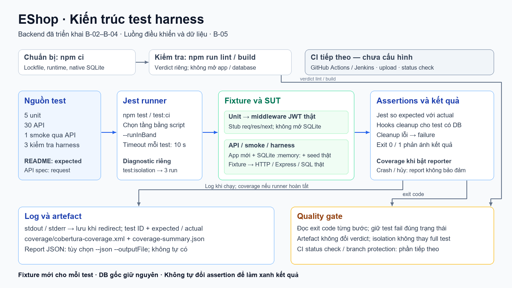
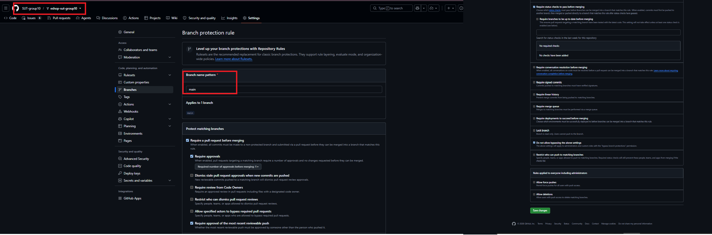
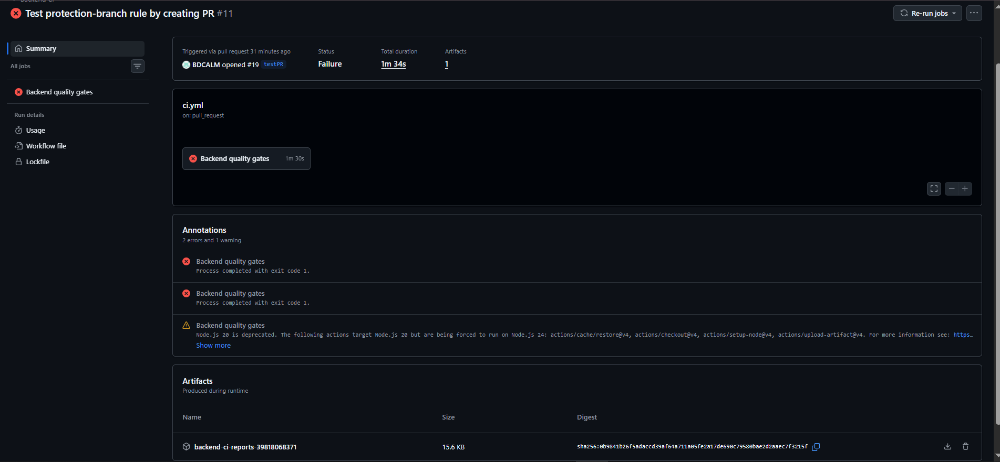
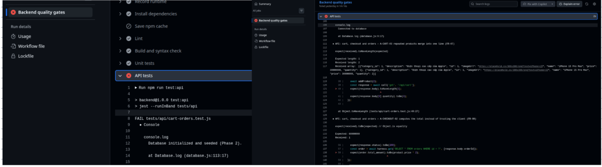
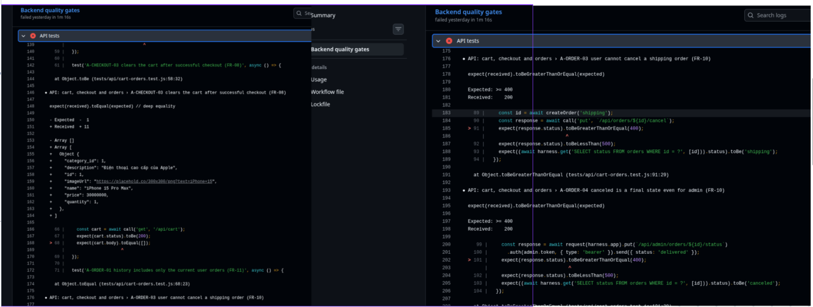
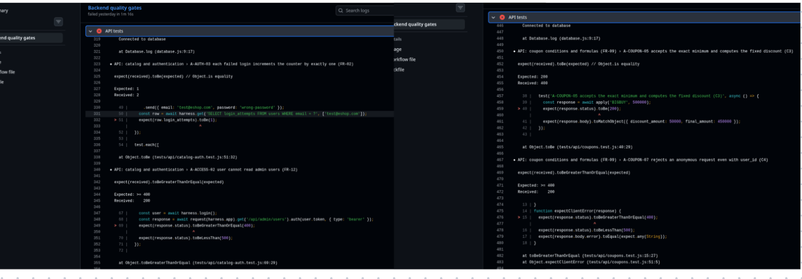
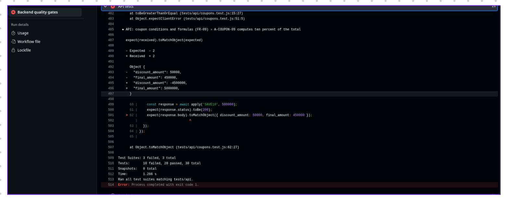

# GitHub Actions

## 1. Mục tiêu

Trong seminar T07, **GitHub Actions** được chọn làm hệ thống CI chính cho dự án EShop, trong khi Jenkins đóng vai trò nền tảng đối chiếu. Mục tiêu của phần này là trình bày cách nhóm thiết kế, triển khai và kiểm chứng một workflow CI tự động hóa hoàn toàn trên GitHub Actions có khả năng tái lập cao (deterministic), thực thi chuỗi cổng chất lượng (quality gates) từ kiểm tra cú pháp đến kiểm thử Unit, API, Smoke trên mã nguồn EShop, đồng thời thu thập đầy đủ báo cáo độ bao phủ (coverage) và log để phục vụ chẩn đoán lỗi kể cả khi kiểm thử thất bại.

Phạm vi bao gồm toàn bộ các nhiệm vụ từ **C-01** (thiết lập workflow trên PR và push), **C-02** (chuỗi cổng chất lượng `lint` → `build` → `unit`/`api`/`smoke`), **C-03** (tối ưu hóa và đo lường `npm cache` trong điều kiện baseline có lỗi), **C-04** (xuất báo cáo Cobertura XML và Jest JSON thành artefact), **C-05** (cấu hình Branch Protection và Required Status Check cho nhánh `main`), **C-06** (kiểm soát tính trung thực của số liệu coverage/badge) đến **C-07** (kiểm chứng khả năng tái lập từ bản clone sạch).

Toàn bộ cấu hình liên quan đến GitHub Actions và Test Harness nằm trong kho mã nguồn `SUT-group10/eshop-sut-group10`, được tổng hợp ở Bảng 1.

*Bảng 1. Các file cấu hình GitHub Actions và Test Harness trong repo*

| File | Vai trò |
| --- | --- |
| `.github/workflows/ci.yml` | Định nghĩa workflow `Backend CI` và job `Backend quality gates` |
| `backend/package.json` | Khai báo các script kiểm thử, quality gates và cấu hình `allowScripts` cho native addon |
| `backend/package-lock.json` | Khóa phiên bản dependency; đầu vào tính mã băm (hash) cho khóa `npm cache` |
| `backend/eslint.config.cjs` | Cấu hình kiểm tra tĩnh (ESLint) cho mã nguồn backend và Jest |
| `backend/jest.config.cjs` | Cấu hình Jest runner, môi trường thực thi và định dạng xuất Cobertura XML / JSON |
| `backend/scripts/check-syntax.cjs` | Script kiểm tra cú pháp (`node --check`) cho bước `npm run build` |
| `backend/tests/helpers/harness.js` | Bộ điều khiển Test Harness: khởi tạo SQLite `:memory:`, nạp seed và dọn dẹp (cleanup) |

---

## 2. Kiến trúc

Hệ thống CI trên GitHub Actions hoạt động theo mô hình hướng sự kiện (event-driven) trên hạ tầng đám mây của GitHub, gồm bốn thành phần chính: Kho mã nguồn & Sự kiện Git (Triggers), Định nghĩa Workflow (`ci.yml`), GitHub-hosted Runner (`ubuntu-22.04`) và Kho lưu trữ Artefact / Caches / Status Checks. Mối quan hệ giữa các thành phần được thể hiện ở Hình 1.



*Hình 1. Các thành phần chính và luồng hoạt động của GitHub Actions CI*

- **Kho mã nguồn và Sự kiện Git (GitHub Repository & Events):** Lưu trữ mã nguồn EShop, bộ kiểm thử và file `.github/workflows/ci.yml`. Mỗi khi có sự kiện `push` lên nhánh `main` hoặc mở/cập nhật một `pull_request` hướng vào `main`, GitHub tự động kích hoạt workflow và tạo một phiên chạy (workflow run) gắn với đúng `GITHUB_SHA` của commit đó.
- **Định nghĩa Workflow (`ci.yml`):** Mô tả pipeline dưới dạng mã YAML: quy định quyền hạn tối thiểu (`contents: read`), cơ chế chống chạy chồng chéo (`concurrency`), thư mục làm việc mặc định (`backend`) và danh sách các step tuần tự trong job `Backend quality gates`.
- **GitHub-hosted Runner (`ubuntu-22.04`):** Là máy ảo Linux sạch được cấp phát mới hoàn toàn cho mỗi lần chạy job. Runner tải mã nguồn, thiết lập môi trường Node.js cố định, khôi phục bộ nhớ đệm từ GitHub Cache, thực thi các lệnh npm trong môi trường SQLite `:memory:` cô lập của Test Harness và trả về mã thoát (exit code) thật của từng bước.
- **Hệ thống Caches, Artefacts và Branch Protection Gate:** Lưu trữ bộ đệm `~/.npm` giữa các lần chạy, giữ lại gói báo cáo `backend-ci-reports-<run_id>` trong 14 ngày để tải về phân tích, đồng thời cung cấp trạng thái của check `Backend quality gates` làm điều kiện bắt buộc (Required Status Check) để khóa hoặc mở nút Merge trên Pull Request.

Một lần thực thi workflow diễn ra theo trình tự sau:

1. Lập trình viên tạo commit hoặc mở Pull Request vào nhánh `main`; GitHub ghi nhận sự kiện và hủy các run cũ đang chạy dở trên cùng nhánh/PR nhờ cấu hình `concurrency`.
2. GitHub cấp phát một runner `ubuntu-22.04` mới, thực hiện `actions/checkout@v4` để lấy mã nguồn và cài đặt Node.js `22.14.0`.
3. Runner tính toán khóa băm từ `backend/package-lock.json`, khôi phục bộ đệm `~/.npm` (nếu có), chạy `npm ci` (biên dịch native addon `sqlite3` từ mã nguồn) và lưu lại cache mới ngay sau khi cài đặt thành công.
4. Runner chạy tuần tự chuỗi cổng chất lượng: `lint` → `build` → `test:unit` → `test:api` → `test:smoke`. Nếu một bước trả về exit code khác `0`, bước đó bị đánh dấu đỏ và các bước kiểm thử phụ thuộc phía sau bị dừng.
5. Bất kể bước kiểm thử trước đó thành công hay thất bại (miễn là run không bị hủy bỏ bởi người dùng — `!cancelled()`), runner vẫn thực thi bước sinh báo cáo tổng hợp (`cobertura-coverage.xml`, `coverage-summary.json`, `jest-report.json`) và tải lên thành Artefact.
6. GitHub cập nhật trạng thái cuối cùng của job `Backend quality gates` lên giao diện Pull Request để Branch Protection quyết định cho phép hay chặn thao tác Merge.

---

## 3. Môi trường triển khai

Để đảm bảo tính tất định (Determinism) và khả năng tái lập giữa các lần chạy, nhóm cố định toàn bộ phiên bản hệ điều hành runner, phiên bản Node.js, cơ chế biên dịch native module và phiên bản các GitHub Actions. Bảng 2 tổng hợp thông số môi trường thực thi, Bảng 3 liệt kê các GitHub Actions chính thức được sử dụng.

*Bảng 2. Thành phần môi trường và phiên bản trên GitHub Actions*

| Thành phần | Phiên bản / Giá trị cố định |
| --- | --- |
| Hệ điều hành Runner (`runs-on`) | `ubuntu-22.04` (`RUNNER_OS: Linux`) |
| Phiên bản Node.js | `22.14.0` (x64) |
| Phiên bản npm đi kèm | `10.9.2` *(Placeholder: Điền phiên bản npm từ log step `Record runtime`, ví dụ `10.9.2`)* |
| Biến môi trường biên dịch | `npm_config_build_from_source: "true"` (bắt buộc cho `sqlite3` trên Linux runner) |
| Cơ sở dữ liệu khi chạy test | SQLite `:memory:` (cô lập hoàn toàn cho từng ca kiểm thử qua `harness.js`) |
| Thư mục làm việc (`working-directory`) | `backend` |
| Giới hạn thời gian (`timeout-minutes`) | `15` phút |
| Quyền hạn (`permissions`) | `contents: read` (nguyên tắc đặc quyền tối thiểu) |

*Bảng 3. Các GitHub Actions sử dụng trong workflow*

| Action | Phiên bản | Chức năng trong pipeline |
| --- | --- | --- |
| `actions/checkout` | `v4` | Tải mã nguồn repository ở đúng commit SHA kích hoạt sự kiện |
| `actions/setup-node` | `v4` | Cài đặt và cố định phiên bản Node.js `22.14.0` trên runner |
| `actions/cache/restore` | `v4` | Tìm và khôi phục bộ đệm thư mục `~/.npm` dựa trên mã băm của `backend/package-lock.json` |
| `actions/cache/save` | `v4` | Lưu bộ đệm `~/.npm` ngay sau bước `npm ci` (tránh bị bỏ qua khi step test phía sau fail) |
| `actions/upload-artifact` | `v4` | Đóng gói và tải lên `cobertura-coverage.xml`, `coverage-summary.json` và `jest-report.json` |

---

## 4. Quy trình triển khai và vận hành từ bản sao sạch (Clean Clone)

Phần này hướng dẫn từng bước để một thành viên bất kỳ kiểm chứng hệ thống từ một máy trắng , kích hoạt CI trên GitHub (Task **C-01, C-02**), đo lường bộ nhớ đệm (Task **C-03**) và thiết lập cổng bảo vệ nhánh `main` (Task **C-05**).

### 4.1. Kiểm chứng tại máy cục bộ từ bản clone sạch (Task C-07)

Để chứng minh bộ kiểm thử không phụ thuộc vào thư mục `node_modules` cũ, file cơ sở dữ liệu cục bộ hay biến môi trường ngầm trên máy cá nhân, người thực hiện mở terminal tại một thư mục trống hoàn toàn và chạy tuần tự các lệnh sau:

```bash
git clone https://github.com/SUT-group10/eshop-sut-group10.git clean-clone
cd clean-clone/backend
node --version
npm --version
npm ci
npm run lint
npm run build
npm run test:unit
npm run test:api
npm run test:smoke
npm run test:ci -- --json --outputFile=test-results/jest-report.json
git status

```

**Lưu ý về quyền thực thi script cài đặt (`install-scripts`) của `sqlite3`:**
Trên các môi trường npm bật cơ chế bảo mật chặn post-install script, lệnh `npm ci` có thể cảnh báo chưa cấp quyền chạy script biên dịch cho `sqlite3@6.0.1`, `@parcel/watcher` và `unrs-resolver`. Nhóm đã xử lý triệt để bằng cách phê duyệt và đóng gói cấu hình vào `package.json` (hoặc chạy `npm rebuild sqlite3 --build-from-source` khi cần kiểm tra thủ công). Nhờ đó, trên runner CI với biến `npm_config_build_from_source: "true"`, `sqlite3` luôn được biên dịch tự động mà không cần can thiệp tay.

Sau khi chạy xong chuỗi lệnh trên từ bản clone sạch:

* Các lệnh `npm ci`, `npm run lint`, `npm run build` và `npm run test:unit` đều trả về exit code `0` (Pass).
* Lệnh `npm run test:api` và `npm run test:ci` trả về đúng baseline 10 lỗi nghiệp vụ của SUT (29 pass / 10 fail trên tổng số 39 test).
* Các file báo cáo `backend/coverage/cobertura-coverage.xml`, `backend/coverage/coverage-summary.json` và `backend/test-results/jest-report.json` được sinh ra đầy đủ.
* Lệnh `git status` xác nhận kho mã nguồn và database gốc không bị biến đổi sau khi chạy kiểm thử.
* **Tiêu chuẩn nghiệm thu (Verification):**
Sau khi chạy toàn bộ chuỗi lệnh trên, quá trình Clean Clone được xác nhận là thành công tuyệt đối nếu output tại bước cuối cùng (`npm run test:ci` và `git status`) in ra kết quả như sau:

```bash
=============================== Coverage summary ===============================
Statements   : 57.98% ( 178/307 )
Branches     : 39.09% ( 52/133 )
Functions    : 39.72% ( 29/73 )
Lines        : 61.48% ( 174/283 )
================================================================================

Test Suites: 3 failed, 3 passed, 6 total
Tests:       10 failed, 29 passed, 39 total
Snapshots:   0 total
Time:        4.47 s, estimated 5 s
Ran all test suites.
Test results written to: test-results/jest-report.json
On branch main
Your branch is up to date with 'origin/main'.
```

### 4.2. Kích hoạt Workflow và cấu hình tách bước Cache 

File `.github/workflows/ci.yml` tự động kích hoạt khi đẩy code hoặc mở PR vào `main`. Điểm kỹ thuật quan trọng nhất trong quy trình triển khai của nhóm nằm ở cách thiết lập bộ nhớ đệm `npm cache`:

* **Vấn đề của cấu hình mặc định:** Khi dùng tham số tích hợp `cache: npm` trong `actions/setup-node@v4` hoặc cờ `save-always: true` (đã bị deprecated) trong `actions/cache@v4`, việc lưu cache được đặt ở bước ẩn `Post ...` cuối Job. Vì mã nguồn SUT hiện có 10 lỗi nghiệp vụ làm step `API tests` trả về exit code `1`, GitHub Actions tự động bỏ qua (skip) các bước `Post`, khiến cache không bao giờ được lưu sau các lần chạy.
* **Giải pháp triển khai thực tế:** Nhóm tách riêng thao tác khôi phục (`actions/cache/restore@v4` với `id: npm-cache`) đặt trước `npm ci` và thao tác lưu (`actions/cache/save@v4`) đặt **ngay sau `npm ci**` (khi mọi bước trước đó vẫn đang xanh), kèm điều kiện:
```yaml
if: ${{ !cancelled() && steps.npm-cache.outputs.cache-hit != 'true' }}

```


* **Cách đo Cache Miss và Cache Hit:**
1. Đẩy commit chứa cấu hình tách bước cache lên nhánh để kích hoạt **Run 1 (Cache Miss)**. Kiểm tra step `Restore npm cache` báo *Cache not found*, và step `Save npm cache` ngay sau `npm ci` báo *Cache saved successfully*.
2. Giữ nguyên `backend/package-lock.json`, nhấn **Re-run all jobs** trên cùng Run (hoặc đẩy một commit chỉ sửa tài liệu) để kích hoạt **Run 2 (Cache Hit)**. Kiểm tra step `Restore npm cache` báo *Cache restored from key...* và step `Save npm cache` tự động được bỏ qua.


### 4.3. Cấu hình Branch Protection và kiểm thử PR Gate (Task C-05)

Để biến job `Backend quality gates` thành cổng kiểm soát chất lượng thực sự trước khi gộp mã vào nhánh chính, quản trị viên repository thực hiện cấu hình tại **Settings → Branches → Branch protection rules** (hoặc **Rulesets**) cho nhánh `main` như Bảng 4.

*Bảng 4. Cấu hình bảo vệ nhánh `main` trên GitHub*

| Tùy chọn bảo vệ (Protection Rule) | Giá trị thiết lập |
| --- | --- |
| Branch name pattern | `main` |
| Require a pull request before merging | Bật (Enabled) — Yêu cầu tạo PR và có review trước khi merge |
| Require status checks to pass before merging | Bật (Enabled) |
| Required status check name | `Backend quality gates` (chọn đúng tên job thực tế của `ci.yml`) |
| Do not allow bypassing the above settings | Bật (Enabled) — Áp dụng cho cả quản trị viên để ngăn merge cưỡng bức khi check đỏ |  
  



*Hình 2. Cấu hình bắt buộc status check `Backend quality gates` trên nhánh `main*`

Sau khi lưu cấu hình, nhóm kiểm chứng hoạt động của cổng chất lượng bằng hai kịch bản Pull Request đối chứng:

* **Kịch bản PR Fail:** Mở Pull Request từ nhánh còn lỗi kiểm thử (hoặc nhánh cố tình sửa sai một assertion trong test). Khi check `Backend quality gates` báo **Failing**, GitHub khóa nút **Merge pull request** và hiển thị thông báo chặn merge.
* *Link PR Fail minh chứng:* `https://github.com/SUT-group10/eshop-sut-group10/pull/19`


* **Kịch bản PR Pass:** Mở Pull Request từ nhánh thử nghiệm đã thỏa mãn toàn bộ điều kiện kiểm thử (hoặc nhánh xác nhận khi toàn bộ các step trong `Backend quality gates` trả về exit code `0`). Khi check `Backend quality gates` chuyển sang màu xanh (**Successful**), GitHub mở khóa nút **Merge pull request**. Sau khi thu thập xong bằng chứng, nhóm đóng PR thử nghiệm để giữ nguyên trạng thái baseline của SUT trên nhánh `main`.
* *Link PR Pass minh chứng:* `https://github.com/SUT-group10/eshop-sut-group10/pull/20`


---

## 5. Thiết kế pipeline

Workflow `Backend CI` chỉ định một job duy nhất tên là `Backend quality gates` gồm 12 bước (steps) nối tiếp nhau. Thiết kế tuân thủ nguyên tắc **Fail-Fast đối với các cổng kiểm thử** nhưng **Always-Collect đối với tầng thu thập báo cáo**. Sơ đồ luồng thực thi của các step như sau:

```text
Checkout → Setup Node 22.14.0 → Restore Cache → Record Runtime → Install (npm ci) → Save Cache
   └──► Lint → Build → Unit Tests → API Tests → Smoke Tests
                                                    └──► [if: !cancelled()] Generate Reports → Upload Artifacts

```

Bảng 5 mô tả chi tiết lệnh thực thi, điều kiện chạy và mục đích của từng step trong `.github/workflows/ci.yml`.

*Bảng 5. Các step trong job `Backend quality gates*`

| Thứ tự & Tên Step | Action / Lệnh thực thi (trong `backend/`) | Điều kiện chạy (`if`) | Mục đích |
| --- | --- | --- | --- |
| 1. `Check out source` | `actions/checkout@v4` | Mặc định (`success()`) | Lấy mã nguồn đúng commit SHA vào workspace sạch của runner |
| 2. `Set up Node.js 22` | `actions/setup-node@v4` (`22.14.0`) | Mặc định (`success()`) | Cài đặt đúng phiên bản Node.js `22.14.0` |
| 3. `Restore npm cache` | `actions/cache/restore@v4` (`~/.npm`) | Mặc định (`success()`) | Khôi phục cache npm theo hash của `backend/package-lock.json` |
| 4. `Record runtime` | `node --version`, `npm --version`, in `GITHUB_SHA`, `RUNNER_OS` | Mặc định (`success()`) | Ghi vết môi trường thực thi vào log để phục vụ truy vết và kiểm toán |
| 5. `Install dependencies` | `npm ci` (với `npm_config_build_from_source="true"`) | Mặc định (`success()`) | Cài đặt chính xác cây thư viện từ lockfile và biên dịch `sqlite3` |
| 6. `Save npm cache` | `actions/cache/save@v4` (`~/.npm`) | `!cancelled() && cache-hit != 'true'` | Lưu bộ đệm `~/.npm` ngay khi cài đặt xong nếu lần chạy đó bị cache miss |
| 7. `Lint` | `npm run lint` (`eslint --max-warnings=0`) | Mặc định (`success()`) | Cổng kiểm tra chất lượng mã tĩnh; chặn ngay nếu có lỗi hoặc cảnh báo |
| 8. `Build and syntax check` | `npm run build` (`node scripts/check-syntax.cjs`) | Mặc định (`success()`) | Kiểm tra cú pháp toàn bộ file `.js`/`.cjs` của backend trước khi chạy test |
| 9. `Unit tests` | `npm run test:unit` | Mặc định (`success()`) | Chạy 5 unit test cho middleware xác thực JWT (mock DB) |
| 10. `API tests` | `npm run test:api` | Mặc định (`success()`) | Chạy 30 integration/API test với Express + Supertest + SQLite `:memory:` |
| 11. `Smoke tests` | `npm run test:smoke` | Mặc định (`success()`) | Chạy 1 kịch bản mua hàng đầu-cuối (end-to-end API flow); bị bỏ qua nếu API test trước đó fail |
| 12. `Generate coverage and Jest report` | `npm run test:ci -- --json --outputFile=test-results/jest-report.json` | `${{ !cancelled() }}` | Chạy trọn bộ 39 test (gồm cả harness test) ở chế độ tuần tự để xuất Cobertura XML, JSON summary và Jest JSON report |
| 13. `Upload coverage and test report` | `actions/upload-artifact@v4` (`if-no-files-found: error`) | `${{ !cancelled() }}` | Tải 3 file báo cáo lên GitHub Artifacts với thời hạn lưu trữ 14 ngày; báo lỗi nếu thiếu bất kỳ file nào |

Thiết kế trên đảm bảo tính trung thực tuyệt đối của pipeline:

* **Không che giấu lỗi:** Không có bất kỳ bước nào dùng `continue-on-error: true`, `|| true`, `--passWithNoTests` hay thay thế kiểm thử nghiệp vụ bằng script chẩn đoán cô lập (`test:isolation`).
* **Luôn có dữ liệu chẩn đoán khi pipeline đỏ:** Nhờ điều kiện `if: ${{ !cancelled() }}` ở hai bước cuối cùng, ngay cả khi `API tests` thất bại làm toàn bộ job mang trạng thái `Failure`, runner vẫn thu thập đầy đủ báo cáo độ bao phủ và chi tiết từng assertion lỗi trong `jest-report.json` để tải lên mục Artifacts.

---

## 6. Kết quả thực nghiệm

### 6.1. Kết quả chạy Quality Gates và thu thập Artefact

Kết quả dưới đây được trích xuất từ phiên chạy GitHub Actions thực tế trên nhánh `[testPR](https://github.com/SUT-group10/eshop-sut-group10/tree/testPR)`, commit `cbdcb88`, URL: `https://github.com/SUT-group10/eshop-sut-group10/commit/cbdcb885cc3974bea7f3b1749f28aa2f9a9bfd91`. Bảng 6 tóm tắt kết quả từng step.

*Bảng 6. Kết quả thực thi các step trong một phiên chạy điển hình trên baseline hiện tại*

| Step | Exit code | Kết quả | Thời lượng | Ghi chú từ log thực tế |
| --- | --- | --- | --- | --- |
| `Check out source` | `0` | Pass | `<1s` | Lấy đúng commit SHA kích hoạt workflow |
| `Set up Node.js 22` | `0` | Pass | `5s` | Cài đặt Node `v22.14.0` |
| `Restore npm cache` | `0` | Pass | `2s` | Khôi phục hoặc kiểm tra khóa cache `Linux-node-22.14.0-npm-...` |
| `Record runtime` | `0` | Pass | `<1s` | Ghi nhận `v22.14.0`, `RUNNER_OS: Linux` |
| `Install dependencies` | `0` | Pass | `1m12s` | Cài đặt 483 packages và biên dịch native binding `sqlite3` |
| `Save npm cache` | `0` | Pass / Skipped | `0` | Lưu cache ở lần Miss (1s); tự động Skipped ở lần Hit (0s) |
| `Lint` | `0` | Pass | `~1s` | ESLint hoàn tất với 0 lỗi, 0 cảnh báo |
| `Build and syntax check` | `0` | Pass | `1s` | Toàn bộ file backend vượt qua kiểm tra cú pháp |
| `Unit tests` | `0` | Pass | `0s` | 5/5 unit test (`authentication.test.js`) đạt yêu cầu |
| `API tests` | `1` | **Failed** | `3s` | 30 API test: **20 pass, 10 fail** (phát hiện đúng 10 lỗi nghiệp vụ của SUT) |
| `Smoke tests` | `-` | **Skipped** | `0s` | Tự động bỏ qua do step `API tests` phía trước trả về exit code `1` |
| `Generate coverage and Jest report` | `1` | **Fail (nhưng vẫn xuất file)** | `2s` | Chạy đủ 39 test (29 pass, 10 fail); ghi thành công XML/JSON ra đĩa trước khi thoát với mã `1` |
| `Upload coverage and test report` | `0` | Pass | `1s` | Upload thành công gói `backend-ci-reports-<run_id>` (3 files) |
| **Tổng kết Job (`Backend quality gates`)** | **`1`** | **FAILURE** | **`1m34s`** | **Quality gate chặn đúng mã nguồn còn lỗi; Artefact vẫn tải về được** |



*Hình 3. Kết quả phiên chạy trên GitHub Actions và gói báo cáo được lưu tại mục Artifacts*

### 6.2. Kết quả đo lường hiệu quả của `npm cache` (Task C-03)

Nhóm thực hiện đo hai lần chạy liên tiếp trên cùng một [commit](https://github.com/SUT-group10/eshop-sut-group10/pull/10/commits/5297dd82b0512709ab598fa9a2cbb42bd8a0dd51)/lockfile (`backend/package-lock.json` có mã băm `7c08e1ce2d98b13fa94005160c0f254bb6459662f4051a6d6de73ea9a8af2f71`), cùng hệ điều hành `ubuntu-22.04` và Node `22.14.0`. Kết quả được trình bày ở Bảng 7.

*Bảng 7. So sánh thời lượng giữa lần chạy Cache Miss và Cache Hit (Task C-03)*

| Chỉ số đo lường | Lần chạy 1 (Cache Miss) | Lần chạy 2 (Cache Hit) | Nhận xét / Chênh lệch |
| --- | --- | --- | --- |
| **Run URL** | `https://github.com/SUT-group10/eshop-sut-group10/actions/runs/39728833825/attempts/1` | `https://github.com/SUT-group10/eshop-sut-group10/actions/runs/39728833825` | Cùng khóa cấu hình và môi trường runner |
| **Trạng thái `Restore npm cache**` | `Cache not found` | `Cache restored from key` | Khôi phục đúng gói tarballs trong `~/.npm` |
| **Trạng thái `Save npm cache**` | `Cache saved successfully` | `Skipped` | Không tốn thời gian ghi đè cache ở lần chạy thứ hai |
| **Thời gian step `Install dependencies` (`npm ci`)** | `1m11s` | `55s` | Giảm `16s ~ 22.5%`; phần thời gian còn lại ở lần Hit chủ yếu do biên dịch C++ cho `sqlite3` |
| **Tổng thời gian Job (`Total duration`)** | `1m32s` | `1m11s` | Rút ngắn đáng kể vòng lặp phản hồi (feedback loop) trên mỗi PR |

### 6.3. Số liệu Coverage thực tế và quyết định về Coverage Badge (Task C-04, C-06)

Khi tải gói artefact `backend-ci-reports-<run_id>` về giải nén, nhóm thu được đầy đủ ba tệp: `cobertura-coverage.xml`, `coverage-summary.json` và `jest-report.json`. Số liệu độ bao phủ mã nguồn tính trên hai tệp cốt lõi của hệ thống (`backend/server.js` và `backend/database.js`) từ `coverage-summary.json` khớp hoàn toàn với lần chạy cục bộ và trên Jenkins:

* **Lines coverage:** `61.48%` (`174 / 283` dòng)
* **Statements coverage:** `57.98%` (`178 / 307` dòng)
* **Functions / Methods coverage:** `39.73%` (`29 / 73` hàm)
* **Branches coverage:** `39.09%` (`52 / 133` nhánh trong `coverage-summary.json`; tương ứng `41.74%` tức `48 / 115` nhánh theo chuẩn quy đổi của `cobertura-coverage.xml`).

**Về việc hiển thị Coverage Badge (Task C-06):**
Theo đúng quy tắc kỹ thuật nhóm **tuyệt đối không gắn huy hiệu (badge) chứa con số coverage tĩnh (hard-coded)** lên `README.md` vì huy hiệu tĩnh sẽ nhanh chóng sai lệch so với kết quả thực tế khi mã nguồn thay đổi, gây hiểu lầm về chất lượng hệ thống. Do workflow hiện khóa quyền ở mức tối thiểu `permissions: contents: read` để bảo mật và không đẩy dữ liệu sang dịch vụ bên thứ ba (như Codecov/Coveralls), nhóm sử dụng trực tiếp tệp `coverage-summary.json` và `cobertura-coverage.xml` trong gói Artefact của từng run làm nguồn dữ liệu chuẩn xác duy nhất (Single Source of Truth).

---

## 7. Phân tích kết quả và chẩn đoán lỗi từ Log / Artefact

### 7.1. Giải thích hành vi dừng ở `API tests` và ý nghĩa của 10 lỗi Baseline

Trong Bảng 6, việc job dừng bước kiểm thử tại `API tests` (khiến `Smoke tests` bị đánh dấu *Skipped*) nhưng vẫn chạy hai bước tạo/tải báo cáo ở cuối là hành vi hoàn toàn đúng theo thiết kế:

* **Khi chạy theo từng tầng (`test:unit` → `test:api` → `test:smoke`):** Tổng số kiểm thử của ba tầng này là 36 test (5 unit, 30 API, 1 smoke). Khi `test:api` phát hiện 10 lỗi nghiệp vụ của SUT và trả về exit code `1`, GitHub Actions lập tức chặn đứng tiến trình kiểm thử chức năng để báo hiệu cổng chất lượng không đạt.
* **Khi chạy bước thu thập báo cáo (`npm run test:ci`):** Lệnh này chạy lại toàn bộ 39 test của kho mã nguồn (bao gồm 5 unit, 30 API, 1 smoke và 3 harness isolation test). Kết quả ghi nhận vào `jest-report.json` là **29 test pass và 10 test fail**, khớp tuyệt đối với baseline đã xác lập ở Task B-04 và trên Jenkins (`A-AUTH-03`, `A-ACCESS-02`, `A-CART-03`, `A-CHECKOUT-02`, `A-CHECKOUT-03`, `A-ORDER-03`, `A-ORDER-04`, `A-COUPON-05`, `A-COUPON-07`, `A-COUPON-09`).

### 7.2. Minh họa quy trình chẩn đoán lỗi trên GitHub Actions (`A-AUTH-03` / `A-COUPON-05`)

Giả sử một kiểm thử viên nhận thấy phiên chạy CI báo đỏ ở bước `API tests`, quy trình khoanh vùng và chẩn đoán nguyên nhân trên GitHub Actions diễn ra qua 3 bước mà không cần chạy lại trên máy cá nhân:

1. **Đọc trực tiếp log của step bị đánh dấu đỏ trên giao diện Actions:**
Mở rộng step `API tests`, tìm từ khóa `FAIL tests/api/` để xác định tên file và mã định danh ca kiểm thử bị lỗi. Ví dụ với lỗi tại `tests/api/coupons.test.js` (`A-COUPON-05` — kiểm tra điều kiện biên tổng đơn hàng tối thiểu `min_order_amount` theo yêu cầu **FR-09**):
* Log hiển thị rõ: Khi áp dụng mã `SAVE10` (ngưỡng tối thiểu `300,000 ₫`) cho đơn hàng có `total_amount = 300000` (đúng bằng giá trị biên), kiểm thử kỳ vọng HTTP `200 OK` kèm tiền giảm giá, nhưng nhận về HTTP `400 Bad Request`.


2. **Đối chiếu với tệp `jest-report.json` trong gói Artefact:**
Tải gói `backend-ci-reports-<run_id>` về máy, mở `jest-report.json` để xem mảng `assertionResults`. Tệp JSON cung cấp chính xác thông điệp `failureMessages`, số dòng mã nguồn trong file test và thời gian chạy của từng ca kiểm thử dưới định dạng có cấu trúc (rất thuận lợi để làm đầu vào chuẩn hóa cho công cụ AI Triage).
3. **Truy ngược về mã nguồn SUT ở đúng `GITHUB_SHA`:**
Dựa vào `Commit SHA` được in ở step `Record runtime`, kiểm thử viên mở file `backend/server.js` tại đúng phiên bản đó và phát hiện câu lệnh điều kiện đang viết `if (total_amount <= coupon.min_order_amount)` thay vì `<` (hoặc tương tự ở các lỗi `A-AUTH-03` tăng bộ đếm sai, `A-CHECKOUT-02` tin tưởng `total_amount` từ client). Nhờ đó, nhóm khẳng định lỗi thuộc về mã nguồn SUT vi phạm đặc tả chứ không phải lỗi môi trường runner.

Hình 4.1 đến Hình 4.4 được lấy từ [Run](https://github.com/SUT-group10/eshop-sut-group10/actions/runs/39728833825/job/119660329330) từ commit ở mục 6.2


*Hình 4.1 Log chi tiết chỉ rõ vị trí assertion thất bại ngay trên giao diện GitHub Actions*


*Hình 4.2 Log chi tiết chỉ rõ vị trí assertion thất bại ngay trên giao diện GitHub Actions*


*Hình 4.3 Log chi tiết chỉ rõ vị trí assertion thất bại ngay trên giao diện GitHub Actions*


*Hình 4.4 Log chi tiết chỉ rõ vị trí assertion thất bại ngay trên giao diện GitHub Actions*

---

## 8. Vận hành, xử lý sự cố và 3 Failure Modes thực tế

### 8.1. Bảng xử lý sự cố thường gặp (Troubleshooting)

Bảng 8 tổng hợp các sự cố thực tế đã phát sinh trong quá trình nhóm xây dựng pipeline GitHub Actions và cách khắc phục.

*Bảng 8. Các sự cố thường gặp trên GitHub Actions và cách xử lý*

| Hiện tượng trên GitHub Actions | Nguyên nhân gốc rễ | Cách xử lý chuẩn xác |
| --- | --- | --- |
| Chạy nhiều lần nhưng log luôn báo `npm cache is not found` | Dùng `cache: npm` mặc định của `setup-node` hoặc `save-always` (deprecated); khi step `API tests` bị đỏ, bước `Post` ở cuối job tự động bị skipped nên không lưu được cache | Tách thành 2 bước `actions/cache/restore@v4` (trước `npm ci`) và `actions/cache/save@v4` (ngay sau `npm ci`) với điều kiện `!cancelled() && cache-hit != 'true'` |
| Lỗi `Cannot find module '.../node_sqlite3.node'` hoặc cảnh báo `install-scripts` khi chạy `npm ci` | Native binding của `sqlite3` chưa được biên dịch cho kiến trúc của máy chạy hoặc bị chặn post-install script | Đặt `npm_config_build_from_source: "true"` ở step `Install dependencies` trên CI; phê duyệt `allowScripts` trong `package.json` hoặc chạy `npm rebuild sqlite3 --build-from-source` ở local |
| Step `Upload coverage and test report` báo lỗi `No files were found` | Step `Generate coverage and Jest report` không có `if: ${{ !cancelled() }}` nên bị bỏ qua khi `API tests` phía trước fail | Gắn `if: ${{ !cancelled() }}` cho cả step sinh báo cáo và step upload artefact; tạo trước thư mục bằng `mkdir -p test-results` |
| Không tìm thấy tên check `Backend quality gates` trong cài đặt Branch Protection | Workflow chưa từng được kích hoạt trên GitHub hoặc người dùng gõ nhầm tên workflow (`Backend CI`) thay vì tên job | Đẩy ít nhất 1 commit để workflow chạy lần đầu, sau đó gõ đúng giá trị trường `jobs.quality.name` là `Backend quality gates` vào ô tìm kiếm |
| Pull Request đã chạy xong check nhưng nút Merge vẫn cho phép Admin bấm dù check đỏ | Chưa bật tùy chọn áp dụng quy tắc bảo vệ nhánh cho quản trị viên | Bật *Do not allow bypassing the above settings* (hoặc *Include administrators*) trong cấu hình Branch Protection của `main` |

### 8.2. Ba kịch bản công cụ gây hiểu lầm (3 Real Failure Modes — Yêu cầu bắt buộc của T07)

Đáp ứng yêu cầu đặc thù của đề tài T07 (*"User guide MUST include a 'failure modes' section listing 3 real ways the tool can mislead users"*), nhóm đúc kết **ba cơ chế gây hiểu lầm thực tế** đã trực tiếp trải nghiệm khi vận hành GitHub Actions, bộ đệm và công cụ AI hỗ trợ trên dự án EShop:

1. **Failure Mode 1 — Cờ `save-always: true` của `actions/cache@v4` gây ảo tưởng rằng cache luôn được lưu khi build đỏ (Deprecated / Silent Skip):**
* *Cơ chế gây hiểu lầm:* Khi cấu hình `save-always: true` trong `actions/cache@v4` (theo gợi ý phổ biến của các mô hình AI hoặc tài liệu cũ), workflow vẫn chạy qua bước khởi tạo mà không báo lỗi cú pháp YAML. Người dùng dễ lầm tưởng cache đã được lưu an toàn sau mỗi lần chạy. Tuy nhiên trên thực tế, GitHub đã vô hiệu hóa chức năng này (*"save-always does not work as intended"*) và vì cơ chế `Post` step của runner vẫn bị bỏ qua khi `API tests` trả về mã thoát khác `0`, bộ nhớ đệm hoàn toàn trống rỗng.
* *Cách kiểm chứng và phòng tránh:* Luôn kiểm tra tab **Actions → Caches** và đọc log của bước `Post` / `Save` thay vì chỉ nhìn cấu hình YAML; sử dụng `actions/cache/restore` và `actions/cache/save` tách rời ngay sau bước cài đặt thư viện.


2. **Failure Mode 2 — "Mù cảnh báo" do Pipeline luôn đỏ (Alert Fatigue / Masked Regressions) và Bẫy exit code `0` của lệnh chẩn đoán:**
* *Cơ chế gây hiểu lầm:* Có hai chiều hướng đánh lừa người xem trên hệ thống hiện tại. Thứ nhất, vì SUT có sẵn 10 lỗi nghiệp vụ làm badge và trạng thái tổng của mọi phiên chạy đều báo **FAILURE (Đỏ)**, lập trình viên rất dễ rơi vào trạng thái "quen mắt với màu đỏ" (alert fatigue) và bỏ qua khi có lỗi cú pháp mới hoặc lỗi kiểm thử thứ 11 phát sinh. Thứ hai, ngược lại, script chẩn đoán `npm run test:isolation` trả về **exit code `0` (Xanh)** ngay cả khi hệ thống vẫn còn nguyên 10 lỗi nghiệp vụ (vì script này chỉ kiểm tra xem kết quả giữa các lần chạy có ổn định và cô lập hay không). Nếu đưa nhầm `test:isolation` làm cổng chất lượng chính, pipeline sẽ báo xanh giả tạo (False Positive).
* *Cách kiểm chứng và phòng tránh:* Không bao giờ dùng script diagnostic thay cho test suite nghiệp vụ; khi pipeline đỏ, bắt buộc đối chiếu số lượng test fail trong `jest-report.json` với con số baseline (10 lỗi) và kiểm tra từng step riêng biệt (`Lint`, `Build`, `Unit`, `API`).


3. **Failure Mode 3 — Ảo tưởng về hiệu năng của `npm cache` khi dự án chứa Native C++ Addon (`sqlite3`) và rủi ro che khuất lỗi dependency:**
* *Cơ chế gây hiểu lầm:* Người dùng thường kỳ vọng khi log báo `Cache restored from key...` (Cache Hit), bước `npm ci` sẽ hoàn tất gần như tức thì (1–2 giây) và mọi vấn đề cài đặt đều đã được giải quyết. Thực tế, `npm cache` chỉ lưu các gói nén `.tgz` trong `~/.npm` chứ không lưu thư mục `node_modules` đã biên dịch. Với biến `npm_config_build_from_source: "true"`, runner vẫn phải giải nén và gọi trình biên dịch C++ (`node-gyp`) để build lại `sqlite3` từ đầu, khiến thời gian chạy `npm ci` khi Cache Hit vẫn có thể kéo dài từ vài giây đến hàng chục giây tùy tải CPU của máy ảo đám mây. Ngược lại, nếu người dùng cố tình cache trực tiếp cả thư mục `node_modules` để ăn gian tốc độ, bộ đệm cũ có thể che khuất lỗi tương thích nhị phân (binary incompatibility) hoặc lỗi thiếu cấu hình `allowScripts` khi triển khai sang một môi trường mới.
* *Cách kiểm chứng và phòng tránh:* Chỉ cache `~/.npm` thay vì `node_modules`, luôn kèm theo bài kiểm tra từ bản sao sạch (Clean Clone — Task C-07) để đảm bảo quy trình biên dịch phụ thuộc hoạt động minh bạch.


## 9. Hạn chế

Hệ thống CI trên GitHub Actions hiện tại của nhóm có bốn giới hạn được ghi nhận rõ ràng:

1. **Phạm vi chỉ bao phủ phân hệ Backend (`backend-only`):** Workflow `.github/workflows/ci.yml` hiện đặt `working-directory: backend` để tập trung vào kiểm thử Unit, API và Smoke của máy chủ Express/SQLite; ba phân hệ giao diện (`frontend-web`, `frontend-admin`, `frontend-mobile`) chưa được đưa vào cổng kiểm tra tự động trên mỗi PR.
2. **Bước `build` chỉ là kiểm tra cú pháp tĩnh:** Do backend viết bằng CommonJS thuần không qua bước biên dịch (transpile/bundle), lệnh `npm run build` chỉ gọi `node --check` thông qua `scripts/check-syntax.cjs` chứ không đóng gói tạo thư mục phân phối (`dist/`) hay kiểm tra khả năng mở cổng mạng thực tế.
3. **Độ bao phủ mã nguồn (Coverage) mới dừng ở mức quan sát (Observability):** Mặc dù `cobertura-coverage.xml` và `coverage-summary.json` luôn được sinh và lưu trữ sau mỗi lần chạy, pipeline chưa áp đặt ngưỡng chặn cứng (coverage threshold gate) để đánh trượt build dựa trên tỷ lệ phần trăm coverage, và chưa tích hợp dịch vụ bên ngoài để hiển thị huy hiệu động (dynamic badge).
4. **Sự phụ thuộc vào tài nguyên máy ảo dùng chung của GitHub:** Thời gian biên dịch từ mã nguồn của `sqlite3` ở bước `npm ci` có độ dao động nhất định giữa các lần chạy (từ vài giây đến khoảng 1 phút) tùy thuộc vào hiệu năng CPU và băng thông I/O của GitHub-hosted runner được cấp phát tại thời điểm đó.


## 10. Kết luận

Nhóm đã xây dựng và vận hành thành công hệ thống CI chính trên **GitHub Actions** đáp ứng đầy đủ các tiêu chuẩn của **Test-Harness Engineering**: môi trường thực thi được khóa chặt (`ubuntu-22.04`, Node `22.14.0`, `npm ci`), cơ sở dữ liệu kiểm thử được cô lập hoàn toàn bằng SQLite `:memory:`, bộ nhớ đệm `npm cache` được tách bước khôi phục/lưu thông minh để hoạt động tin cậy ngay cả khi kiểm thử nghiệp vụ thất bại, và cổng bảo vệ nhánh `main` (Branch Protection với check `Backend quality gates`) đã được kiểm chứng qua cả hai kịch bản PR Pass và PR Fail.

Kết quả thực thi trên GitHub Actions thống nhất tuyệt đối với môi trường Clean Clone cục bộ và nền tảng đối chiếu Jenkins: phát hiện chính xác 10 lỗi nghiệp vụ baseline của SUT (29/39 test pass, line coverage đạt 61,48%) và tự động xuất đầy đủ gói artefact (`cobertura-coverage.xml`, `coverage-summary.json`, `jest-report.json`) ở mọi phiên chạy. Hạ tầng này đóng vai trò là nền tảng cốt lõi để nhóm thực hiện phép so sánh đa nền tảng với Jenkins (Task D-05, D-06) cũng như triển khai thí nghiệm 10 lần chạy Flaky Test và đánh giá khả năng chẩn đoán log của AI (Task E).


