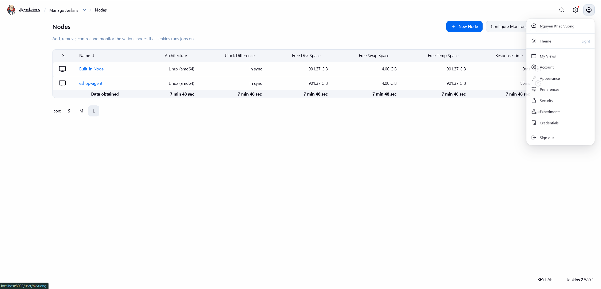
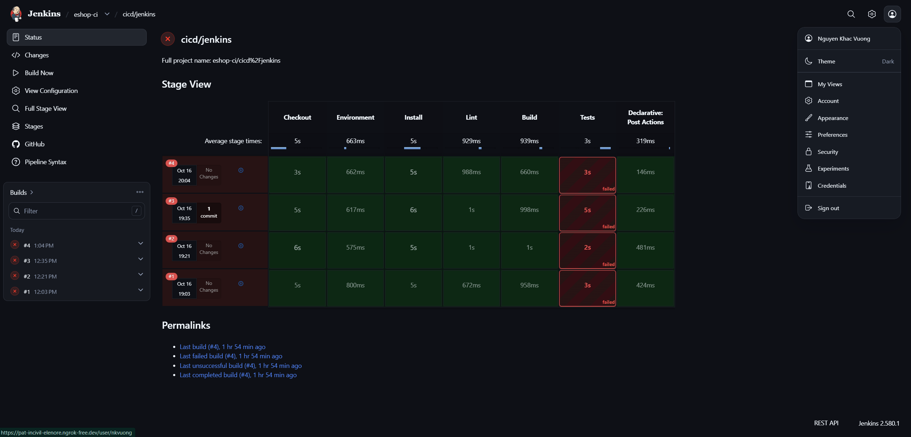
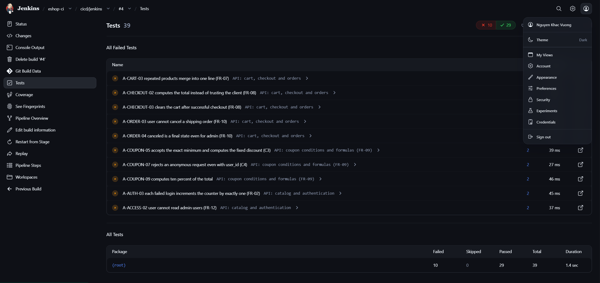
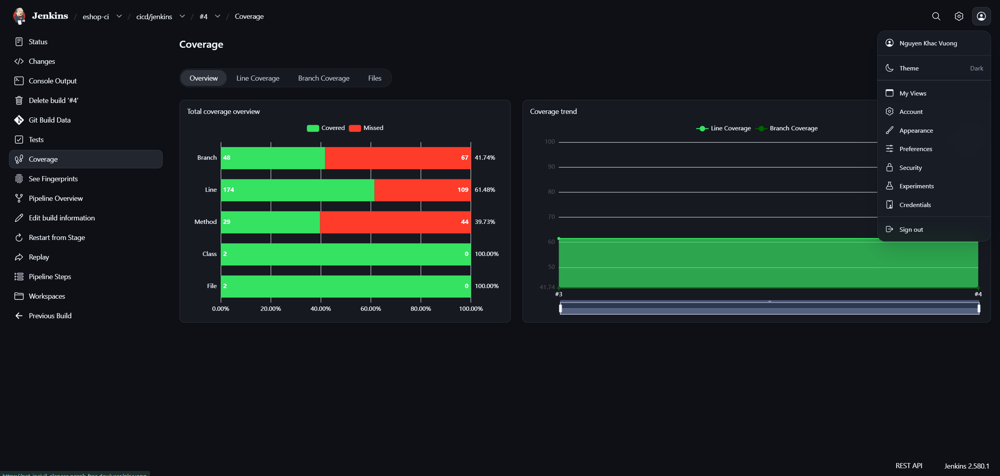
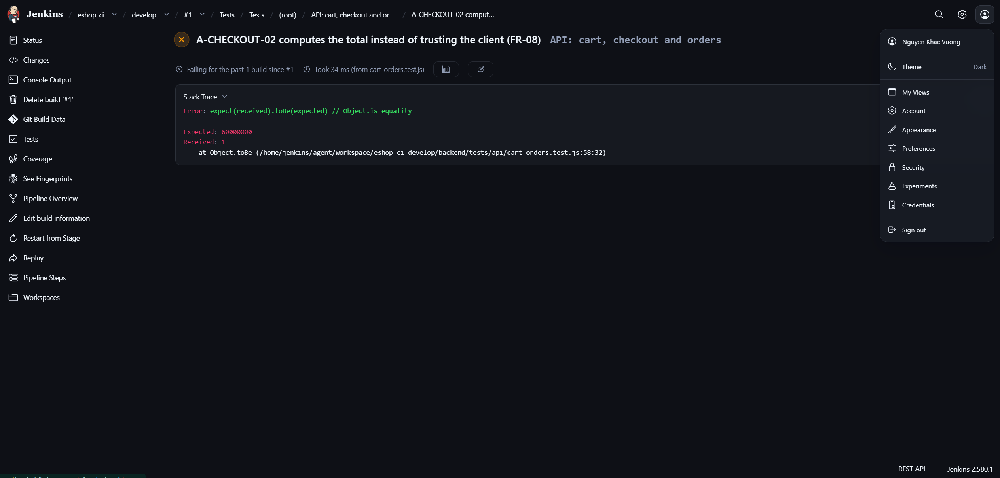

# Jenkins

## 1. Mục tiêu

Trong seminar, GitHub Actions được chọn làm hệ thống CI chính, còn Jenkins đóng vai trò nền tảng đối chiếu. Mục tiêu của phần này là trình bày cách nhóm dựng một môi trường Jenkins có thể tái lập, xây dựng pipeline chạy cùng bộ lệnh và cùng bộ kiểm thử với GitHub Actions trên mã nguồn EShop, đồng thời cho thấy kết quả build cung cấp đủ thông tin để chẩn đoán lỗi.

Phạm vi bao gồm các task D-01 (dựng Jenkins), D-02 (viết `Jenkinsfile`), D-03 (lưu báo cáo kiểm thử, coverage, log và cache) và D-04 (minh họa một ca lỗi có chủ đích). Việc đo đạc và so sánh hai nền tảng (D-05, D-06) được trình bày riêng trong phần so sánh hai nền tảng.

Toàn bộ cấu hình nằm trong repo mã nguồn `SUT-group10/eshop-sut-group10`, như liệt kê ở Bảng 1.

*Bảng 1. Các file cấu hình Jenkins trong repo*

| File | Vai trò |
| --- | --- |
| `Jenkinsfile` | Định nghĩa pipeline |
| `infra/jenkins/compose.yaml` | Docker Compose cho Jenkins controller |
| `infra/jenkins/compose.agent.yaml` | Docker Compose cho agent |
| `infra/jenkins/agent.Dockerfile` | Image agent chứa Git, Java 21, Node/npm |
| `infra/jenkins/.env.example` | Mẫu biến môi trường (cổng, agent secret) |

## 2. Kiến trúc

Hệ thống CI trên Jenkins gồm bốn thành phần chính: kho mã nguồn trên GitHub, `Jenkinsfile`, Jenkins controller và agent. Mối quan hệ giữa các thành phần được thể hiện ở Hình 1.


*Hình 1. Các thành phần chính và luồng hoạt động của Jenkins*

- **Kho mã nguồn GitHub** chứa mã nguồn EShop, bộ kiểm thử và `Jenkinsfile`. Đây là nơi Jenkins lấy định nghĩa pipeline và mã nguồn cho mỗi lần build, đồng thời nhận lại trạng thái build dưới dạng commit status.
- **`Jenkinsfile`** mô tả pipeline dưới dạng mã (pipeline as code): chạy trên agent nào, gồm những stage gì và lưu báo cáo ra sao. Vì nằm cùng repo, pipeline được quản lý phiên bản và review như mã nguồn.
- **Jenkins controller** là thành phần điều phối. Controller quản lý job Multibranch Pipeline, phát hiện các nhánh có `Jenkinsfile`, giao việc cho agent, lưu lịch sử build và hiển thị kết quả qua các plugin JUnit và Coverage. Controller không trực tiếp chạy lệnh build hay kiểm thử.
- **Agent** là thành phần thực thi. Agent lấy mã nguồn từ GitHub, chạy các lệnh npm của pipeline và gửi log, báo cáo, verdict về controller. Môi trường của agent (Node, npm, Git, Java) được cố định để kết quả có thể tái lập, và pipeline chọn agent thông qua label `eshop-node`.

Một lần build diễn ra theo trình tự sau:

1. Controller quét repo, đọc `Jenkinsfile` của nhánh cần build và xác định commit sẽ chạy.
2. Controller giao job cho agent có label phù hợp.
3. Agent thực hiện `checkout scm` để lấy đúng commit đó từ GitHub, rồi chạy lần lượt các stage của pipeline.
4. Agent gửi log, báo cáo kiểm thử, coverage và kết quả về controller.
5. Controller lưu và hiển thị kết quả, đồng thời gửi commit status về GitHub.

## 3. Môi trường triển khai

Nhóm cố định phiên bản của mọi thành phần để kết quả có thể tái lập. Image Jenkins và image agent được khóa theo digest; Node được kiểm tra ngay trong pipeline. Bảng 2 tổng hợp môi trường đã dùng, Bảng 3 liệt kê các plugin cần thiết.

*Bảng 2. Thành phần và phiên bản*

| Thành phần | Phiên bản / giá trị |
| --- | --- |
| Jenkins controller | `jenkins/jenkins:2.580.1-jdk21` (LTS) |
| Agent base image | `jenkins/inbound-agent`, JDK 21 |
| Node / npm trên agent | `v24.14.0` / `11.9.0` |
| Git trên agent | `2.47.3` |
| Hệ điều hành agent | Debian GNU/Linux 13 (trixie) |
| Tên node / label | `eshop-agent` / `eshop-node` |

*Bảng 3. Plugin sử dụng*

| Plugin (ID) | Phiên bản | Chức năng |
| --- | --- | --- |
| Pipeline (`workflow-aggregator`) | 608.v67378e9d3db_1 | Chạy `Jenkinsfile` |
| Git (`git`) | 5.11.0 | Checkout mã nguồn |
| GitHub Branch Source (`github-branch-source`) | 1986.v801e40614d00 | Multibranch Pipeline, quét nhánh và PR |
| JUnit (`junit`) | 1442.vb_b_a_467df2767 | Hiển thị kết quả từng test từ `junit.xml` |
| Coverage (`coverage`) | 3.3436.v3f0591159a_dd | Hiển thị coverage từ Cobertura XML |
| Timestamper (`timestamper`) | 1.30 | Dấu thời gian trong Console Output |
| Pipeline Graph View (`pipeline-graph-view`) | 1053.v9df19e6ceed2 | Sơ đồ stage của từng build |
| Pipeline: Stage View (`pipeline-stage-view`) | cài bổ sung | Bảng stage theo từng build trên trang nhánh |

Vì Node/npm đã có sẵn trong image agent và pipeline chỉ gọi lệnh npm, nhóm không cần đến các plugin NodeJS, Docker Pipeline, Maven, JaCoCo hay SonarQube.

## 4. Quy trình triển khai

Phần này mô tả các bước dựng môi trường theo thứ tự thực hiện. Điều kiện tiên quyết là Docker Desktop đã cài với Linux engine đang chạy, repo đã được clone, và người thực hiện có tài khoản GitHub với quyền đọc repo. Mọi lệnh được chạy từ thư mục gốc của repo.

### 4.1. Dựng controller

Controller được khởi động bằng Docker Compose:

```powershell
docker compose -f infra/jenkins/compose.yaml up -d
docker compose -f infra/jenkins/compose.yaml ps
```

Khi container đạt trạng thái `healthy`, giao diện Jenkins có tại http://localhost:8080 (cổng có thể đổi qua biến `JENKINS_PORT` trong `infra/jenkins/.env`). Ở lần đầu, Jenkins yêu cầu mật khẩu khởi tạo, lấy bằng lệnh:

```powershell
docker compose -f infra/jenkins/compose.yaml exec controller cat /var/jenkins_home/secrets/initialAdminPassword
```

Sau khi mở khóa, người thực hiện chọn *Install suggested plugins*, tạo tài khoản quản trị, rồi vào **Manage Jenkins → Plugins** để cài các plugin còn thiếu trong Bảng 3. Plugin Coverage không thuộc bộ cài đặt đề xuất nên luôn phải cài bổ sung. Danh sách phiên bản plugin thực tế được xuất từ **Manage Jenkins → Script Console** bằng đoạn mã:

```groovy
Jenkins.instance.pluginManager.plugins
    .sort { it.shortName }
    .each { println "${it.shortName}:${it.version}" }
```

Bước này hoàn tất khi controller hoạt động ổn định, đăng nhập được, đủ plugin, và cấu hình vẫn được giữ sau khi dừng rồi khởi động lại container.

### 4.2. Dựng và kết nối agent

Agent được khai báo trên giao diện tại **Manage Jenkins → Nodes → New Node** với loại *Permanent Agent* và cấu hình như Bảng 4.

*Bảng 4. Cấu hình node agent*

| Trường | Giá trị |
| --- | --- |
| Node name | `eshop-agent` |
| Number of executors | `1` |
| Remote root directory | `/home/jenkins/agent` |
| Labels | `eshop-node` |
| Usage | Only build jobs with label expressions matching this node |
| Launch method | Launch agent by connecting it to the controller |

Sau khi lưu, trang node hiển thị một mã `-secret` dùng để agent xác thực với controller. Mã này được ghi vào file `infra/jenkins/.env` (đã được gitignore), không đưa vào commit hay ảnh chụp:

```dotenv
JENKINS_PORT=8080
JENKINS_AGENT_SECRET=<mã-secret-của-node-eshop-agent>
```

Image agent được build và khởi động bằng:

```powershell
docker compose -f infra/jenkins/compose.yaml -f infra/jenkins/compose.agent.yaml up -d --build agent
```

Trạng thái `Up` của container chưa đủ để kết luận agent đã kết nối; tiêu chí đúng là node hiển thị Online trên giao diện Jenkins (Hình 2). Nhóm kiểm tra thêm các công cụ trên agent bằng `docker compose ... exec agent <lệnh>` với `node --version` (`v24.14.0`), `npm --version` (`11.9.0`), `git --version`, `java -version` (21) và `npm config get cache` (`/home/jenkins/.npm`). Cuối cùng, số executor của Built-In Node được đặt về 0 để mọi job chỉ chạy trên agent.



*Hình 2. Trang Nodes: agent `eshop-agent` đã kết nối với controller*

### 4.3. Tạo Multibranch Pipeline

Để Jenkins đọc được repo qua GitHub API mà không bị giới hạn quota của truy cập ẩn danh, nhóm tạo một Personal Access Token (PAT) có quyền đọc repo (và quyền ghi commit status nếu muốn Jenkins gửi kết quả build về GitHub), rồi lưu vào **Manage Jenkins → Credentials** dưới dạng *Username with password* với ID `github-eshop-pat`. Cần phân biệt ba loại bí mật trong hệ thống: agent secret dùng để agent kết nối controller, PAT dùng để Jenkins truy cập GitHub, và webhook secret dùng khi GitHub chủ động gọi vào Jenkins.

Job được tạo với tên `eshop-ci`, loại **Multibranch Pipeline**, cấu hình như Bảng 5.

*Bảng 5. Cấu hình job `eshop-ci`*

| Mục | Giá trị |
| --- | --- |
| Branch Source | GitHub, credential `github-eshop-pat` |
| Repository URL | `https://github.com/SUT-group10/eshop-sut-group10.git` |
| Behaviours | Discover branches – All branches |
| Build Configuration | by Jenkinsfile, Script Path `Jenkinsfile` |

Credential phải được chọn ngay tại Branch Source; nếu chỉ tạo ở trang quản trị mà không gắn vào job, Jenkins vẫn truy cập GitHub ở chế độ ẩn danh. Sau khi lưu, thao tác **Scan Multibranch Pipeline Now** tạo một job con cho mỗi nhánh có `Jenkinsfile`. Build được kích hoạt bằng **Build Now** trên job con. Webhook (ví dụ qua ngrok) chỉ cần khi muốn mỗi lần push tự động kích hoạt build, không phải điều kiện để pipeline chạy được.

## 5. Thiết kế pipeline

Pipeline chạy trên agent có label `eshop-node` và gồm sáu stage nối tiếp. Khi một lệnh lỗi, stage chứa nó chuyển sang trạng thái thất bại và các stage sau bị bỏ qua, nhờ đó người đọc xác định ngay bước gây lỗi. Bảng 6 mô tả từng stage.

```text
Checkout → Environment → Install → Lint → Build → Tests
```

*Bảng 6. Các stage của pipeline*

| Stage | Lệnh (trong `backend/`) | Mục đích |
| --- | --- | --- |
| Checkout | `deleteDir()`, `checkout scm` | Bắt đầu từ workspace sạch, không dùng lại report hay `node_modules` của build trước |
| Environment | Ghi commit SHA, nhánh, Node, npm, OS vào `environment.log` | Xác định chính xác build chạy trên commit và môi trường nào; dừng nếu Node khác `v24.14.0` |
| Install | `npm ci --no-audit --no-fund` | Cài dependency đúng theo `package-lock.json`, dùng lại npm cache trong volume |
| Lint | `npm run lint` | ESLint với `--max-warnings=0` |
| Build | `npm run build` | Kiểm tra cú pháp Node; backend không sinh bundle |
| Tests | `npm run test:ci` | Chạy 39 test unit, API, smoke và harness; sinh `junit.xml` và Cobertura XML |

Thiết kế pipeline chú trọng vào việc giữ kết quả trung thực. Thứ nhất, mọi lệnh chạy với `set -euo pipefail`, nên dù output được chuyển qua `tee` để lưu log, exit code lỗi vẫn được giữ nguyên. Thứ hai, khối `post { always }` của stage Tests luôn publish báo cáo JUnit và Coverage, kể cả khi test thất bại; nếu file báo cáo không được sinh ra, publisher báo lỗi thay vì ngầm coi là không có test. Thứ ba, khối `post { always }` của toàn pipeline luôn lưu artifact gồm log từng bước, `results.json`, `junit.xml`, `cobertura-coverage.xml` và `coverage-summary.json`, giúp chẩn đoán được cả khi build thất bại.

Ngoài ra, pipeline giới hạn thời gian chạy 20 phút, không cho chạy song song nhiều build trên cùng một nhánh, chỉ giữ 20 build gần nhất và gắn dấu thời gian cho từng dòng log.

## 6. Kết quả thực nghiệm

Kết quả dưới đây lấy từ **build #4**, commit `a559c53`, chạy ngày 16/10/2026. Bảng 7 tóm tắt kết quả theo stage.

*Bảng 7. Kết quả build #4*

| Stage | Kết quả |
| --- | --- |
| Checkout | Pass, đúng commit `a559c53` |
| Environment | Pass |
| Install | Pass |
| Lint | Pass |
| Build | Pass |
| Tests | Fail – 39 test: 29 pass, 10 fail, 0 skip |
| Post actions | Publish JUnit, Coverage và lưu artifact thành công |
| **Verdict** | **FAILURE** |

Hình 3 cho thấy cùng một mẫu kết quả lặp lại ở cả bốn build đầu tiên: các stage trước Tests đều thành công, chỉ Tests thất bại. Tổng thời gian build #4 theo Jenkins là khoảng 17,6 giây, trong đó Jest chạy khoảng 1,96 giây.



*Hình 3. Stage View qua bốn build*

Trang Tests của build (Hình 4) liệt kê mười test thất bại kèm mã yêu cầu và nhóm API tương ứng.



*Hình 4. Kết quả kiểm thử của build #4*

Về coverage, Coverage plugin ghi nhận line coverage 61,48% (174/283), method 39,73% (29/73) và branch 41,74% (48/115), như Hình 5. Cần lưu ý rằng file `coverage-summary.json` do Jest sinh ra ghi branch coverage là 39,09% (52/133), khác với số liệu plugin đọc từ Cobertura XML, trong khi line coverage của hai nguồn trùng nhau. Vì vậy, khi so sánh giữa các nền tảng, nhóm chỉ dùng một nguồn số liệu thống nhất.



*Hình 5. Báo cáo coverage của build #4*

## 7. Phân tích kết quả

### 7.1. Ý nghĩa của verdict FAILURE

Verdict FAILURE của build #4 là kết quả đúng, không phải dấu hiệu pipeline hoạt động sai. Việc năm stage đầu đều thành công chứng tỏ môi trường, dependency và mã nguồn đều ở trạng thái chạy được. Stage Tests thất bại vì mười assertion phản ánh các yêu cầu mà SUT chưa đáp ứng, gồm `A-AUTH-03`, `A-ACCESS-02`, `A-CART-03`, `A-CHECKOUT-02`, `A-CHECKOUT-03`, `A-ORDER-03`, `A-ORDER-04`, `A-COUPON-05`, `A-COUPON-07` và `A-COUPON-09`. Tập lỗi này trùng hoàn toàn với kết quả chạy cục bộ ở task B-04 trên cùng mã nguồn.

Do phạm vi seminar không cho phép sửa SUT, nhóm giữ nguyên toàn bộ bộ kiểm thử làm quality gate và không đổi expected, bỏ qua test hay nuốt exit code để có build xanh. Pipeline dừng ở Tests nghĩa là quality gate đã chặn đúng mã nguồn còn lỗi. Khi đọc một build thất bại mới, người dùng đối chiếu danh sách test lỗi với mười ID trên: nếu trùng hoàn toàn thì đó là lỗi đã biết của SUT; nếu xuất hiện ID mới hoặc một stage khác thất bại thì đó là vấn đề mới cần điều tra.

### 7.2. Minh họa chẩn đoán: A-CHECKOUT-02

Để cho thấy kết quả build đủ thông tin chẩn đoán (task D-04), nhóm chọn test `A-CHECKOUT-02` – *computes the total instead of trusting the client (FR-08)*. Test tạo một giỏ hàng có hai sản phẩm, gọi `POST /api/checkout` và cố ý gửi `total_amount: 1`, sau đó đọc đơn hàng trong database và kiểm tra tổng tiền phải bằng giá sản phẩm nhân hai.

Quá trình chẩn đoán gồm bốn bước. Trước tiên, Stage View cho thấy chỉ Tests thất bại, loại trừ khả năng lỗi cài đặt, lint hay cú pháp. Tiếp theo, chi tiết test trong trang Tests (Hình 6) chỉ ra assertion `expect(received).toBe(expected)` với `Expected: 60000000`, `Received: 1`, tại `tests/api/cart-orders.test.js:58:32`; lỗi nằm ở bước kiểm tra dữ liệu đơn hàng, sau khi request đã trả về HTTP 200. Sau đó, đối chiếu route `POST /api/checkout` trong `backend/server.js` ở cùng commit cho thấy server lấy `total_amount` trực tiếp từ `req.body` và ghi thẳng vào bảng `orders` mà không tính lại từ giá và số lượng. Cuối cùng, nhóm kết luận nguyên nhân là server tin tổng tiền do client gửi; test giữ expected theo yêu cầu FR-08 nên việc thất bại là đúng.



*Hình 6. Chi tiết test `A-CHECKOUT-02` (ảnh chụp ở một lần chạy khác trên cùng mã nguồn, cho cùng Expected/Received và cùng vị trí assertion như build #4)*

## 8. Vận hành và xử lý sự cố

Môi trường được dừng và khởi động lại bằng hai lệnh dưới đây; cả hai đều giữ nguyên ba volume dữ liệu. Lệnh `docker compose down -v` sẽ xóa volume, làm mất tài khoản, job, lịch sử build và npm cache, nên chỉ dùng khi chủ động muốn dựng lại từ đầu.

```powershell
docker compose -f infra/jenkins/compose.yaml -f infra/jenkins/compose.agent.yaml stop
docker compose -f infra/jenkins/compose.yaml -f infra/jenkins/compose.agent.yaml up -d
```

Bảng 8 tổng hợp các sự cố thường gặp khi dựng và chạy pipeline cùng cách xử lý.

*Bảng 8. Sự cố thường gặp*

| Hiện tượng | Nguyên nhân và cách xử lý |
| --- | --- |
| Compose báo thiếu `JENKINS_AGENT_SECRET` | Chưa có `infra/jenkins/.env` hoặc biến để trống |
| Agent báo unknown client name / authorization | Sai tên node `eshop-agent` hoặc secret không thuộc node này |
| Agent báo connection refused | Controller chưa healthy hoặc Docker engine chưa chạy; URL trong agent phải là `controller`, không phải `localhost` |
| Build chờ mãi ở `Still waiting to schedule task` | Agent Offline hoặc label của job khác `eshop-node` |
| Không xuất hiện job con sau khi scan | Sai URL repo, thiếu quyền đọc, bộ lọc nhánh hoặc Script Path không đúng |
| Scan báo anonymous access, chờ rate limit nhiều phút | Chưa chọn credential trong Branch Source |
| Console báo commit status 403 | PAT thiếu quyền ghi commit status; không ảnh hưởng báo cáo trên Jenkins |
| Build thất bại ở Environment | Node trên agent khác `v24.14.0`; cần build lại image agent |
| Không có trang Tests hoặc Coverage | Build thất bại trước stage Tests, hoặc thiếu plugin JUnit/Coverage; xem log Post Actions |

## 9. Hạn chế

Pipeline hiện tại có một số giới hạn cần lưu ý. Thứ nhất, vì SUT còn lỗi và không được sửa, pipeline chưa bao giờ đạt verdict thành công toàn bộ; các lỗi mới có thể bị che khuất nếu người đọc chỉ nhìn màu build thay vì đối chiếu danh sách test lỗi. Thứ hai, coverage mới chỉ được ghi nhận để quan sát, chưa được dùng làm quality gate. Thứ ba, npm cache được giữ qua volume nhưng chưa có số liệu đo cache hit và cache miss trong phần này. Cuối cùng, pipeline dừng ở bước kiểm thử, không bao gồm đóng gói hay triển khai ứng dụng.

## 10. Kết luận

Nhóm đã dựng được môi trường Jenkins theo mô hình controller – agent bằng Docker, với phiên bản các thành phần được cố định và có thể dựng lại theo hướng dẫn. Pipeline sáu stage chạy cùng bộ lệnh npm và cùng 39 test như môi trường cục bộ, cho kết quả trùng khớp với baseline (29 pass, 10 fail, line coverage 61,48%). Báo cáo JUnit, Coverage và artifact luôn được lưu kể cả khi build thất bại, cho phép xác định đến từng assertion và dòng mã nguồn gây lỗi, như đã minh họa với `A-CHECKOUT-02`. Đây là cơ sở để so sánh Jenkins với GitHub Actions trong phần so sánh hai nền tảng (D-05, D-06).
